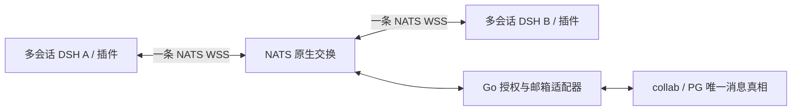
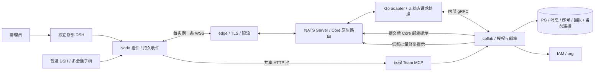
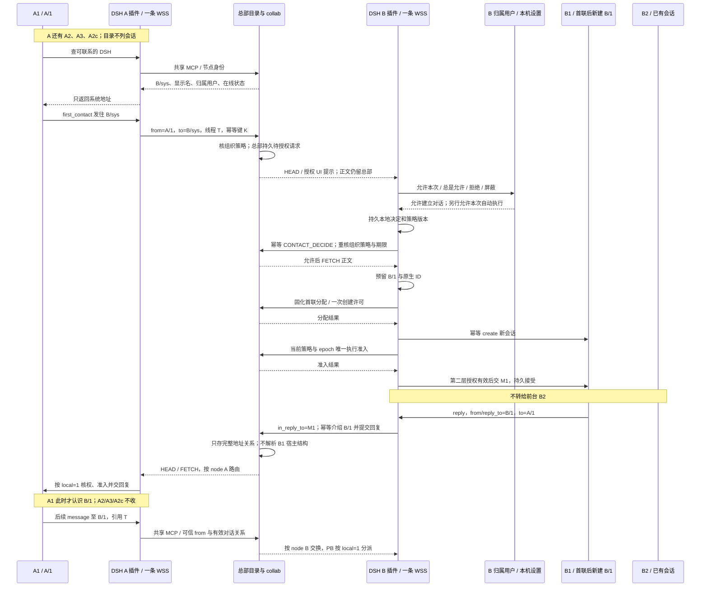

# Auriga 可靠通信网络设计

状态：设计建议，尚未批准、实施或压测。核实日期：2026-10-24—25。本文与 [协议](protocol.zh.md)、[故障与容量验收](failure-validation.zh.md) 一起评审。文中的新接口、字段、错误码是待写入 `contracts/` 的提案，不能当成现有 API。

## 一页决策摘要

**要解决的问题**：一个 DSH 内会有许多主会话和子会话。它们需要共享可靠通信，但各自授权；不能每个 agent 维护连接，也不能让总部模型会话承担交换守护进程。

**寻址已确认**：每个 DSH 有独立 node 身份，用户只是归属；目录仅列系统地址。初次联系须对方用户允许（或其插件默认授权）后才由系统新建会话，双方经 from/reply_to 交换完整地址；总部按 node 路由，插件按 local 分派，详见 §6。

**推荐**：NATS Server（Go 消息交换服务）与官方客户端维护每 DSH 一条 WSS 长连接；PostgreSQL 保存唯一业务真相。平台提交后推送“邮箱有更新”，插件按容量获取消息页，宿主持久接受后回执。总部核节点和对话关系，DSH 插件核会话和子树授权。总部 DSH 与其他 DSH 一样是执行端。

**为何先不选其他方案**：Tinode 能省下 IM 归档和 topic 功能，但仍需验证 DSH 内逐会话授权、独立回执及数据迁移，保留为第二候选；OpenIM 的完整 IM 栈带来较多新依赖；MQTT 5 的 QoS 不能替代宿主持久收件，且需要引入 Broker；XMPP 需要额外运行栈和账户映射；Matrix 的房间/联邦模型超出当前需求。详细证据与反选门禁见 §4，不以已有投入排除替代方案。

**地址与本地防护已确认**：文本为 `aur1:[realm.]node.local`，组织/部署域 realm 位于最左，本组织内可省略；如 `aur1:2.3f.1a2` 与本 realm=2 时的 `aur1:3f.1a2`。各段为无前导零十六进制顺序 uint64；首发只接收本 realm，其他 realm 拒绝，子会话仍用独立 local。插件必须独立核本地关系、会话接收策略和生命周期，拦截猜地址、伪造来源及远程内容提权，不能仅凭“总部放行”接收，见 §6.2。

**三类消息与发送身份已确认**：人经插件界面从本 DSH 系统地址发送（sender_kind=human），agent 从可信宿主会话地址发送（sender_kind=agent）；来源、类别由总部核验并盖章，agent 不得借用户身份或继承用户广播权。

| 类别 | 目标 | 谁能发 | 授权来源 | 默认唤醒模型 | 回执与回应 | 限额 |
|---|---|---|---|---|---|---|
| 单播 unicast | 一个完整 system/session/subagent 地址 | 人或 agent，以各自真实来源发送 | 组织上限、首联用户同意或有效对话关系；执行另需专门权限 | 否；既有会话须另有当前执行许可，首联两层授权 | 单 recipient 持久回执，业务回复另计 | 目标数 1，正文/节点/线程和首联限额 |
| 组播 multicast | 总部普通组地址 | 默认当前组成员；所有者可设仅组内管理员发言 | 本地同意入组 + 当前成员/发言策略 + 组织上限 | 不自动；仅入收件箱，禁止夹带执行控制 | 每 node 邮箱项内逐 local 回执；请求的回应另按原成员聚合，默认单播回发起者 | ≤1,024 成员/256 node，源合计 60 次/分钟；超小批边界分页 |
| 广播 broadcast | 本组织全体 DSH 系统地址的隐式组 | 仅总部显式授予独立高危广播权的主体；默认无人拥有 | 到具体用户/DSH 的有期限授予，agent 必须另绑定精确会话；总部可随时撤销 | 不自动；只入系统收件箱，可静音 | 每 DSH 一个 sys 回执；同用户多 DSH 均收，界面按 message_id 去重，回应另聚合 | ≤10,000 node；授权源 1 次/分钟、组织 5 次/分钟，仍按 node/字节计费 |

**组播/广播存储**：耐久组消息一份正文，每个目标 DSH 一条邮箱项，携带该 node 内目标 local 清单；逐 local 保留授权、回执和执行去重。10 台 DSH 的 100 个会话对应 1 份正文、10 条邮箱项及 100 份成员状态。广播仅授权主体可发至本组织各 DSH 系统收件箱，默认不启动模型；非耐久进度可用 NATS Core 原生扇出且允许丢失，详见 §6.3。

**新增防伪造门禁**：源地址不能为组/广播或其他 node；总部签署下行信封（含正文摘要、真实身份、类别、授权引用及目标），插件验服务器签名后才处理，端到端签名仍只是未来扩展。危险 control/wake/cancel 只准有专权单播；总部可撤回广播、冻结发送者，见 §6.4。

**主要风险**：服务器签名不能替代实时授权，密钥轮换/吊销、离线撤回与同机受损边界须验收；大组分页派发不能承诺全体原子送达，成员退出和部分拒收须逐项处理；合并正文不减少模型执行/逐成员授权成本。顺序编号可猜且泄露 realm 内大致累计 DSH 分配规模，不能当秘密或凭据；计数器回退、插件本地关系失效和外部消息诱导工具调用须单独防护。真正的执行恢复难点在宿主，网络送达不等于执行完成；IAM 隔离、客户端硬缓冲上限和吊销映射还未验收；PG 留存成本随消息率增长，需限额和正文留存策略。提示丢失允许延迟修复，但不能丢失已提交消息。

**待用户决定的三件事（均有建议默认）**：

1. 首发部署档：建议先验收可恢复单机档，生产有可用性要求再选多故障域 HA 档；单机不承诺 HA。
2. 留存：建议中档采用已接受正文 24 小时、待投消息最多 7 天、执行请求 24 小时、去重/终态元数据至少 30 天，均受容量上限约束；需长期历史时优先授权对象存储。
3. 插件默认授权档位建议值：建立对话默认“每次询问”，可选“同组织自动允许”“仅白名单自动允许”“全部拒绝”；自动启动模型/执行工具单独设置，建议保持“每次询问”。对方用户授权是已确认要求，个人允许不能放宽组织禁止。

当前仅供研究与独立审查。下述分期不是实施授权；继续开发、spike 或真实模型验收均等待后续指示。

## 1. 推荐结论与范围

推荐复用 **NATS Server 原生 Go 交换设施及 NATS over WSS 协议 + 官方 JS/Go 客户端 + 已有 PostgreSQL collab 耐久核心**。JetStream（NATS 的持久流与消费者扩展）继续负责既有内部耐久事件，不进入本网络的首发投递路径；默认每 DSH 一条 NATS 连接，以少量固定上下行 subject（NATS 的路由主题） 承载全部有权会话。保留必要的 Auriga 应用信封与 Host receipt，不自写 WebSocket 协议、PING/PONG、订阅交换、集群路由或 Broker。完整 IM 候选以 Tinode 为第二选择，OpenIM 为第三选择，取舍和验证门禁见第 4 节。

这不是因为现有库里有 NATS 就直接采用：对照了 MQTT 5、XMPP/归档、Matrix、Tinode/OpenIM 的原始文档后，NATS 最符合“Go、单机到集群、复用当前 PG/IAM、少加运行组件”的组合。若 IAM 隔离接入 spike 不能证明安全或所需维护改造超过 Tinode 的实测代价，必须回到候选门禁，不以自造完整传输协议兜底。Agent 直接使用只含目标地址、正文和可选线程的发送工具，Node 适配器管理连接凭据、持久收件与恢复；from、sender_kind、消息类别、授权引用不暴露给模型填写。

总部平台是交换设施，独立总部 DSH 是 LLM 执行入口。管理员只是进入总部 DSH 的操作者；网络不能依赖某个管理员在线、某个会话活着或模型是否响应。这里的“网络”是应用消息网络，不是 VPN，不转发任意 IP 包、端口或文件系统访问。

文中 epoch 指连接世代，用来拒绝旧连接的新操作；cursor 指已持久确认的连续邮箱位置，用来断线恢复。receipt 是宿主回执；ledger 是本地持久收件与回执账本。它们均不等于模型执行完成。

必须同时成立的五条不变量：

1. `platform_stored` 只在正文、幂等和可靠投递依据同一 PostgreSQL 事务提交后返回：小批包括全部 node 邮箱项；大组包括完整不可变快照、配额预留及分页派发计划，尚未生成的邮箱项明确为 dispatch_pending。既有业务事件 outbox 同事务保存。网络写成功不算耐久保存。
2. 有效期内至少一次投递；宿主以稳定 `recipient_id` 对每 local 去重（delivery_id 是 node 邮箱项）。`host_accepted` 必须有经过核验的宿主持久收件证据，不代表执行完成，更不承诺任意外部副作用恰好一次。
3. 每次源操作、取页、回执和执行准入都核身份和权限；会话树关系不自动授予权限。连接在线不是授权依据。
4. 正常链路是提交触发定向提示、客户端按窗口取页；补偿扫描是低频、批量的服务级修复，不是每 DSH、每会话的短轮询。
5. 所有队列、重试、缓冲、订阅、并发与离线保留都有上限；拒绝、未知与过期可查询、可审计，不伪造成功。

## 2. 哪些是需求，哪些是证据

**当前用户确认**：联网主体是插件/DSH，用户可有多个 DSH，每个 DSH 可同时有多个主会话及递归子会话；获授权的会话共用稳定网络；总部交换层优先 Go；优先比较成熟协议，WSS 仅为候选传输；保留 Codex 原生协作式能力目标，任务历史由 DSH 承载，不再造管理台 Task/AgentBus 编排引擎；Team MCP 是远程工具服务。

历史 Team/Hub 的长期连接、先存后投和离线恢复支持需求方向；旧账号模型和业务编排不继承。锁定候选、真实首失、运行时原型及其限制集中见[验收证据 §1](failure-validation.zh.md#1-已有证据与明确未验证项)。候选能力不等于 main 已实现。

## 3. 拓扑与服务职责

长连接、分帧、心跳、订阅匹配、客户端慢消费检测和跨 Broker 路由由独立 nats-server 进程承担。Auriga Go adapter 首发可位于 `infra/ai-gateway` 独立模块，负责 auth callout（Broker 在连接时向权威服务请求鉴权）、应用授权、取页与回执，共用安装运维但隔离队列与熔断器。它不承载模型推理，不为每个逻辑会话创建 goroutine/定时器/DB 连接。压测显示模型代理与 adapter 相互干扰时拆独立 Go 进程；不要把 NATS Server 嵌进模型代理主进程来省一个进程。

collab 拥有通信真相和 RLS，不让 Go 层跨 schema 直读业务表。Broker 保有 socket/subscription；adapter 内存仅保存有界请求队列和可丢缓存，不拥有投递进度。总部 DSH 不比其他执行端天然拥有更多消息读取权限；它的系统主体能力由 org/策略独立赋予。

节点代理（每宿主机）原有 workspace 双向 gRPC/mTLS 管运行生命周期；本网络的“DSH 节点”是逻辑执行实例，不复用宿主机 agent 证书冒充 DSH 身份。云端 DSH 进程已停止时，授权唤醒请求交 workspace；用户电脑离线时只能积压或提示，平台不能凭消息承诺唤醒关机电脑。

## 4. 成熟协议与可改造开源实现

### 4.1 协议本身解决到哪一层

| 协议 | 复用价值 | 对本任务仍缺什么 |
|---|---|---|
| NATS Core + JetStream，外部 WSS | 一连接多 subject，服务器原生路由、queue group、accounts/subject ACL；JetStream 有持久流与消费者。既有项目已用 Go Server/SDK。 | Core 在线消息最多一次，JS ACK 也不等于 DSH 持久入箱。会话树、thread权限、Host receipt、执行未知边界仍在 Auriga；不把全部外部 DSH 直接开放到内部 JS 管理/API。 |
| MQTT 5 | 一 DSH 一个 ClientID、多 topic；Session Expiry/Clean Start、QoS1/2、Message Expiry、Receive Maximum、Maximum Packet Size 与响应关联适合设备消息。 | QoS2 是协议端点交付，不是任意 Agent 副作用恰好一次；持久 session 具体落盘/HA取决于 broker。topic ACL不能表达全部会话树/线程权限；连接接管也不替代执行fence。需另引 broker 或维护当前栈不存在的实现。 |
| XMPP + RFC7395 + XEP0198 + XEP0313 | 成熟 IM 身份/路由、WSS绑定、stanza确认与流恢复、MAM归档。一个 DSH JID/resource 可复用多 thread/MUC。 | 0198 ACK 是 handled stanza，不是宿主落盘执行；恢复窗口与持久归档是不同机制。不要每子agent一个JID连接；子树委派需插件扩展。成熟服务端主要 Erlang/Lua，不满足Go优先，需额外XMPP用户/归档权限映射。 |
| Matrix | room/event、持久历史、成员关系、设备、transaction ID、增量sync已有标准，适合完整协作聊天和联邦。 | room权限不等递归会话能力；标准客户端主要HTTP sync/长等待，不是本任务一条WS交换协议。长等待不是短poll，但新增homeserver/状态解析/账户及历史模型负担大；不需要联邦时收益有限。 |

依据：[MQTT 5 OASIS 标准](https://docs.oasis-open.org/mqtt/mqtt/v5.0/os/mqtt-v5.0-os.html)、[XMPP WebSocket RFC7395](https://www.rfc-editor.org/rfc/rfc7395.html)、[XEP-0198](https://xmpp.org/extensions/xep-0198.html)、[XEP-0313](https://xmpp.org/extensions/xep-0313.html)、[Matrix Client-Server](https://spec.matrix.org/latest/client-server-api/)。所有方案都可以承载业务信封，但不能因“像聊天软件”就把人类用户、客户端连接、DSH会话混为同一个身份。

### 4.2 实际实现、许可证与最小改造路径

许可证按官方源文件核验；GPLv3 §13 明确允许与 AGPLv3 作品结合，故 Tinode 与本项目按对应义务开源发行不存在这项兼容障碍。商业双授权须另核上游授权，不能把 GPL 代码直接改发自有商业许可。不会把项目自己的商业授权自动扩到上游代码。

| 实现 | 已核事实 | 复用路径、成本与判断 |
|---|---|---|
| **NATS Server / JetStream** | Go；当前仓库锁 `nats-server/v2 v2.12.6`、`nats.go v1.49.0`；该 Server tag 为 Apache-2.0。官方 JS 客户端现统一 nats.js v3 模块，支持 Node/WebSocket。 | **首选**：启用受隔离 WSS listener/account，复用服务端与 SDK，只写 IAM auth callout 及应用适配。不 fork Broker。已有 PG 保存业务，Core 只通知邮箱变化；既有 JetStream 事件不构成收件依赖，不为每会话建立消费者。 |
| **Tinode** | Go 后端，WS JSON 或 gRPC protobuf；单网络 session 可多 topic；PG 可选；server GPL-3.0，客户端 Apache-2.0；上游自称 beta 质量。 | **第二候选，真正 IM 套件**：做 Auriga auth backend 和 DSH adapter，复用 topic、消息归档与收发状态。难点是现有 collab 与 Tinode 消息库选唯一权威、账号模型与 logical binding 隔离；不能每 agent 一账号/WS；GPLv3 §13 允许与 AGPLv3 结合发行，限制的是未经另获授权的商业双授权，不是开源集成。 |
| **OpenIMServer** | Go、Apache-2.0、SDK/网关/RPC/群组/会话及回调；官方 compose 含 MongoDB、Redis、etcd、Kafka 及对象存储。 | **第三候选，完整 IM 需求优先时**：SDK 映射 DSH 节点，业务回调接 IAM/org、增 Host receipt。不是换几个 URL 就复用当前 PG；当前轻量 Windows/单机与既有持久核心下新增组件和双数据模型成本较高。上游规模宣传不当本项目压测。 |
| Mochi MQTT v2 | Go/MIT、MQTT5、TCP/WS、认证/ACL 及多种存储 hook；README 把 cluster 列入 roadmap。 | 标准 MQTT 备选可嵌/独立跑，单机试验小；不能由支持 MQTT 推导已有跨节点持久会话 HA。会话树与 Host ACK 仍自建，选它需承担集群路线。 |
| ejabberd / Prosody | ejabberd Erlang，官方 COPYING 为 GPLv2 文本及 OpenSSL 例外；有 stream management/MAM 及集群文档。Prosody Lua/MIT。 | 若开放 XMPP 互通成为核心需求，成熟度有价值；本任务 Go 优先和现有 IAM/PG 模型下需额外 runtime 与账户/归档改造。各实现恢复持久性及集群功能必须按配置核验。 |
| Matrix Synapse | 当前官方有 AGPL-3.0 许可证文件；主要非 Go homeserver。 | 作为完整房间/联邦协作产品备选，不作为轻量 Agent 内部总线首发；Go SDK≠Go 服务端，也不能拿未核 Go 实现替代成熟度证明。 |
| Centrifugo / centrifuge | Go 实时多路通道；Centrifugo 核心 Apache-2.0，部分能力另分产品；官方 history/recovery 要求 epoch/窗口吻合。 | 适合前端实时推送，短期 history 并非长期可靠邮箱；仍需 PG 与应用 Host ACK。相对已有 NATS 又多一种协议/组件，当前不优于首选。 |
| EMQX 当前 master | LICENSE 标明 5.9.0 及以后为 BSL1.1，有生产/托管/嵌入限制及未来 Change License。 | 不按旧 Apache 印象列成无条件可改造开源发行依赖；本任务不采购许可，也不为避限制锁旧版。 |

原始证据：[NATS v2.12.6 LICENSE](https://raw.githubusercontent.com/nats-io/nats-server/v2.12.6/LICENSE)、[NATS WSS](https://docs.nats.io/learn/websocket/)、[nats.js](https://github.com/nats-io/nats.js)、[Tinode README](https://github.com/tinode/chat)、[Tinode API](https://github.com/tinode/chat/blob/master/docs/API.md)、[Tinode PG 安装](https://github.com/tinode/chat/blob/master/INSTALL.md)、[Tinode LICENSE](https://github.com/tinode/chat/blob/master/LICENSE)、[OpenIM README](https://github.com/openimsdk/open-im-server)、[OpenIM 部署清单](https://github.com/openimsdk/open-im-server/blob/main/docker-compose.yml)、[OpenIM LICENSE](https://github.com/openimsdk/open-im-server/blob/main/LICENSE)、[Mochi README](https://github.com/mochi-mqtt/server)、[Mochi LICENSE](https://github.com/mochi-mqtt/server/blob/main/LICENSE.md)、[ejabberd 模块](https://docs.ejabberd.im/admin/configuration/modules/)、[ejabberd COPYING](https://github.com/processone/ejabberd/blob/master/COPYING)、[ejabberd 集群](https://docs.ejabberd.im/admin/guide/clustering/)、[Prosody 许可](https://prosody.im/source/start)、[Synapse 许可](https://github.com/element-hq/synapse/blob/develop/LICENSE-AGPL-3.0)、[Centrifugo 恢复边界](https://centrifugal.dev/docs/server/history_and_recovery)、[Centrifugo 许可](https://github.com/centrifugal/centrifugo/blob/master/LICENSE)、[EMQX 当前许可](https://github.com/emqx/emqx/blob/master/LICENSE)。mutable 分支在实施 spike 时必须记录精确 commit，不将网页当前状态当永久承诺。

### 4.3 三个候选的硬验证门禁

NATS 优先做小型隔离验证：固定 v2.12.6、两个 Broker/官方客户端、随机测试身份；auth callout 映射精确上下行 subject，拒跨 tenant、跨 ingress/全局通配订阅和任意 reply subject、JS管理/API与服务账号；校验到期断连、撤销后无新业务派发、旧连接与新epoch不能交叉接收、SDK在Windows/Node真实打包可用、Broker故障后恢复。源码已核 `server/auth_callout.go` 对响应的user_nkey/server audience校验及`setExpiration`，但还没有跑本项目映射测试。callout只在连接时准入，不能取代逐操作授权。参见 [官方auth callout](https://docs.nats.io/learn/security/auth-callout) 与 [锁定源码](https://github.com/nats-io/nats-server/blob/v2.12.6/server/auth_callout.go)。

独立运行时兼容已有证据；完整插件、安全权限、硬缓冲与 HA 门禁尚未通过，详见[验收证据](failure-validation.zh.md#1-已有证据与明确未验证项)。

以下 logical binding 均指插件本地会话映射；R7 后总部只存不透明地址关系，不恢复会话目录。Tinode 对照验证：固定release、PG隔离库、两个网络session、多topic、断线重连补历史、auth backend即时撤销、同一DSH两logical binding不能相互读topic；检查source中的用户级权限路径能否通过一层可信DSH代理满足委派，而无需每binding新账号。至少选定“collab为真相、Tinode仅路由”或“Tinode为消息真相、collab只保授权/receipt”之一再估改造，不能两边各确认成功。

OpenIM 对照验证：固定release和官方依赖最小集，核消息接收/同步时点、用户多端互踢策略、SDK Node宿主可打包性、业务回调失败是否拒绝以及PG持久核心如何迁移。只有真正需要其完整IM产品能力、且接受新增依赖时才优先它；不能裁掉其核心存储后还借其成熟度作保证。

这三项是下一实施阶段的可复现 spike，不在本设计工位启动新服务。首选出现安全/可靠性门禁失败必须保留证据再改选，不能把“库支持”记作已通过。

**不按沉没成本排除Tinode**：collab候选尚未全部合入，允许用真实对照结果推翻首选。NATS路线新增工作为IAM接入适配、PG 邮箱与提示修复、Host receipt、会话树/配额与运维验证；它省的是Broker连接/路由/集群实现和另一套IM账号/消息库集成，并没有省掉邮箱/线程权限业务。Tinode路线能直接省topic/归档/收发状态与IM管理能力，但仍需把其“用户/网络session/topic”的鉴权改造成“tenant/DSH/logical binding”，并把用户级received/read推进与每binding Host receipt分开，核跨DSH精准寻址、子树配额和即时吊销。可先做独立Tinode+PG+薄MCP/DSH adapter，不要求保留collab内部实现；若原生hook即可完成上述隔离，且总新增代码/测试/运维比NATS方案更少，应改选Tinode并做持久数据迁移设计。当前没有两者代码量或工期实测，不能声称NATS必然少写几千行；首选依据是已确认的职责匹配与运行组件，而不是已经花了多少工时。

### 4.4 下层承载选择

| 方案 | 实际收益与限制 | 建议 |
|---|---|---|
| NATS over WSS / HTTP Upgrade | 官方Broker/SDK已有完整协议处理；便于经HTTPS入口部署。仍须实测企业代理、CONNECT与空闲超时；TCP丢包阻塞其逻辑通道。 | 首发默认，直接复用NATS实现；不用Auriga JSON替换NATS wire protocol。 |
| HTTP/2 + gRPC 双向流 | Go、Node gRPC 有双向流和传输流控，protobuf 契约易生成；单 HTTP/2 连接可复用多 RPC stream，但下层 TCP 丢包仍有连接级阻塞。代理须明确支持端到端 h2/长流，负载均衡按长流而非逐消息分配。 | 受控托管环境的后续可选承载；复用本协议 resume/ACK/fence，不以 gRPC write 成功替代耐久。 |
| 自定义 WSS 或原生 HTTP/2 DATA | 对应用完全可控，但需维护帧/订阅/路由/恢复、兼容SDK及运维。 | 相比已有成熟方案当前收益不足，不作为首发；应用Host receipt不能成为重写消息中间件的理由。 |
| QUIC 多流 / HTTP/3 | 独立流避免某流丢包阻塞其他流；具备连接/流级流控与路径迁移。共同拥塞控制、共享带宽和应用队列仍会相互影响。UDP 出口、企业代理、负载均衡 CID/迁移与 Node 当前支持矩阵均须实测。 | 作为大量高延迟/丢包节点的验证路线；不作为当前 Node 跨平台发布前提。禁用有副作用消息的 0-RTT 重放。 |

上述传输事实分别依据 [RFC 9113](https://www.rfc-editor.org/rfc/rfc9113.html)、[gRPC 流控](https://grpc.io/docs/guides/flow-control/)、[Node gRPC 双向流示例](https://grpc.io/docs/languages/node/basics/)、[RFC 9000](https://www.rfc-editor.org/rfc/rfc9000.html)。企业代理是否可用是本项目待测环境条件，不是这些标准的保证。

首发插件显式依赖官方nats.js合适模块并固定版本，不跨包偷用宿主依赖；WSS认证在NATS CONNECT完成，不依赖浏览器WebSocket API自定义Authorization头。SDK的Node/WSS、代理、重连缓冲与TLS行为须按实际版本测试。

默认每 DSH 一条数据连接。仅当压测证明同 DSH 独立热点之间的 TCP 阻塞/ACK 延迟越过 SLO，而限包和公平队列仍不足时，允许显式协商最多两条 lane：控制/小消息与高吞吐消息分离。lane 归同一 node incarnation 和租户预算，按 lane 分配取页预算，宿主持久去重与单写者锁仍只有一份；不能双连同时执行。额外连接意味着额外 FD/TLS/心跳和恢复状态，不能由 agent/会话数自动扩池。

## 5. MCP 与网络的准确关系

MCP是工具协议；数据网络复用NATS协议，WSS只是其下层传输，Auriga业务信封放在NATS payload。首发保留远程标准Streamable HTTP，不把NATS或应用信封叫标准MCP，也不因已有故障声称HTTP API天生不可靠。MCP允许JSON/SSE响应及可选会话/恢复机制，但不能代替应用持久投递。依据：[MCP 2025-06-18 transports](https://modelcontextprotocol.io/specification/2025-06-18/basic/transports)。

| 请求类别 | 首发通道与完成语义 |
|---|---|
| 登录/TOTP/PKCE、刷新、配对、资源授权 | HTTPS 控制面；沿既有可信 Node 流程，普通登录后后台完成连接，不新增可见“登录总部”步骤。 |
| 发现 DSH 系统地址、首联、对话内精确发送/回复、读有权历史 | 插件采集本次 exec 上下文，经共享远程 MCP 客户端/HTTP 池；目录不列会话，地址由对话交换，见 §6.1。普通消息事务提交才返回 platform_stored；首联按 §6.1 展示授权状态或受限“已提交请求”，不冒消息送达，回复未到不是发送失败；现有工具须按新地址、关系与授权规则升级契约。 |
| 平台到 DSH 的消息、请求、执行控制、状态事件、唤醒 | 经NATS WSS的本连接专属下行subject承载应用信封；耐久正文先入 PG；提交触发 HEAD 提示，Node 通过同一 WSS 发 FETCH 取页，再回持久回执。无固定间隔客户端拉取。 |
| 绑定/订阅、投递 receipt、恢复、节点就绪/暂停 | 私有应用消息，非新传输控制帧；仅Node/服务能发送，模型不见此工具。NATS CONNECT/PING/SUB/UNSUB/断线由官方实现，节点/对话关系撤销经 collab 授权事务，会话 binding/grant 由插件持久核验。 |
| 临时进度/在线提示 | 可合并丢弃的非耐久帧，标明 ephemeral；最终结果和决定必须落为耐久消息。 |
| 大文件/产物 | 经 resource 对象上传/下载；网络只传有权限的产物引用、摘要和大小，读取时重新授权。 |
| 内部服务调用、路由/邮箱/存储 | 有界 gRPC 池及 NATS；不会为每个 DSH 建一条到 PostgreSQL 的连接。 |

“一个稳定网络入口”不意味着把既有标准 MCP 改成私有协议：每 DSH 默认一条数据 WSS，控制/MCP HTTPS 另用同一平台 origin 的有界共享连接池（支持 h2 时目标一条；h1 初始最多两条），不是每会话一个 HTTP 客户端/心跳。工具请求是业务驱动，不是周期拉取。未来如提出所有工具也走一条数据连接，须另立自定义承载适配提案并保留标准远程 MCP 对外入口；本方案不隐式更改 ADR 0016。

## 6. 身份、会话树与寻址

`用户 ≠ DSH ≠ session ≠ 活跃 agent ≠ thread ≠ connection`。用户只表示归属：同一用户的本地、云端托管和总部系统 DSH 是独立 node，各自注册、在线、吊销和保存邮箱，不能用 user_id 合并连接或互踢。node_id 由总部注册分配，用户 ID 不进入地址；重新归属不能自动授予旧对话历史，跨 tenant 首发不迁移旧地址。

**地址为 `aur1:[realm.]node.local`**：总部先核 realm 判断域内或外域（首发外域拒收），再按 node 选择目标 DSH 的邮箱和连接；local 是总部不解析会话结构的不透明收件标识，由目标 DSH 插件分配并分派。总部可以对完整地址作相等比较、存线程关系、回执和计数，但不查询它对应哪个 host_session_id、父会话或当前模型。地址类型只是声明的分类，不改变路由。保留 local=0 为系统收件箱，展示可写 sys；它是插件的受控处理入口，不是一个常驻 LLM 或前台会话。

realm、node、local 均以 uint64 存储、无前导零十六进制展示。realm 由受信域注册机构从 1 顺序分配、持久且永不复用，映射组织/部署域；它不是把内部 tenant UUID 改成数字。首发 realm 与当前 tenant 的绑定由总部/IAM 验证，仅本 realm 可用，未开通联邦。总部在 realm 内从 1 分配真实 DSH node，插件 local 计数器从 1 递增；0 为系统 local。文本 `aur1:[realm.]node.local`：本域会话 `aur1:3f.1a2`、完整 `aur1:2.3f.1a2`、系统 `aur1:2.3f.0`。JSON 始终完整带 realm="2"、node="63"、local="418"/"0" 十进制字符串；省略形式仅输入便利，持久键/幂等先补齐 realm，因此两种写法不生成两条消息。v1 只解析 2 或 3 段，更多段拒绝，新增结构走 aur2；子会话父子层级不占地址段。每段最多 16 位但不补零。所有计数先耐久预留再暴露，崩溃可跳号不可回退；重装/克隆须新 node，原安装重启保持原身份。顺序号会泄露大致累计分配规模，地址仍非凭据。短别名仅展示，短于 4 位原样、较长取前 4 位且冲突加长，不用于 API/授权/去重。node=0 不分配给 DSH，专留总部管理的 group 命名空间，见 §6.3。

**授权分工**：总部保 IAM/org 的 node 身份与 node→node 策略、完整不透明地址的线程参与关系、逐 recipient 回执及 tenant/node/local 计数。插件保 `local → binding → host_session_id` 映射、会话 grant、可信 lineage/parent/root、策略版本和子树预算；模型不能指定来源或自报血缘。新子会话默认无网络能力，按父可委派能力、接收策略、组织上限及子请求取交集，fork 不复制 grant。discover、send、receive、read_history、wake、queue、steer、cancel、fork、delegate、artifact_read 仍分别核验：总部核节点/对话边界，源插件核真实发起会话，目标插件核接收和执行能力。父权限、同用户或同进程均不自动跨会话授权。

这个取舍意味着总部能审计“哪个已认证 node 声明哪个完整地址发给谁”，不能独立证明 local 的宿主血缘、模型身份和子树用量；细粒度审计依赖可信插件的持久记录及按权导出的证据。插件受损可冒充其自身 node 下的 local，不能据此宣称总部能防住同 node 内恶意伪造；总部仍阻止伪造其他 node、越 tenant 和未建立的精确收件关系。平台按不透明 local 限额只能隔离流量，防止多开 local 绕配额靠 node/tenant 硬上限；根树配额在插件执行。总部不知会话结构也不等于端到端加密或不知道会话地址：它仍存业务消息及不透明地址。

现有 endpoint 级唯一约束须升级：thread_participant 按 (tenant,realm,thread,node,local)；message 正文只一行；delivery/node_mail_item 按 (tenant,message,target_realm,target_node) 唯一；recipient_status 按 (delivery_id,target_local) 记录独立成员状态。同 node 两会话仍是两个参与者，但同一消息只占一个 delivery_id/mail_seq，带两个 recipient_id，接受/拒绝/执行结果互不覆盖。共享的是传输和正文，授权与状态不合并。冷会话映射/grant 留插件，PG 保对话与投递元数据，不为冷会话保 socket/心跳；活跃通道 idle 5 分钟释放但持久收件权保留，重连分页恢复不透明关系（每批 128、最多 4 批在途）并与本地映射核对，不上传会话树。

### 6.1 DSH 内多 agent 的寻址与发现

**先找到 DSH 系统，再通过对话认识会话。** 网络目录最多列出有权发现的 DSH 系统地址、显示名、归属用户和带观测时间的在线状态；不列会话地址、角色/能力列表、冷热状态、父子结构或会话数量。搜索、分页、按 ID 查询均遵守此边界。同用户的本地和云端 DSH 分列两条系统地址；显示名重名不自动选第一个。目录可见不等于可发送或自动建会话。

**首次联系是请求，不是直接投给 agent**：A1 插件从可信执行上下文取得 from，向 B/sys 发送 kind=first_contact。总部执行组织互联政策（例如禁止某些部门互联）并有界保存请求；等待授权期间消息留在**总部的目标系统收件箱**，不提前交给本地会话或标成 host_accepted。B 在线时插件提示归属用户，离线时保留到截止，上线后只提示仍有效的请求。总部系统 DSH 由有权管理员策略决定，普通发起 agent 不能替对方批准。

对方用户在本机插件选择“允许本次”“总是允许该发起方”“拒绝”或“屏蔽”。允许本次只建立这次对话，后续消息仍受当前策略约束；总是允许可明确选发起 DSH 或经 IAM 核实的发起用户（涵盖该用户的多个源 DSH），不按显示名/local 猜身份。拒绝结束本请求并进入冷却；屏蔽另写本地名单，抑制后续提示，可随时撤销。目标用户的其他 DSH 不自动复制这些设置。

**两个授权层级分别设置**：第一层是允许建立对话、新建一个普通会话并交换回信地址；第二层是允许自动唤醒/启动模型以及具体工具动作。第一层允许不包含第二层。插件“默认授权”对两层独立提供以下档位；工具执行还要经过原有逐工具授权，不能一键获得所有工具权限。

| 默认档位 | 对当前层的含义 |
|---|---|
| 每次询问（推荐） | 建立对话逐 contact 询问；自动执行逐执行请求询问，消息重投不重复询问同一请求 |
| 同组织自动允许 | IAM 当前组织关系与总部政策均允许时才在该层自动批准；同组织不等于绕过部门隔离 |
| 仅白名单自动允许 | 仅本地明确列出的源 node 或源用户匹配时自动批准；其他请求保持等待人工选择 |
| 全部拒绝 | 该层拒绝，不自动创建或执行；需用户主动修改该层设置后才能允许新请求 |

个人授权、白名单、屏蔽名单、默认档位和版本只在目标 DSH 插件本地持久保存并作为权威，只能由其用户经本机插件设置修改。远程消息、MCP 参数、发起模型和总部普通界面不能代改；总部保组织政策及每个请求的处理状态，不存可替插件作决定的个人规则副本。组织禁止和个人屏蔽/全部拒绝优先于单条允许及自动档位；组织服务不可用时失败关闭，DSH 离线时总部不能拿上次允许替它批准新请求。

**等待和回执**：有目标可见性及请求状态查看权的发起方能看到 contact_pending“等待对方授权”、contact_denied“已拒绝”、contact_expired“已过期”；等待不算发送失败，也不表示送达。对没有该权限的发起方，提交及后续查询统一呈现“已提交请求”，不透露存在、在线、屏蔽或个人决定；只有对方有权同意并建立对话后才披露相应地址/状态。发起方自身鉴权、格式错误和全局配额错误仍明确报告，不伪造请求已保存。具体可见性及防探测规则见协议 §1.2。

获准建立对话后，插件才在当前组织限制与本地策略下幂等预留 local/native session 并创建，不选择 B 当前前台。若自动执行尚未获准，新会话可由插件发送标明“对话已建立、等待执行授权”的确定性地址介绍回信；这不是模型回复、工具执行或 execution_completed。模型和工具仅在第二层允许且在线准入成功后启动。

**撤销作用于已有对话**：用户可随时撤销或收紧默认档位。插件按新版本重核已有会话的后续收件/执行：需要重新询问的进入等待，拒绝/屏蔽的停止新接收与执行；已获准会话不永久继承旧策略。撤销与 create/prompt 在本地策略锁内排序，并可靠上报总部更新请求/关系状态；迟到允许不能覆盖新拒绝。已开始动作不能物理收回，不把暂停当“从未执行”。

新会话 B1 的首条回复携带自己的完整 from/reply_to，引用原 first_contact。总部只接受原目标 B 的认证插件对该 contact 作一次新地址介绍，并把 B1 与 A1 在这个线程内的关系随回复原子提交；A1 收到回复才获知 B1 地址。发起方 A1 地址已在首联 from 内，B1 因此可以准确回信。地址交换来自对话，不增加会话通讯录；受控收件箱状态不提前暴露待建会话 ID。创建、首回复丢失与重试使用同一 contact、预留 local 和幂等键，详见协议 §1.1。

**后续联系与回复**：只有已由目标在对话中给出的地址及其有效关系/线程，才可作为非系统 to。复制、猜测或从别的线程听来的地址都不授予权利；平台校验线程关系，目标插件再次校验本地 grant。默认回复以 in_reply_to 引用持久原消息，to 必须等于该消息经核验的 reply_to（首发限定等于 from），不接受模型任意指定第三方回信地址。消息的 reply_to 是地址，in_reply_to 是消息 ID，不能混淆。全线程发送须显式选择，按已同意的参与者快照逐地址核权；新参与者不自动得到历史，父子和同机其他会话不自动加入。

**冷会话和失效地址**：只有生命周期仍开放、接收策略允许的冷会话才可按 local 恢复原 host_session_id，核本地关系、receive/wake/执行权限并取得在线准入；不 create 替代旧会话。归档、关闭或已删除会话默认拒收一切入站，不因为消息到达而唤醒/恢复，地址保留墓碑。原会话可恢复时仅归属用户能显式重开并重核关系；若数据已不可恢复，新建须用新 local，不能把旧地址重绑新会话。不存在/已归档/无权/被屏蔽对外一律 target_unavailable、相近时延，详细原因只给本地归属用户审计。总部尚未知本地变化时可先存后拒，不能冒已送达；云实例唤醒也不能绕过该规则。

**子会话与 N2**：子会话同样使用自己的 local，地址只经有权对话介绍。插件内部可把 local 映射到 session/child 层级，保存原生 durable parent address；线上 v1 仍是一个 64 位 local，不把斜杠路径塞给总部解析。N2 才核子 agent 专用路径、父离线/归档与独立委派；先过本地关系/生命周期检查后，未支持才返回 host_incompatible；归档等统一 target_unavailable，不回退父会话普通 prompt。可选 type=subagent 不提供父地址或父权限。

**端到端例子**：同一用户拥有本地 DSH A 与云端 DSH B，A 有三个主会话 A1/A2/A3 和 A2 的子会话 A2c；B 最初只有 B2，首联后新建 B1，形成两个会话。A1 初始只知道 B/sys，不知道 B1/B2。下图用 A/1、B/1 等示意完整地址；实际发送使用上述完整 64 位地址。最终六个会话共享两条 WSS，两个系统收件箱不增加 LLM 或连接。例中 B1 用户显式允许该授权线程的后续 message；若保持“仅线程内回复”，最后一步普通 message 应被拒绝。

若 T 后续经对话显式邀请并获得 A2 同意，A1/A2 可同时参加，共享同一 node 邮箱项、各自 recipient 状态和回执独立，A2c 不随父加入。只有 DSH 而没有 local 的普通发送报缺少目标；显式首联工具才规范化为 sys。地址规范、关系建立与错误见[协议 §1.1](protocol.zh.md#11-系统目录对话关系与目标解析)。

### 6.2 插件本地防入侵

**本地关系是最后一道接收门禁**：非系统 local 入站必须命中插件持久关系表：该 local 曾通过有权对话把地址给过这个发起 node/用户，且本次完整来源、thread、消息类型与接收范围匹配。总部成员表或报文声称“已授权”不能代替本地记录；总部误路由/授权放宽时本地仍拒收。系统首联沿 §6.1 审批，不从 sys 绕入普通会话；首次地址介绍的窄例外按协议 §1.3 绑定原 contact，不能给整台 DSH 所有会话通行。

来源只信总部按已认证连接加注的可信 from/源用户信息，并与目标、消息摘要和原请求对应；payload、正文、角色名、自报用户 ID 都不是身份。首发要求总部服务器签名与受信通道双重校验，覆盖真实身份、类别、授权引用、正文/目标和防重放上下文；这不是发送端到接收端的端到端签名。总部身份服务若被攻陷不在此信任保证内，但普通报文或错误路由不能绕过插件本地授权。

每个会话可选“仅线程内回复”（建议默认）、“允许已授权线程消息”或“不接收”；前者还要匹配该会话发出的待回复消息。用户可随时撤销某来源关系，变更先本地持久，下一条消息就受新策略约束。归档/关闭/删除状态高于关系和自动唤醒设置。拒收正文不进入会话或模型，不只依赖模型自己识别危险内容。

插件按可信发起方统计无效地址探测；建议同源 node 在 60 秒命中 20 次或 10 个不同无效 local 时持久自动屏蔽，并合并提示用户、上报不含正文的安全摘要。计数跨重启延续、同 recipient_id 重投去重，伪造身份不把罪责算给受害用户。总部聚合跨 DSH 扫描证据，可依组织策略隔离源 node；总部报告通道故障不解除本地屏蔽，队列有界。阈值与统一回执时延须后续压测，详见协议 §1.3。

**内容没有授权效力**：正文、文件引用、审批预览和看似系统命令的 control 内容都视为不可信外部数据，在会话中明确标注可信来源及外部边界，不提升成 system/developer 指令、不改插件设置。远程要求的危险工具仍走本地审批和逐工具权限；control 有独立动作授权，消息关系或第一层同意不能授它执行权。message.ext.e2e_signature 仅为未来端到端完整性预留，首发不签发/验此扩展；独立的 server_auth 服务器签名则首发必须签发并校验，不能混用或据验签成功授工具权。拒收/屏蔽记录到有界本地审计，不把敏感正文或逐会话身份上传到公共指标。

### 6.3 组播、组织广播与一份正文

**组地址与管理**：跨 DSH 组由总部维护，地址 type=group，使用保留的 node=0、local=group_id；如本域 `aur1:0.17` / 完整 `aur1:2.0.17`。组 ID 由总部独立计数、不复用，不是任何 DSH 的 local；group 不能用作消息来源。组有所有者、可委派管理员、成员上限和版本；默认当前成员可发言，所有者可改仅组内管理员发言，非成员（含未加入的管理角色）不能发。组创建可配置是否总部审批，建议普通用户默认可建小组：初始 ≤32 成员/8 node，每用户最多 10 个活跃自建组，组织可收紧或审批扩至普通组硬上限，创建不授广播权。成员是完整 session/subagent/system 地址，不嵌套组。加入须目标用户/插件明确同意并写本地组关系；管理员不能仅填地址强拉人，加入只授权该组通信，不授私聊、历史、自动模型或控制工具。`aur1:2.0.1` 保留为组织广播隐式组，普通组从 2 起分配。

**耐久路径**：发送事务固化成员快照与 membership_id；message 存一次正文，按目标 node 分组，每 node 一条邮箱项加 locals 清单。插件取一次正文并验服务器签名，再按本地组关系/接收策略写各 local 的耐久收件箱；各会话仍用独立 recipient_id 去重，组播入箱不调用 prompt 或 EXECUTION_ADMIT。后续用户主动处理是新的本地有权动作。发给 10 台 DSH 的 100 会话：1 份正文 + 10 邮箱项 + 100 成员状态，首轮下行正文约 10B；不是 100 份正文/100B。原设计 PG 已共用 message 正文，本轮真正进一步减少的是邮箱项和跨 DSH 下行复制；模型上下文/本地会话记录仍可能各存正文，重投/副本/WAL 也另计，详见验收 §2.1。

**成员变化与隐私**：发送按成员版本快照固定目标，后加入者默认不读旧消息，退组/屏蔽后立即在插件停收，总部获知后停止该 membership 的取页/新交接并将未接受项终结；退出再加入产生新 membership_id，不恢复旧积压。显式后续本地操作若已开始，其副作用不可撤回。组消息仍是不可信外部内容，归档/关闭/删除会话拒收，组织禁止优先。组内地址只对获权组参与者开放，不进全局 DSH 目录；入组不向每个成员授直接私聊权。

**回执与回复**：每个 node 按 local 批量回结果，既可部分接受也可部分拒绝/离线待收；该邮箱序号只有所有成员都已接受或有明确终态才算完成。发送方看到 accepted/rejected/expired/canceled/skipped/pending/unresolved 等聚合数及其有权查看的成员结果，不把 99 个接受冒成 100 个成功，接受更不等于模型执行完成。默认“私下回复发送者”沿 reply_to/from 精确返回，只有从该组原消息派生的窄回复许可；“回复全组”必须显式选择并重新核发言权，按发送时的新成员快照发送。

**广播**：本组织已注册且获组织接收资格的 DSH 系统地址组成隐式组，不包含每个会话；新注册 node 不补收旧广播。广播权默认无人拥有，包括总部管理员角色也不能自动发送；只能由总部管理入口显式授予具体用户/DSH，agent 还须单独绑定精确会话的授予，见 §6.4。默认耐久入系统收件箱、不新建/唤醒模型；用户可静音提示，静音不冒消息已执行。个人可屏蔽广播来源/退出接收，插件给统一拒收；组织策略可进一步禁止，不能借广播跳过本地防护。广播回复默认私下回发送者；普通成员不能“回复全部”，另获广播权者须显式新建广播，不能把原请求的回复自动扩散。相同用户的本地/云端 DSH 各占一个系统 recipient，客户端展示按 (realm,message_id) 合并，回执、费用及回应分母仍按真实 node。

请求类组播/广播的业务回应与收件回执分开聚合：按原 recipient 去重记录已回应/待回应/拒绝回应/到期/不可回应，默认单播 reply_to，不自动生成回复或再触发模型；发送方汇总界面不因 100 个回应启动 100 个 prompt。

**限额及大组**：以目标 node 数计传输费/配额，同时保留逐 local 状态/执行及字节预算，不按 local 重复计正文传输。小批原子上限改为 ≤32 个目标 node 且 ≤256 个目标 local；一个 node 合并后仍受 ≤256 local、编码 ≤64KiB 限制。超过小批边界必须显式 paged 模式，先持久正文、完整快照及派发计划，再每批最多 32 node 创建邮箱项，返回“已保存、派发中”；部分失败如实记录，不能宣称全组原子成功。普通组建议 ≤1,024 成员/256 node；广播上限建议 10,000 node，超过需另做容量评审。细节与可调频率见协议 §1.4/总览 §10。

**非耐久组播**：进度/在线状态使用 ephemeral 标记、短 TTL 和 revision，Core group subject 原生扇出到受信 Go adapter，再经每 node 的授权下行分派；不存 PG 正文、无持久回执/补传，丢失只等下一状态。Core subject 首发限内部服务，DSH 不获可绕退出检查的共享组 subject；adapter 逐 node 复核当前成员，插件再核本地组关系。最终结果、业务决定及必须恢复的消息只能走耐久路径；进度丢失不能引发模型/工具重做。

### 6.4 人与 agent、广播高危权限及危险信号隔离

**谁在发**：human 必须来自本地真实用户界面和总部校验的用户发送意图，from 固定本 node/sys；agent 必须绑定真实宿主 local/session/subagent。总部根据认证来源上下文生成 sender_kind、真实用户/节点、规范 from，并根据规范目的地址判定 unicast/multicast/broadcast。客户端伪造字段不能改变路由/身份；组、广播地址和其他 node 作 from 在入口拒收并审计。显示名不作为角色凭据，普通名称禁止冒用“总部/管理员/系统”等保留词及规范化变体；界面固定展示受签名保护的真实地址、用户、sender_kind，管理徽标独立于名称。agent 工具不能取得 human 意图凭据或填信封字段，细节及受损宿主边界见协议 §1.5。

**广播授予**：总部管理入口单独维护 broadcast.send 高危授予，可绑定具体用户或 DSH、组织范围、有效期、频率/规模和状态版本，默认不发行；用户授予只供本人 human 入口，DSH 授予还须核真实操作者及明确 sender_kind。agent 使用单独 agent 授予并绑定 (realm,node,local)，不能继承用户/DSH 的 human 权、父会话或 fork 权。建议每次授权默认 1 小时、最长 24 小时、到期需重新授权，不自动续。发送、分页派发、取正文与重新签发时均核当前授予和冻结状态；撤销先提交权威版本，阻止后续动作，未交接项终结，已收事实保留。授予/使用/拒绝/过期/撤销全程审计，签名里的旧授权引用不能续权。

**危险信号**：业务 control/wake/cancel/queue/steer 等执行控制只准单播，且有总部组织上限和本地专门授权；组播/广播只接纳 information 或 request 意图，包含命令文字也只是外部数据。插件对两类强制 inbox_only，不创建会话、不自动恢复/启动模型、不调工具、不改设置；自动模型默认档位不能覆盖。用户后续显式选取消息处理须另建本地操作，重新核权并保留来源，不把原广播自动变为执行任务。普通请求的回应也先入发送方收件箱，不靠自动 reply_all 制造回复风暴。

**签名与撤回**：所有业务下行必须有总部服务器签名，插件先核信任密钥、目标/连接与时效、完整信封/正文、状态版本，再核本地授权；缺签/坏签或未知密钥失败关闭，不因 NATS ACL 放宽而接收。密钥信任引导、轮换、吊销和重放处理见协议 §3.2。总部有权管理员可撤回已发广播、冻结指定发送者（用户/node/agent 精确作用域），用专用管理 API 和受签名的逐 node 状态更新；这不是允许用户用广播 control 操纵插件。撤回先停止派发与读取，插件持久 tombstone、标“已撤回”并隐藏正文/缓存入口；离线设备重连先同步撤回，再展示旧缓存。已读、截图/导出或在途副作用无法抹除，审计和原接受回执不改写。

## 7. 邮箱序号与客户端游标同步

### 7.1 主链路：提交、提示、取页、回执

邮箱按 node 分配单调序号 `mail_seq`；cursor（游标）表示已确认的连续前缀，不表示执行进度。每个目标 node 每条消息一个 delivery，内部每个 local 有独立 recipient 状态和授权；共享正文不合并会话权限。

1. **提交**：collab 小批同事务写一份 message、每目标 node 的 delivery/locals 状态、幂等记录并更新目标 node 邮箱 head；大组则按 §6.3 先提交快照/派发计划，再分页幂等创建邮箱项。序号在锁定邮箱行的事务中分配，回滚不留下未说明空洞。原有业务事件 outbox（与业务同事务的待发事件表）照常保留，但投递不等待它。提交后才返回 platform_stored。
2. **提示**：提交回调尽力向内部 Core subject 发 {node, head_seq}，不带正文。Go adapter 用 queue group（多副本竞争处理同一请求的订阅组）消费。每副本按 node 只保最新 head，以 100ms 合并窗口限速下发；不为每条业务消息保存一条待发 HEAD。发送/合并窗口进行时的新 head 替换待发值，结束后仅在有更新时补一次。集合有全局和租户硬上限，满时可丢提示并记指标，修复扫描兜底，不能挤占正文/回执预算。多副本可能重复提示，每副本仍只保一项，不引入分片所有权。
   adapter 经 collab 查询当前 route，可缓存最多 2 秒；收到接管/撤销事件即失效。缓存仅用于无正文 HEAD，不用于 FETCH、执行准入或回执写入。旧缓存最多产生过时提示，不授新权限；实际取页仍由 collab 权威核 epoch/授权。无可靠事件失效保证时也按 TTL 强制刷新，不能无限续缓存。
3. **取页**：插件在收到 HEAD、READY 成功、重连或已有待取页且容量恢复时，通过同一 NATS WSS 发 FETCH。collab 逐项核权并返回限条数、限编码字节的页面。每 node 默认一个取页请求在途；超时按同游标有界重试，不产生领取租约，也不改变投递状态。head 不变时仍可能有未确认空洞，不能据此停止对账。
4. **处理与持久接受**：先验服务器签名及来源/类别。组播、广播和其请求回应只耐久入箱，按收件阶段回执；需要执行的有权单播，网络层先在线登记本次处理尝试，平台按 recipient 持久计数，再把条目交给独立宿主 adapter 的 `deliver(page) → receipts` 接口。宿主按 recipient_id 去重，真正 queue/prompt 前须取得当前 epoch 的在线执行准入 CAS；持久接受后才批量回 RECEIPT。首联待授权期间留在总部，提示或预览不产生 host_accepted；获准后本地系统耐久收件才可回 accepted_by=system，仍不代表新会话接受。contact 创建/执行继续单独管理，授权等待不消耗宿主处理次数。隔离/未知报告不是接受成功。collab 幂等提交每个 recipient 的接受或明确终态，只有该 node 邮箱项内所有 locals 均闭合才推进连续确认前缀，返回 RECEIPT_COMMITTED。
5. **继续与隔离**：未确认项不从 PG 删除。分页位置与确认游标分开；卡住的线程记录重试/隔离状态，允许继续扫描其他线程，绝不取“最大已见序号”当确认。隔离不延长原期限，最长 24 小时后按策略终结传输；本线程空洞限额只限制该 thread/完整目标地址，新消息不挤占其他线程。连续已确认后缀合并成精确区间，单个旧空洞不要求无限保存稀疏条目；只有 node 总量实际耗尽才 node 级背压。详见协议 §4/§5/§8。

这是一条服务端通知驱动的长连接同步链路。正常路径多一次“提示→取页”的往返，用实现复杂度换取有界背压。首发不做提示内联正文；未来优化不得改变回执和游标语义。Core 的最多一次语义与 JetStream 的持久消费者不同，见 [Core](https://docs.nats.io/learn/core-nats/) 与 [JetStream](https://docs.nats.io/concepts/jetstream)；本方案的恢复依据始终是 PG 邮箱。

### 7.2 提示丢失、离线与低频修复

adapter 先建立内部订阅，再在启动时批量检查在线积压；READY 直接返回 head 与平台确认前缀，不依赖之前是否收到过提示。随后服务端默认每 60 秒扫描“route 有效且存在未确认积压”的索引，分页取最多 256 个 node，定向重发 HEAD。一个有界扫描任务足够首发；重复扫描无害，不需要 owner generation 或 dirty CAS。多副本部署时可用单服务级扫描锁减少重复，丢锁只影响效率，恢复正确性不依赖持有者身份。

扫描用稳定键遍历，一轮开始固定边界并避免热点反复抢占队首；新连接由 READY 覆盖。扫描每 60 秒按起始时刻调度，每轮完成目标 ≤30 秒；一次提示成功到达后的合并/取页预算为 10 秒。在下一轮修复 HEAD 未再次丢失、依赖健康且无积压的条件下，尾提示丢失恢复预算才是 60+30+10=100 秒，测试 deadline 为 120 秒。每轮独立重试：若前 k 轮修复 HEAD 也丢失、第 k+1 轮成功，预算为 100+60k 秒（等价于第 n 轮成功时 60n+40 秒）；再丢一轮是 160 秒，测试 deadline 180 秒。持续丢包/分区或超载没有有限上限，必须告警并限入。没有未确认积压的在线节点不发周期 HEAD，离线节点只存储；修复 HEAD 不用全网广播，与有权业务广播分开。

既有 outbox/JetStream 保留内部业务事件用途，故障不阻塞本网络提示与 FETCH；事件积压若触及共享磁盘上限仍须拒绝新写。整个 NATS 不可用时只能在配额内保存消息，不能声称仍有在线 push。正常测试关闭修复扫描仍应即时到达；只丢通知测试才依赖低频修复。不得恢复旧每节点短 poll。

### 7.3 两个候选的明确取舍

下表按“须独立证明恢复正确的状态族”计数，属于设计复杂度比较，不是已测代码行数或工期；共同的授权与执行状态机不重复计入。

| 比较 | 原逐条租约 / 分片 dispatcher 候选 | 推荐邮箱 / 游标候选 |
|---|---|---|
| 单条邮箱投递的恢复状态族 | 7 类：通知 outbox、JS 消费进度、dispatcher owner generation、delivery 租约/token、dirty CAS/repair、连接世代、邮箱确认前缀 | 4 类：PG 邮箱/逐成员状态与前缀、客户端分页/ledger、连接世代、提示修复扫描；R10 大组另增可恢复派发计划，不是逐条投递租约 |
| 关键竞态 | 租约过期与迟到 ACK；owner 迁移与 claim；dirty 清理与新提交；另有连接/游标恢复 | 并发提交与 head；回执空洞与分页；换连接与在途页。receipt 幂等，不重新领取 token |
| 必须新增的机制 | 分片协调器、租约签发/回收、JS 通知确认、ready 集合与公平调度器、两套恢复协调 | 邮箱 FETCH/RECEIPT、受限客户端扫描、定向 HEAD 与低频批量补提示；复用 Broker 请求路由 |
| 开销与适用性 | 可直接推正文，少一次 RTT；平台持有调度/在途负担 | 每批多一次 RTT；接收端自控窗口，适合单 DSH 复用多个会话 |

**选择邮箱方案**。当前没有必须依赖逐条租约的需求。N3 如压测发现公平性瓶颈，可增加请求调度或扫描分区；不能仅因扩容就加回逐消息 lease/token。PG 本身的锁与 HA 单写者约束仍然必须存在。

### 7.4 当前连接与接管

`connection_route` 保存 tenant/node/incarnation、connection_epoch、ingress_id、down subject、服务端/CID 映射和有效期。epoch（连接世代）是 PG 原子递增的路由版本；它限制新 FETCH、发件与执行准入，不充当每条消息的领取凭证。Broker 负责定位 socket，内存连接表不是数据库真相。

READY 接管与在线 admit 按同一 node/执行记录锁序串行化。旧 epoch 已 RECEIVED 但尚未准入的项，必须在当前有效连接下重新在线核权和准入；离线、旧连接或本地缓存不能授权 prompt。迟到旧页不执行，持久 receipt 可在新连接幂等重送。

若 A 在 epoch 5 收件但未准入，B 接管 epoch 6 后，A 的 admit 被拒；B 可依法取得唯一准入。若 A 已先取得准入，即使没有回执，B 也不能重新获得许可。准入不会随每小时续接、超时或进程重启清空；不确定窗口进入 outcome_unknown 并持久终结自动重试，不能换身份重做。已获准的在途动作仍不能靠 epoch 物理收回。旧 ingress 的有效迟到 receipt 只作受限对账，撤销身份无此例外，见协议 §5。

插件须有 profile 单写者锁与持久 ledger。同凭据双进程、克隆或不同 incarnation 冲突不采用无限“最后连接赢”，进入 conflict 并停止新执行；合法原实例连接续接需要可信注册记录，重装/克隆必须新 node；不能把故障克隆的防重用例当成受支持的身份迁移。旧进程已开始的副作用无法由 epoch 回收。丢失设备先吊销，再注册新 node，对未决执行单独对账。

## 8. 高可用、扩容与发布

首发单 edge/adapter/collab/PG/NATS 可验证恢复，但不是 HA。生产 HA 档采用至少两个 edge/adapter/collab 副本、多个 Core 接入 Broker、独立故障域与同步提交 PG；既有 JetStream 若要求 HA，独立配置三副本，其 quorum 不进入邮箱投递路径。PG 故障切换保持单写者，同步 standby 不足时拒绝新耐久写，不默降异步后仍承诺 RPO=0。依据：[PG 同步复制](https://www.postgresql.org/docs/17/warm-standby.html#SYNCHRONOUS-REPLICATION)。

外部 LB 仅在建连时分配 Broker，无需 cookie 粘性；adapter 经 queue group 分担 FETCH/RECEIPT，不持有 node 投递租约，也不需要客户端 socket 迁移。滚更 adapter 时停止接新请求、有界结束在途事务，客户端重试未获答请求；Broker 按原生 drain/lame-duck 迁移，稳态一连接。恢复只重订固定 subjects、READY 和分页，不逐会话建立连接。

大组派发计划新增 PG 页进度与预算预留，须独立故障验收；不能沿用小批“无派发持久进度”的复杂度结论。大规模先按测量增加请求副本和修复扫描分区；邮箱热点或 PG 写瓶颈才考虑按 tenant 分库，迁移要停写/追平/切换并隔离旧主。跨分片 fanout 不再假装单事务。route 有效期由 node 健康批量更新，不能每会话新增 DB 心跳。故障域隔离不足时将外部 Broker 与内部 JetStream 分部署，精确导入导出 subject，不开放全通配。

## 9. 分期与接线责任

| 阶段 | 必须实现与过关条件 | 不能据此宣布 |
|---|---|---|
| N0：设计与独立接缝门禁 | 先定 schema、IAM 网络授权上限、FETCH/回执/游标语义；分别核 auth callout 的 server_id/CID 与 KICK、私有 inboxPrefix、SDK 硬缓冲。宿主 adapter 可用 fixture 传输独立验收 create/cwd/bind 与持久恢复，不被 Broker spike 阻塞。 | 本阶段已获实施授权，或只有接口同名就兼容。 |
| N1：最小可靠闭环 | 单 nats-server + auth callout + PG 邮箱/游标 + Core HEAD/FETCH/RECEIPT + 独立宿主 ledger；两真实 DSH 普通会话往返、非默认 cwd、冷恢复、建线程映射竞争、丢回执和崩溃恢复。保留三类消息/人-agent 身份隔离、服务器签名/轮换、广播显式高危授予与撤回、危险消息仅单播、基本限额、系统地址目录、本 realm 三段/省略地址及小组聚合收件、无前导零地址/持久分配、防入侵本地关系与扫描屏蔽、两级本地授权/组织覆盖/隐私回执、首联幂等建会话、对话内完整地址定向与回复、同 DSH 多普通会话参与者、平台持久尝试计数、prompt 前在线准入和失败关闭。 | JetStream 通知/dispatcher 已必需、子 agent 已兼容、HA 或大容量已通过。 |
| N2：授权会话树 | 可信 lineage/parent address、最小委派、递归预算、子 local 的对话授权及本地批量恢复；子 agent 专用适配单独过关，普通会话多 local 路由在 N1 即须正确。 | 全部 Codex 原生协作能力已复现。 |
| N3：HA 与容量 | 大组分页/广播突发/成员退出与部分回执门禁；多副本 Core/adapter、PG 故障切换、滚更与容量压测；按瓶颈增加扫描分区/请求公平调度，分别验既有 JS 故障隔离。 | 自动恢复逐条租约方案、未测跨地域多活或无限扩容。 |
| 后续增强 | 视测量选择正文外置、存储分片、双 lane 或其他承载；fork/历史/等待/中断/产物分别按原生能力验收。 | 用网络替代业务调度引擎。 |

宿主接缝必须独立于传输：`deliver(page) → receipts` 只接受经核验的投递上下文，内部负责会话映射、串行调用在线 admit 回调与持久证据；连接、分页、登记处理尝试和发送回执由网络插件负责。fixture 能证明状态机边界，真实宿主和模型验收仍不可省。

实施边界：`contracts/` 先行；`infra/ai-gateway` 承担 Go 网络/远程 MCP；`infra/edge` 增加精确升级路由和 WS 生命周期安全；`services/collab` 负责持久状态/配额/授权；`services/iam`、org 增补节点主体和组织授权上限；`services/common` 对 outbox 的任何改进须兼容现有使用者；`clients/dsh-plugin` 承担 local 分配、系统收件箱、binding/grant/lineage、本地子树配额、连接管理与宿主 adapter。`infra/agent|node|egress` 仅在实例生命周期/出口规则确需改变时另派受保护任务。

不得为本网络删掉真实 IAM/TOTP/PKCE、RLS、幂等和持久线程；把现有 pull 标为迁移期路径，N1 端到端通过后移除周期主链路。所有 PR 都需 CI 与 fresh 非作者独审；命中保护路径标【待审查】，作者/主控不自行合并。本设计本身也尚待独立挑战。

## 10. 可调默认值（设计提案，未批准或压测）

这是三篇文档的运营默认值集中入口；容量档位和性能 SLO 另见验收篇。条数与字节限制同时存在时取先到者；不得把硬上限当预分配量。

| 配置 / 作用域 | 建议默认 | 边界 |
|---|---|---|
| 数据连接 / 每 DSH | 稳态 1，换连接短暂最多 2 | 未来双 lane 须另测；不随会话扩池 |
| MCP HTTP 池 / 每 DSH | h2 目标 1；h1 最多 2 | 业务驱动，无定时拉取 |
| 一次性连接票据 | 30 秒、仅兑换一次 | 只存摘要，不是网络长期授权 |
| 网络连接 JWT | ≤1 小时且不超过 IAM 会话/设备授权截止 | 独立于短访问 token；到期前 60–120 秒随机重建连接，逐操作持续核权 |
| 吊销断连目标 | 系统控制面正常时 ≤5 秒 | 权威逐操作拒绝先行；KICK 失败有界重试，不复活授权 |
| 心跳 / route 健康 | 空闲 30 秒；连续两次无响应判异常；route 有效期目标 90 秒 | node 级批量更新，每批最多 256；不放宽鉴权 expiry |
| 重连 / 全站准入 | full jitter，0.5 秒指数至 60 秒；示例限入 100 次/秒 | 服从 Retry-After；429 不立即重试 |
| HEAD 合并 / route 提示缓存 | 每副本每 node 仅最新值，100ms 合并；缓存 TTL ≤2 秒；集合最多 10k node/副本、1k/tenant | 集合满可丢提示，丢失有指标；缓存不用于正文、执行或回执授权 |
| 提示修复 / 服务级 | 60 秒一轮；256 node/页；整轮目标 ≤30 秒 | 下一轮修复提示成功时预算 100 秒、deadline 120 秒；再丢 k 轮加 60k 秒 |
| 单个 NATS payload / 正文 | 64KiB / 16KiB；禁应用分片及压缩 | FETCH_RESULT 整页也受 payload 上限，不是每项各获 64KiB |
| FETCH / node | 最多 128 项、含头 ≤64KiB；默认 1 请求在途；超时 10 秒 | 实际页按剩余窗口缩小；满正文通常一页只能数项 |
| 不透明参与关系恢复 / node | 每批 128、最多 4 批在途 | 与正文 FETCH 分开计费 |
| 未确认接收 / node；channel | 256 条 / 1MiB；16 条 / 64KiB | 含已接收未提交回执项，另受本地持久队列限制 |
| 接入 Broker 每连接缓冲 / 写超时 | max_pending=2MiB；write_deadline=10s | Broker 进程级配置；不等于 SDK cap，须计全站总量及内部共用连接影响 |
| adapter 输出 / node | 硬上限 2MiB；回执/恢复控制保留 64KiB、100 条/秒 | SDK/WebSocket 自身还须证明硬上界 |
| 本地待处理 recipient / node | ≤1,024，另受磁盘/字节预算 | 合并邮箱项不等于可无限调度会话 |
| 活跃通道 / 订阅 / node | 1,000 / 5,000；临时通道空闲 5 分钟释放 | Broker 仅固定少量订阅；持久收件授权不随空闲删除 |
| 执行准入 / node；session | 4；1 | 接受消息不保证立即执行 |
| 子树 | 委派深度 8、root 活跃后代 256 | 插件执行，仍受 node/tenant 额度 |
| 耐久原子派发 / 小批 | ≤32 目标 node 且 ≤256 目标 local | 超限显式 paged；计费按 node，状态/执行按 local |
| 普通组 / 单 node 项 | ≤1,024 成员、256 node；每 node ≤256 local 且编码 ≤64KiB（预留 FETCH 页封装） | 不嵌套组；正文/locals 一并限长，超限拒绝不暗拆邮箱项 |
| 组发言 / 频率 | 每源 node 合计 60 次/分钟、突发 10；每组 300 次/分钟 | 同受源用户/tenant 总额、字节/目标 node 预算限制 |
| 自建小组 / 创建政策 | 默认普通用户可建 ≤32 成员/8 node；每用户 ≤10 个活跃自建组 | 可配置总部审批，扩组不越普通组硬上限 |
| 广播授权 / 时效 | 默认无人拥有；建议 1 小时、最长 24 小时 | 具体用户/DSH；agent 单独精确会话授予，到期不自动续 |
| 服务器签名 / 密钥集 | Ed25519；下行封装 ≤5 分钟且不超业务/授权截止，密钥集新鲜度 ≤5 分钟 | 端到端签名另预留；验签失败不降级 |
| 请求回应 / 风暴预算 | 每原 recipient 最多 1 个最终回应（修订最多 3 次）；默认 ≤24 小时且不超原 TTL | 幂等重试不增数，源/目标 node 与字节限额叠加，不自动模型 |
| 广播 / 大组分页 | 广播≤10,000 node，授权发送者 1 次/分钟、突发 1，组织 5 次/分钟；派发页≤32 node | 广播只到 sys；分页计划并发/存储有界，默认不自动模型 |
| 毒消息 / 隔离截止 | 平台按 recipient 最多自动 5 次；隔离截止为原 expires_at 与首次隔离+24 小时中较早者；到期扫描目标 60 秒 | 调用 deliver 前持久计数；重启不退款；隔离/未知报告不冒 host_accepted |
| 空洞 / (thread, target_node, target_local) | 首个未决项后最多 1,024 个本线程位置或 256 个稀疏确认区间 | 只拒该逻辑收件人新增消息；不把其他线程序号算作本线程跨度 |
| 稀疏确认 / node | 4,096 个精确区间，另保留 256 个在途回执增量 | 连续后缀压缩；未决位置不能被区间覆盖；仅总量耗尽才限制 node |
| FETCH 排除提示 | held_ids 最多 256 个 recipient_id，暂停 thread/完整目标地址 最多 128 项 | 本次请求有效，整包仍 ≤64KiB；不确认、不删数据 |
| 无效地址扫描 / 本地源 node | 60 秒内 20 次或 10 个不同无效 local | 持久自动屏蔽至用户解除；计数重投去重；总部失联不放行 |
| 接收策略 / 会话 | 仅线程内回复 | 可显式允许已授权线程消息或不接收；归档/关闭/删除始终拒收，用户重开后重新核权 |
| 首联默认授权 / 目标插件 | 建立对话、自动执行两层均“每次询问” | 可分别选同组织自动允许/仅白名单自动允许/全部拒绝；本地权威，组织禁止优先 |
| 首联频率 / 源 node→目标；源用户→目标；目标 node | 前两者各每分钟 5 次（突发 5）；目标每分钟 30 次（突发 10） | 按 IAM 身份聚合，不因换 local 重置；另受 tenant 总额约束 |
| 首联待决 / 源 node→目标；源用户→目标；目标 node | 1 条；3 条；100 条或 1MiB | 总部系统收件箱；包括离线待决；同幂等键只占一项 |
| 首联拒绝冷却 / 待授权期限 | 同源 node 或源用户→目标均 24 小时；期限 min(原 TTL,24 小时) | 冷却由拒绝状态计算；屏蔽本地保存至用户解除；对无状态查看权者统一回执 |
| 积压 / node；tenant | 10k 条或 64MiB；100k 条或 1GiB | PG 未交接及宿主已交接未处理队列均设限，先到先拒 |
| 留存 / 中档 | 待投 ≤7 天；执行请求默认 24 小时；已接受正文 24 小时 | 需 7 天正文历史时显式提高预算或外置；未接受正文不提前删除 |
| 幂等与终态元数据 | 至少 30 天；producer_epoch 最长 7 天 | 覆盖未决空洞与重试窗口后才回收；旧世代永远不能新写 |
| 磁盘阈值 | 70% 告警、80% 限 fanout/大正文、90% 拒新耐久写 | 预留 WAL、回执和回收空间；本地也适用 |

数值可在独立评审和压测后调整，不改变“持久确认、最小授权、有界资源”的语义。
