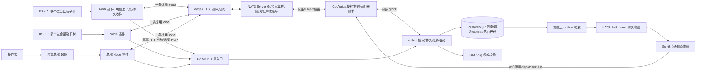

# Auriga 可靠通信网络设计

状态：设计建议，尚未批准、实施或压测。核实日期：2026-10-24—25。本文与 [协议](protocol.zh.md)、[故障与容量验收](failure-validation.zh.md) 一起评审。文中的新接口、字段、错误码是待写入 `contracts/` 的提案，不能当成现有 API。

## 1. 推荐结论与范围

推荐复用 **NATS Server 原生 Go 交换设施及 NATS over WSS 协议 + 官方 JS/Go 客户端 + 已有 PostgreSQL collab 耐久核心**。JetStream 负责内部耐久事件；默认每 DSH 一条 NATS 连接，以少量固定上下行 subject 承载全部有权会话。保留必要的 Auriga 应用信封与 Host receipt，不自写 WebSocket 协议、PING/PONG、订阅交换、集群路由或 Broker。完整 IM 候选以 Tinode 为第二选择，OpenIM 为第三选择，取舍和验证门禁见第 4 节。

这不是因为现有库里有 NATS 就直接采用：对照了 MQTT 5、XMPP/归档、Matrix、Tinode/OpenIM 的原始文档后，NATS 最符合“Go、单机到集群、复用当前 PG/IAM、少加运行组件”的组合。若 IAM 隔离接入 spike 不能证明安全或所需维护改造超过 Tinode 的实测代价，必须回到候选门禁，不以自造完整传输协议兜底。Agent 直接使用工具，Node 适配器管理连接凭据、持久收件与恢复。

总部平台是交换设施，独立总部 DSH 是 LLM 执行入口。管理员只是进入总部 DSH 的操作者；网络不能依赖某个管理员在线、某个会话活着或模型是否响应。这里的“网络”是应用消息网络，不是 VPN，不转发任意 IP 包、端口或文件系统访问。

必须同时成立的五条不变量：

1. `platform_stored` 只在消息、收件投递、幂等记录和 outbox 同一 PostgreSQL 事务提交之后返回。网络写成功不算耐久保存。
2. 投递至少一次；宿主以稳定 `delivery_id` 去重。`host_accepted` 必须有经过核验的宿主持久收件证据，不代表执行完成，更不承诺任意外部副作用恰好一次。
3. 每次源操作、领取、ACK、执行准入都核身份和权限；会话树关系不自动授予权限。连接在线不是授权依据。
4. 正常链路是提交触发通知、定向推送；补偿扫描是低频、分片、批量的服务级修复，不是每 DSH、每会话的短轮询。
5. 所有队列、重试、缓冲、订阅、并发与离线保留都有上限；拒绝、未知与过期可查询、可审计，不伪造成功。

## 2. 哪些是需求，哪些是证据

**当前用户确认**：联网主体是插件/DSH，用户可有多个 DSH，每个 DSH 可同时有多个主会话及递归子会话；获授权的会话共用稳定网络；总部交换层优先 Go；协议可自行设计并比较承载；保留 Codex 原生协作式能力目标，任务历史由 DSH 承载，不再造管理台 Task/AgentBus 编排引擎；Team MCP 是远程工具服务。

**历史需求证据，不是当前实现证明**：旧 Team 设计第 3—4 节要求参与端主动 WSS、平台先存库再投递、ACK 后确认、离线补投和有界重连；第 8 节要求跨端沟通、追问和参与者权限。这支持长期通信的方向。历史“一个 DSH 就是一个 agent”“连接在就是在线”“约两百行自写 WS”和总部任务工作流不能原样继承。旧文档的临时存文后删除策略只作为留存决策依据，不能悄悄覆盖当前持久线程设计。旧 Hub/Team 只读作需求来源，运行时不依赖旧服务、旧插件或旧数据库。

**当前代码已核**：基线 `45fcacf1c3415fddad7a5707ded3276e4d703897`。另只读以下未合候选，不能把它们描述为 main 已具备：

| 证据 | 已确认及限制 |
|---|---|
| TEAMMCP1 `f3c76eb90bc0e79747c042be804a204182358d04`，TEAMREMOTE2 `3998c91397dbc4c072423c64b95175db0eaee12b` | `services/collab/.../V1__team_communication.sql` 有 endpoint、binding、thread、message、delivery、request_dedup，含 RLS/租户外键；`CollabService` 分配线程序号、持久幂等、30 秒租约与 ACK。没有可靠 WS 网络。 |
| TEAMREMOTE2 的 `infra/ai-gateway/internal/team`、`docs/dev/team-mcp.md` | 标准远程 Streamable HTTP `/ai/mcp`；四工具；Node 私有 register/bind/pull/ack/revoke；设备在线 IAM/org 核验。托管实例和总部系统身份尚未开放。 |
| LOCALCONNECT2 `841ee54a6d19317b2b44712b70db6f11ae2ee409`，`clients/dsh-plugin/src/local/team.js` | Node 周期 pull；receive 对已有会话仍 create；prompt 的 requestId=delivery.id，flush 后 ACK。主控真实双 DSH 验收发现非默认工作目录 create 冲突，完整往返未通过。 |
| IAM `60cdad46e17e432b2fcbc93df8946ec3912812af`；edge `e9ad9ae1b1d961c086a5fb6f2da2e54eb923abeb` | 保留真实登录/TOTP/PKCE、设备认证、退出吊销及入口隔离；这不证明新增网络身份与路由已开放。 |
| `services/common/.../events/{OutboxEventPublisher,OutboxForwarder,NatsEvents}.java` | 同事务 outbox、afterCommit 唤醒、SKIP LOCKED、JetStream publish ACK 已存在；forwarder 默认 500ms 周期补扫，发布等待处于 outbox 事务中；不能直接称作最终高容量 dispatcher。 |
| ADR 0016、0017、0020、0014、0008 | 每请求可信宿主上下文、共享 MCP 客户端、浏览器与 Node 凭据隔离、独立实例源、内部 gRPC/mTLS 与 NATS 事件是既有约束。 |

主控提供的脱敏真实失效摘要证明真实登录、注册、MCP 初始化和部分消息入库/宿主接受；不证明整个方案或双向执行通过。本设计不重复调用真实模型，不改变当前运行服务。

## 3. 拓扑与服务职责

长连接、分帧、心跳、订阅匹配、客户端慢消费检测和跨 Broker 路由由独立 nats-server 进程承担。Auriga Go adapter 首发可位于 `infra/ai-gateway` 独立模块，负责 auth callout、应用授权/投递/receipt 与有界调度，共用安装运维但隔离队列与熔断器。它不承载模型推理，不为每个逻辑会话创建 goroutine/定时器/DB 连接。压测显示模型代理与 adapter 相互干扰时拆独立 Go 进程；不要把 NATS Server 嵌进模型代理主进程来省一个进程。

collab 拥有通信真相和 RLS，不让 Go 层跨 schema 直读业务表。Broker 保有 socket/subscription；adapter 内存仅保存有界调度窗口、当前连接标识和可丢缓存。总部 DSH 不比其他执行端天然拥有更多消息读取权限；它的系统主体能力由 org/策略独立赋予。

节点代理（每宿主机）原有 workspace 双向 gRPC/mTLS 管运行生命周期；本网络的“DSH 节点”是逻辑执行实例，不复用宿主机 agent 证书冒充 DSH 身份。云端 DSH 进程已停止时，授权唤醒请求交 workspace；用户电脑离线时只能积压或提示，平台不能凭消息承诺唤醒关机电脑。

## 4. 成熟协议与可改造开源实现

### 4.1 协议本身解决到哪一层

| 协议 | 复用价值 | 对本任务仍缺什么 |
|---|---|---|
| NATS Core + JetStream，外部 WSS | 一连接多 subject，服务器原生路由、queue group、accounts/subject ACL；JetStream 有持久流与消费者。既有项目已用 Go Server/SDK。 | Core 在线消息最多一次，JS ACK 也不等于 DSH 持久入箱。会话树、thread权限、Host receipt、执行未知边界仍在 Auriga；不把全部外部 DSH 直接开放到内部 JS 管理/API。 |
| MQTT 5 | 一 DSH 一个 ClientID、多 topic；Session Expiry/Clean Start、QoS1/2、Message Expiry、Receive Maximum、Maximum Packet Size 与响应关联适合设备消息。 | QoS2 是协议端点交付，不是任意 Agent 副作用恰好一次；持久 session 具体落盘/HA取决于 broker。topic ACL不能表达全部会话树/线程权限；连接接管也不替代执行fence。需另引 broker 或维护当前栈不存在的实现。 |
| XMPP + RFC7395 + XEP0198 + XEP0313 | 成熟 IM 身份/路由、WSS绑定、stanza确认与流恢复、MAM归档。一个 DSH JID/resource 可复用多 thread/MUC。 | 0198 ACK 是 handled stanza，不是宿主落盘执行；恢复窗口与持久归档是不同机制。不要每子agent一个JID连接；子树委派需插件扩展。成熟服务端主要 Erlang/Lua，不满足Go优先，需额外XMPP用户/归档权限映射。 |
| Matrix | room/event、持久历史、成员关系、设备、transaction ID、增量sync已有标准，适合完整协作聊天和联邦。 | room权限不等递归会话能力；标准客户端主要HTTP sync/长等待，不是本任务一条WS交换协议。长等待不是短poll，但新增homeserver/状态解析/账户及历史模型负担大；不需要联邦时收益有限。 |

依据：[MQTT 5 OASIS 标准](https://docs.oasis-open.org/mqtt/mqtt/v5.0/os/mqtt-v5.0-os.html)、[XMPP WebSocket RFC7395](https://www.rfc-editor.org/rfc/rfc7395.html)、[XEP-0198](https://xmpp.org/extensions/xep-0198.html)、[XEP-0313](https://xmpp.org/extensions/xep-0313.html)、[Matrix Client-Server](https://spec.matrix.org/latest/client-server-api/)。所有方案都可以承载业务信封，但不能因“像聊天软件”就把人类用户、客户端连接、DSH会话混为同一个身份。

### 4.2 实际实现、许可证与最小改造路径

许可证为核查日官方源文件事实，未做法律兼容性结论；商业双授权发布前需按锁定 tag/依赖清单另验。不会把项目自己的商业授权自动扩到上游代码。

| 实现 | 已核事实 | 复用路径、成本与判断 |
|---|---|---|
| **NATS Server / JetStream** | Go；当前仓库锁 `nats-server/v2 v2.12.6`、`nats.go v1.49.0`；该Server tag为Apache-2.0。官方JS客户端现统一nats.js v3模块，支持Node/WebSocket。 | **首选**：启用受隔离WSS listener/account，复用服务端与SDK，只写IAM auth callout及应用适配。不fork Broker。已有PG保存业务，JS用固定分片通知，不为10万会话造10万消费者。 |
| **Tinode** | Go后端，WS JSON或gRPC protobuf；单网络session可多topic；PG可选；server GPL-3.0，客户端Apache-2.0；上游自称beta质量。 | **第二候选，真正IM套件**：做Auriga auth backend和DSH adapter，复用topic、消息归档与收发状态。难点是现有collab与Tinode消息库选唯一权威、账号模型与logical binding隔离；不能每agent一账号/WS，也不能将GPL后端纳入自有商业双许可直接发。 |
| **OpenIMServer** | Go、Apache-2.0、SDK/网关/RPC/群组/会话及回调；官方compose含MongoDB、Redis、etcd、Kafka及对象存储。 | **第三候选，完整IM需求优先时**：SDK映射DSH节点，业务回调接IAM/org、增Host receipt。不是换几个URL就复用当前PG；当前轻量Windows/单机与既有持久核心下新增组件和双数据模型成本较高。上游规模宣传不当本项目压测。 |
| Mochi MQTT v2 | Go/MIT、MQTT5、TCP/WS、认证/ACL及多种存储hook；README把cluster列入roadmap。 | 标准MQTT备选可嵌/独立跑，单机试验小；不能由支持MQTT推导已有跨节点持久会话HA。会话树与Host ACK仍自建，选它需承担集群路线。 |
| ejabberd / Prosody | ejabberd Erlang，官方COPYING为GPLv2文本及OpenSSL例外；有stream management/MAM及集群文档。Prosody Lua/MIT。 | 若开放XMPP互通成为核心需求，成熟度有价值；本任务Go优先和现有IAM/PG模型下需额外runtime与账户/归档改造。各实现恢复持久性及集群功能必须按配置核验。 |
| Matrix Synapse | 当前官方有AGPL-3.0许可证文件；主要非Go homeserver。 | 作为完整房间/联邦协作产品备选，不作为轻量Agent内部总线首发；Go SDK≠Go服务端，也不能拿未核Go实现替代成熟度证明。 |
| Centrifugo / centrifuge | Go实时多路通道；Centrifugo核心Apache-2.0，部分能力另分产品；官方history/recovery要求epoch/窗口吻合。 | 适合前端实时推送，短期history并非长期可靠邮箱；仍需PG与应用Host ACK。相对已有NATS又多一种协议/组件，当前不优于首选。 |
| EMQX当前master | LICENSE标明5.9.0及以后为BSL1.1，有生产/托管/嵌入限制及未来Change License。 | 不按旧Apache印象列成无条件可改造开源发行依赖；本任务不采购许可，也不为避限制锁旧版。 |

原始证据：[NATS v2.12.6 LICENSE](https://raw.githubusercontent.com/nats-io/nats-server/v2.12.6/LICENSE)、[NATS WSS](https://docs.nats.io/learn/websocket/)、[nats.js](https://github.com/nats-io/nats.js)、[Tinode README](https://github.com/tinode/chat)、[Tinode API](https://github.com/tinode/chat/blob/master/docs/API.md)、[Tinode PG安装](https://github.com/tinode/chat/blob/master/INSTALL.md)、[Tinode LICENSE](https://github.com/tinode/chat/blob/master/LICENSE)、[OpenIM README](https://github.com/openimsdk/open-im-server)、[OpenIM部署清单](https://github.com/openimsdk/open-im-server/blob/main/docker-compose.yml)、[OpenIM LICENSE](https://github.com/openimsdk/open-im-server/blob/main/LICENSE)、[Mochi README](https://github.com/mochi-mqtt/server)、[Mochi LICENSE](https://github.com/mochi-mqtt/server/blob/main/LICENSE.md)、[ejabberd模块](https://docs.ejabberd.im/admin/configuration/modules/)、[ejabberd COPYING](https://github.com/processone/ejabberd/blob/master/COPYING)、[ejabberd集群](https://docs.ejabberd.im/admin/guide/clustering/)、[Prosody许可](https://prosody.im/source/start)、[Synapse许可](https://github.com/element-hq/synapse/blob/develop/LICENSE-AGPL-3.0)、[Centrifugo恢复边界](https://centrifugal.dev/docs/server/history_and_recovery)、[Centrifugo许可](https://github.com/centrifugal/centrifugo/blob/master/LICENSE)、[EMQX当前许可](https://github.com/emqx/emqx/blob/master/LICENSE)。mutable分支在实施spike时必须记录精确commit，不将网页当前状态当永久承诺。

### 4.3 三个候选的硬验证门禁

NATS 优先做小型隔离验证：固定 v2.12.6、两个 Broker/官方客户端、随机测试身份；auth callout映射精确上下行subject，拒跨tenant、通配订阅、任意reply subject、JS管理/API与服务账号；校验到期断连、撤销后无新业务派发、旧连接与新epoch不能交叉接收、SDK在Windows/Node真实打包可用、Broker故障后恢复。源码已核 `server/auth_callout.go` 对响应的user_nkey/server audience校验及`setExpiration`，但还没有跑本项目映射测试。callout只在连接时准入，不能取代逐操作授权。参见 [官方auth callout](https://docs.nats.io/learn/security/auth-callout) 与 [锁定源码](https://github.com/nats-io/nats-server/blob/v2.12.6/server/auth_callout.go)。

R2证据更新：主控隔离探针已在实际DSH Electron44.7.0/Node24.21.0中，用官方@nats-io/nats-core3.4.0分别验证原生W3C WebSocket和显式ws8.22.0两条路径；正确CA根签发leaf、TLS校验开启，两者均一连接两订阅通过。独立运行时兼容已通过，完整Auriga插件、IAM/租户权限、硬buffer与HA仍未测。旧首失是不规范leaf充CA的fixture，已保留而不归为上游故障；详情见验收文档。选型及其余门禁不变。

Tinode 对照验证：固定release、PG隔离库、两个网络session、多topic、断线重连补历史、auth backend即时撤销、同一DSH两logical binding不能相互读topic；检查source中的用户级权限路径能否通过一层可信DSH代理满足委派，而无需每binding新账号。至少选定“collab为真相、Tinode仅路由”或“Tinode为消息真相、collab只保授权/receipt”之一再估改造，不能两边各确认成功。

OpenIM 对照验证：固定release和官方依赖最小集，核消息接收/同步时点、用户多端互踢策略、SDK Node宿主可打包性、业务回调失败是否拒绝以及PG持久核心如何迁移。只有真正需要其完整IM产品能力、且接受新增依赖时才优先它；不能裁掉其核心存储后还借其成熟度作保证。

这三项是下一实施阶段的可复现 spike，不在本设计工位启动新服务。首选出现安全/可靠性门禁失败必须保留证据再改选，不能把“库支持”记作已通过。

**不按沉没成本排除Tinode**：collab候选尚未全部合入，允许用真实对照结果推翻首选。NATS路线新增工作为IAM接入适配、PG→在线派发/repair、Host receipt、会话树/配额与运维验证；它省的是Broker连接/路由/集群实现和另一套IM账号/消息库集成，并没有省掉邮箱/线程权限业务。Tinode路线能直接省topic/归档/收发状态与IM管理能力，但仍需把其“用户/网络session/topic”的鉴权改造成“tenant/DSH/logical binding”，并把用户级received/read推进与每binding Host receipt分开，核跨DSH精准寻址、子树配额和即时吊销。可先做独立Tinode+PG+薄MCP/DSH adapter，不要求保留collab内部实现；若原生hook即可完成上述隔离，且总新增代码/测试/运维比NATS方案更少，应改选Tinode并做持久数据迁移设计。当前没有两者代码量或工期实测，不能声称NATS必然少写几千行；首选依据是已确认的职责匹配与运行组件，而不是已经花了多少工时。

### 4.4 下层承载选择

| 方案 | 实际收益与限制 | 建议 |
|---|---|---|
| NATS over WSS / HTTP Upgrade | 官方Broker/SDK已有完整协议处理；便于经HTTPS入口部署。仍须实测企业代理、CONNECT与空闲超时；TCP丢包阻塞其逻辑通道。 | 首发默认，直接复用NATS实现；不用Auriga JSON替换NATS wire protocol。 |
| HTTP/2 + gRPC 双向流 | Go、Node gRPC 有双向流和传输流控，protobuf 契约易生成；单 HTTP/2 连接可复用多 RPC stream，但下层 TCP 丢包仍有连接级阻塞。代理须明确支持端到端 h2/长流，负载均衡按长流而非逐消息分配。 | 受控托管环境的后续可选承载；复用本协议 resume/ACK/fence，不以 gRPC write 成功替代耐久。 |
| 自定义 WSS 或原生 HTTP/2 DATA | 对应用完全可控，但需维护帧/订阅/路由/恢复、兼容SDK及运维。 | 相比已有成熟方案当前收益不足，不作为首发；应用Host receipt不能成为重写消息中间件的理由。 |
| QUIC 多流 / HTTP/3 | 独立流避免某流丢包阻塞其他流；具备连接/流级流控与路径迁移。共同拥塞控制、共享带宽和应用队列仍会相互影响。UDP 出口、企业代理、负载均衡 CID/迁移与 Node 当前支持矩阵均须实测。 | 作为大量高延迟/丢包节点的验证路线；不作为当前 Node 跨平台发布前提。禁用有副作用消息的 0-RTT 重放。 |

上述传输事实分别依据 [RFC 9113](https://www.rfc-editor.org/rfc/rfc9113.html)、[gRPC 流控](https://grpc.io/docs/guides/flow-control/)、[Node gRPC 双向流示例](https://grpc.io/docs/languages/node/basics/)、[RFC 9000](https://www.rfc-editor.org/rfc/rfc9000.html)。企业代理是否可用是本项目待测环境条件，不是这些标准的保证。

首发插件显式依赖官方nats.js合适模块并固定版本，不跨包偷用宿主依赖；WSS认证在NATS CONNECT完成，不依赖浏览器WebSocket API自定义Authorization头。SDK的Node/WSS、代理、重连缓冲与TLS行为须按实际版本测试。本轮没有安装任何新依赖。

默认每 DSH 一条数据连接。仅当压测证明同 DSH 独立热点之间的 TCP 阻塞/ACK 延迟越过 SLO，而限包和公平队列仍不足时，允许显式协商最多两条 lane：控制/小消息与高吞吐消息分离。lane 归同一 node incarnation 和租户预算，消息只能被一个 lane 领取；不能双连同时执行。额外连接意味着额外 FD/TLS/心跳和恢复状态，不能由 agent/会话数自动扩池。

## 5. MCP 与网络的准确关系

MCP是工具协议；数据网络复用NATS协议，WSS只是其下层传输，Auriga业务信封放在NATS payload。首发保留远程标准Streamable HTTP，不把NATS或应用信封叫标准MCP，也不因已有故障声称HTTP API天生不可靠。MCP允许JSON/SSE响应及可选会话/恢复机制，但不能代替应用持久投递。依据：[MCP 2025-06-18 transports](https://modelcontextprotocol.io/specification/2025-06-18/basic/transports)。

| 请求类别 | 首发通道与完成语义 |
|---|---|
| 登录/TOTP/PKCE、刷新、配对、资源授权 | HTTPS 控制面；沿既有可信 Node 流程，普通登录后后台完成连接，不新增可见“登录总部”步骤。 |
| agent 列端点、开线程、回复、读有权历史 | 插件采集本次 exec 上下文，经共享远程 MCP 客户端/HTTP 池；发送事务提交才返回 platform_stored，回复未到不是发送失败。 |
| 平台到 DSH 的消息、请求、执行控制、状态事件、唤醒 | 经NATS WSS的本连接专属下行subject承载应用信封；有耐久要求的内容先入PG，再push。 |
| 绑定/订阅、投递 receipt、恢复、节点就绪/暂停 | 私有应用消息，非新传输控制帧；仅Node/服务能发送，模型不见此工具。NATS CONNECT/PING/SUB/UNSUB/断线由官方实现，绑定/撤销等持久变更仍经collab授权事务。 |
| 临时进度/在线提示 | 可合并丢弃的非耐久帧，标明 ephemeral；最终结果和决定必须落为耐久消息。 |
| 大文件/产物 | 经 resource 对象上传/下载；网络只传有权限的产物引用、摘要和大小，读取时重新授权。 |
| 内部服务调用、路由/租约/存储 | 有界 gRPC 池及 NATS；不会为每个 DSH 建一条到 PostgreSQL 的连接。 |

“一个稳定网络入口”不意味着把既有标准 MCP 改成私有协议：每 DSH 默认一条数据 WSS，控制/MCP HTTPS 另用同一平台 origin 的有界共享连接池（支持 h2 时目标一条；h1 初始最多两条），不是每会话一个 HTTP 客户端/心跳。工具请求是业务驱动，不是周期拉取。未来如提出所有工具也走一条数据连接，须另立自定义承载适配提案并保留标准远程 MCP 对外入口；本方案不隐式更改 ADR 0016。

## 6. 身份、会话树与寻址

`用户 ≠ DSH ≠ session ≠ 活跃 agent ≠ thread ≠ connection`。同用户多个 DSH 分别有 node 身份和收件箱；同 DSH 多个主会话共享连接但互相不自动授权。session 是持久会话，agent 是其当前执行实体，冷会话没有必须常驻的 agent。

最小寻址为 `(tenant_id, node_id, binding_id)`，thread 是显式参与者集合；host_session_id 由 Node 可信宿主读取且为不透明字符串。socket 地址、MCP Session ID、模型自填 sessionId 不是身份。连接世代是临时路由版本，不替代稳定 node/binding/delivery ID。

拟新增授权记录包含 subject binding、可信 parent binding、root binding、授予方、权限交集、目标范围、expiry、最大委派深度与 policy revision。父子关系来自宿主原生 lineage/owner 接口；模型参数不能自报血缘。每个新子会话默认无网络能力，按需要由有权主体请求裁剪授权。子能力是父可委派能力、目标准入、租户策略和子请求的交集；不继承父的设备凭据、全部线程历史或所有工具。fork 复制了文本上下文也不复制 grant。

授权动作至少区分 discover、send、receive、read_history、wake、queue、steer、cancel、fork、delegate、artifact_read；同进程信任不等于跨成员授权。首发跨 tenant 拒绝，不借总部/admin 主体绕过。跨 DSH 的子任务是新远程授权参与者，不可把本地 parentSession 字符串当远程委派凭据。

现有 `thread_participant UNIQUE(tenant,thread,endpoint)` 与 `delivery UNIQUE(tenant,message,target_endpoint)` 限制同 DSH 同线程只能有一个参与会话，必须在契约阶段显式升级为逻辑参与者/target binding 级去重；不能只加 WS 后假称同 DSH 多会话已经支持。未绑定的首次接触落到 node 的授权 provisioning inbox，由策略明确允许新建普通会话或转交某个已授权 binding；不能随机选当前前台会话。绑定持久后不能静默重映射。

冷会话只保留持久 binding/grant 与未处理 delivery，不保 socket、心跳、goroutine 或永久订阅。活跃订阅在通道打开时建立，idle 5 分钟或会话结束释放；需要被离线唤醒的“收件权”单独持久化，不靠在线订阅续命。关闭/归档默认暂停新执行并撤销临时委派；保留历史读权需单独策略。重连按 node 分页恢复有权通道，默认每批 128、最多 4 批在途；不逐个会话握手。

## 7. 可靠 push 与路由真相

### 7.1 事务到在线推送

1. collab 按稳定锁顺序检查发送者、参与者和配额；同事务写 message、每逻辑收件人的 delivery、dedup、endpoint 的 `dirty_version`/待处理索引及 outbox 指针事件。事件不复制敏感全文。
2. commit 后本机 `wakeUp()` 唤醒 outbox 转发器；多副本可用 PostgreSQL NOTIFY 提示分片变脏。NOTIFY 只发不透明分片标识，不发正文/凭据，丢失无损正确性。监听连接启动时先 LISTEN 成功，再扫一遍未发布 outbox，消除注册竞态。事务内 NOTIFY 只在 commit 后交付，见 [PostgreSQL NOTIFY](https://www.postgresql.org/docs/17/sql-notify.html)。
3. 有界转发器领取 outbox 批次，提交短租约后在事务外发布 JetStream，收到 PubAck 再条件更新 published；宕机可重复发布，使用 event_id 幂等。现有 common 的发布期间持锁模式可小规模沿用作过渡，但正式高容量版本须先测试并拆开网络等待，不能改弱原有事务一致性。
4. 固定少量分片的 JetStream durable consumer 收到可用性事件，将node放进所属Go dispatcher的有界ready集合。通知消费者可在PG待处理状态确认存在后ACK；即使此后worker崩溃，dirty状态仍在。没有每节点、每会话一个JetStream consumer。
5. dispatcher按公平调度调用collab `ClaimDeliveries`，服务检查node epoch、dispatcher分片owner generation、授权与容量，原子领取有序batch。adapter发布到该连接专属下行subject，Broker原生路由至持有该订阅的WSS连接，不自建跨网关socket转发表。**Core push可能丢失**，写socket/PUB/PONG均不清PG；只有Host receipt事务推进，租约超时或重连cursor使同delivery再投。ACK/接收窗口恢复触发下一批，不等定时器。
6. 待处理清理必须 CAS `dirty_version`：仅在当前版本无可投项且所有到期/在途状态已设置 next_due 后清除当前 ready 标记。并发新提交增加 version，旧 worker 不能擦掉新唤醒。发送完但未 host ACK 的 delivery 仍在数据库，next_due 至少指向租约到期。

JetStream 本身具有持久消费/重投，Core NATS 是最多一次、离线不保留；这是两者分工，不是把名字写入设计就实现可靠性。依据：[NATS Core](https://docs.nats.io/learn/core-nats/)、[JetStream](https://docs.nats.io/concepts/jetstream)。原有 `AURIGA_EVENTS` 可装载新的 collab 通知 schema；按既有 ADR 0008，不新增 Redis/Kafka。要审核 stream 的磁盘、MaxAge/MaxBytes、replicas 和 ACL，源码当前 FileStorage 默认不能当 R3 高可用证明。

### 7.2 丢通知、离线与迁移修复

每个逻辑分片最多一个活动 repair owner（PG 租约，owner_generation），默认每 30 秒批扫索引命中的 dirty/到期 endpoint，限制每批 256、时间预算和 tenant 公平份额；扫描起点/下一页持久化。正常 afterCommit/JetStream 不等扫描。首次连接、重连、换路由、ACK、新额度、鉴权恢复均即时触发该 node 检查。离线 node 标成 parked，仅保留最早到期时间；不持续对每个离线端点发送 hint。超过 repair SLO 的 backlog 告警并准入限流。

服务级索引补扫是故障恢复；绝不恢复旧 `每 2 秒 * 每节点` pull。验证需证明正常流量在完全禁用repair的受控试验中仍立即投递，丢通知试验才依赖repair。只有JetStream不可用而Core仍在线时，PG有界积压内可确认platform_stored，repair可驱动Core投递；整个Broker不可用时只存储有界积压，不能称还能push。超过积压/磁盘阈值停止新durable admission。

### 7.3 路由与世代

`connection_route`由collab保存`(tenant,node,incarnation,connection_epoch,ingress_id,down_subject,lane,last_seen,lease_deadline)`。ingress_id是一次Broker连接准入的随机身份，不是每会话ID；subject由平台分配、严格ACL约束。Broker本身负责定位socket，PG只保当前有权连接/世代与dispatcher owner generation。连接auth callout与应用READY握手完成后原子接管epoch，旧连接即使暂时存活也只订阅其旧ingress专属下行，不接收新世代正文；延迟claim、ACK、resume仍由数据库fence。不能让旧新连接共订阅裸node_id主题。

仅有长连接不会阻止两份本地进程同时执行：插件还必须用宿主 profile 的单写者锁与稳定 node incarnation、持久 receipt ledger；从快照复制出的实例不得并发复用 node 身份。服务器同凭据竞争不能以“最后连接赢”无限互踢，检测短期反复接管后停在 conflict/需人工处理。合法崩溃接管通过新 boot ID 和注册接管策略；设备疑似丢失先吊销，再注册新的 node，不继承旧执行未决任务。

## 8. 高可用、分片与发布

简单首发可单edge、Go adapter、PG、NATS进程，足以验证耐久恢复但不是HA。客户端NATS account与内部服务account严格分离；接入限额/运维不能跨account影响内部事件，压测后可将外部接入Broker与内部JetStream集群分部署，以精确subject导入导出连接。生产HA档至少两个edge/adapter/collab副本、独立故障域、具同步提交与可信故障切换的PG、三副本JetStream及多Broker接入。PG仍每分片单写者，不做无协调多主。同步standby不可用时拒绝新耐久写，不自动降异步又承诺RPO=0。依据：[PostgreSQL同步复制](https://www.postgresql.org/docs/17/warm-standby.html#SYNCHRONOUS-REPLICATION)。

外部LB只在建连时分配Broker，不要求cookie粘性，也不把重连固定到死节点；内部NATS路由让adapter无需持有客户端socket。dispatcher固定逻辑分片hash(tenant,node)，其owner/generation可迁移，和Broker扩容分别进行。热点thread排序需串行化，增加Broker不能无限提高单线程写速率。后期按tenant分PG集群、维护版本目录；迁移须停写/追平/切换/旧主fence，不引入无原子事务的跨分片广播。

滚更分别处理Broker lame-duck/drain和adapter分片交接：停止新连接/领取，有界处理receipt；客户端按SDK断线事件和抖动重获凭据、重连、恢复。adapter升级不必让所有socket断开。drain不删除pending，不等LLM完成。凭据到期、DB不可达、route lease失效均停止派发/执行准入；route续期按adapter批处理，不能为每逻辑会话增加数据库心跳。

## 9. 分期与接线责任

| 阶段 | 必须实现与过关条件 | 不能据此宣布 |
|---|---|---|
| N0：开源接入/契约/宿主接缝 | NATS官方SDK+auth callout安全spike、接入account隔离；应用schema/状态机/错误码、IAM DEVICE/INSTANCE/SYSTEM准入、会话树/target binding；rc.3普通会话恢复验证。 | JS/IAM未测部分已可用、subagent已兼容。 |
| N1：最小可靠网络 | 原生NATS WSS与Node单连接、PG原子outbox/dirty/epoch、JS通知、Core push缺口修复、窗口/配额、宿主receipt ledger；两个真实DSH往返与崩溃恢复。 | HA、10万agent容量、任意副作用恰好一次。 |
| N2：授权会话树 | 可信 lineage/parent address、独立最小委派、递归聚合预算、同 DSH 多逻辑参与者、订阅批量恢复；普通/冷/子agent 各有真实原生试验。 | 全部 Codex 协作能力已复现。 |
| N3：HA 与容量 | 多副本网关、PG/JS 故障切换、滚更、慢消费者与重连风暴、目标容量压测、恢复与留存 runbook。 | 未测跨地域多活、无限扩容。 |
| 后续增强 | 测量后选择双 lane、gRPC/QUIC 或存储分片；授权历史、fork、等待状态、中断、产物各自按原生能力验收。 | 把网络设计变成另一个业务调度引擎。 |

实施边界：`contracts/` 先行；`infra/ai-gateway` 承担 Go 网络/远程 MCP；`infra/edge` 增加精确升级路由和 WS 生命周期安全；`services/collab` 负责持久状态/配额/授权；`services/iam`、org 增补主体与委派判定；`services/common` 对 outbox 的任何改进须兼容现有使用者；`clients/dsh-plugin` 承担连接管理与宿主 adapter。`infra/agent|node|egress` 仅在实例生命周期/出口规则确需改变时另派受保护任务。

不得为本网络删掉真实 IAM/TOTP/PKCE、RLS、幂等和持久线程；把现有 pull 标为迁移期路径，N1 端到端通过后移除周期主链路。所有 PR 都需 CI 与 fresh 非作者独审；命中保护路径标【待审查】，作者/主控不自行合并。本设计本身也尚待独立挑战。

## 10. 少量需产品确认的决定

可按本方案推进设计评审，承载选择不必反复询问。实施前真正需要确定的只有：

- 首发安装默认是可恢复单机档，还是必须达到双故障域 HA 档；后者需要确定可用基础设施与存储预算。
- 正文留存与离线执行期限：暂按待投消息最多 7 天、执行请求默认 24 小时、正文接受后最多 7 天、去重/终态元数据 30 天设计；这些是待批准运营默认值，不是悄悄沿用旧隐私策略。
- 无明确授权的首次远程消息默认仅入受控 provisioning inbox、不自动启动模型；哪些成员/系统主体可授予自动唤醒和新会话创建，需产品权限策略决定。

容量、SLO、故障矩阵与宿主兼容证据详见另外两篇。以上估算和规范不会被描述为已完成的网络。
