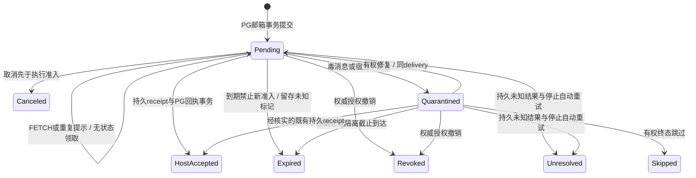

# 网络协议、授权与宿主恢复

状态：待评审协议提案。不是现有契约。本篇与 [总览](README.zh.md)、[验收](failure-validation.zh.md) 配套；后续必须先生成正式 schema/protobuf 和一致性测试，禁止各端私加同名字段。

## 1. 稳定身份与临时标识

| 标识 | 分配者、范围与含义 |
|---|---|
| tenant_id / realm / owner_user_id | IAM/org 决定 tenant 与节点归属用户；realm 为联邦预留，v1 必须等于认证上下文 tenant。owner_user_id 仅归属属性，不进入地址，不能合并同用户的多个 node。 |
| node_id | 总部注册分配的 uint64，realm 内永不复用、0 保留不用；本地/云端/总部 DSH 各占一个，初期 endpoint 映射需显式迁移。 |
| local_id | DSH 插件分配的 uint64，在该 node 内永不复用；0 是 system 收件箱，其他值映射本地 session/subagent。总部只做不透明值比较和计数。 |
| address_version / address_type | 地址结构版本；类型 system/session/subagent/group（group 仅预留，首发拒绝）。不是额外路由段或授权；同一 node/local 不得通过换类型变成第二身份。 |
| node_incarnation | 平台批准的实例注册世代；恢复/克隆不能自行复用旧世代执行，也不能借新世代清零 local 分配高水位。 |
| connection_epoch（连接世代） | PG 接管连接时原子递增 uint64，关联 ingress；不改变稳定地址、delivery 或执行准入记录。 |
| binding_id / host_session_id | 插件本地持久映射 local→binding→真实宿主 session；总部不建立宿主 session 外键，不解析其内部 ID。 |
| grant_id / policy_revision / lineage | 会话 grant、父子/root 和递归预算由插件依据可信宿主维护；总部保 node 策略版本和不透明对话关系的撤销版本。 |
| channel_id | 插件逻辑通道，关联本地 binding 与完整地址；不等于 NATS socket/consumer。 |
| thread_id / thread_sequence | 平台持久对话及提交序号，参与者为完整不透明地址；不是宿主会话树。 |
| message_id / delivery_id | 平台不可变消息 ID / 某消息到某完整目标地址的投递 ID；重试不变，宿主 requestId 使用规范化 delivery_id。 |
| contact_id | kind=first_contact 的原 message_id；不是另一个无地址暂存对象，目标固定为系统地址。 |
| request_id | 单次协议请求关联，不提供业务幂等。 |
| producer_epoch + idempotency_key | 源操作幂等域 (tenant, source_node, source_local, operation, producer_epoch, key)，同键同体返回原结果，异体拒绝。 |
| mail_seq / resume_cursor | node 邮箱序号与连续确认前缀；scan_after 另作分页位置，均不是执行进度。 |

**地址编码**：v1 文本为 `aur1:<node_hex16>.<local_hex16>`，两段固定 16 位小写十六进制；例如 `aur1:00000000000000a1.0000000000000001`，系统地址为 `aur1:00000000000000b2.0000000000000000`。文本只编码版本和两段 ID；realm 从当前已认证 tenant 补齐，type 从系统地址约束或目标在对话中给出的元数据取得，不能从数字猜父子类型。文本不是跨 realm 全局地址，首发不支持联邦文本导入。JSON 完整地址形如 `{"version":1,"realm":"tenant-fixture","type":"session","node":"161","local":"1"}`，对应上述 a1/1；所有 uint64 使用无前导零的十进制字符串，禁止 JS number 精度截断。0/sys 的人类写法只能在明确首联 UI 内规范化，不作另一种线上 ID。

**不复用与恢复**：总部使用事务唯一分配及持久高水位保 node；插件使用单写者事务分配 local，先持久预留再创建宿主，不依赖 64 位随机碰撞概率。local=0 永久代表该 node 系统入口，非零 local 关闭后留 tombstone，不重映射到新会话；换模型不换地址，fork 得新 local。序号耗尽必须拒绝分配，不能回绕。恢复备份须证明高水位不回退（独立耐久分配日志/预留区间且恢复跳过所有已租出区间）；无法证明时停用旧 node、重新注册新 node，旧地址明确失效，不能靠增 incarnation 重用旧 local。总部同样不能从回滚备份无证据继续发旧 node ID。克隆共享 node 按 epoch fencing 接管，正常同用户两 DSH 应注册两个 node。

短别名取各段前 4 位，冲突逐位加长到完整 16 位；顺序分配常共享前缀，别名会较长，这是展示取舍。UI 只在当前可见集合生成别名；不能用于导入、去重、授权或 API 寻址，未知/歧义别名不自动匹配。local 可在插件内部映射为 session/child 层级，v1 线上不传可解析路径；未来变化须新版本协商，不把 parent address 塞入 local。host_session_id、原生 parent address 和本地 grant 不进入公共目录或发给对端。

### 1.1 系统目录、对话关系与目标解析

对应[总览 §6.1](README.zh.md#61-dsh-内多-agent-的寻址与发现)。第 7 轮已替换 binding 通讯录；本轮增加 §1.2 首联用户授权，以下均为待契约化语义。

**发现与信任**：目录只返回有权发现的 DSH 系统地址、display_name、owner_user_id、online_state/status_observed_at；不提供会话搜索、精确 local 存在性查询、会话数量或冷热能力索引。来源插件以本次可信宿主上下文选本地 local，并在私有认证请求中声明 from；总部强制 from.node/realm 等于认证主体，不信模型 JSON 中的身份。插件自己保证 local→宿主和 send grant；总部不能独立识别已被攻陷的 node 对自身 local 的伪造。这是职责下沉后的明确信任边界，不改变跨 node/tenant 鉴权。

**地址不是凭据**：总部每次操作核 IAM/node→node 策略及已存的完整地址关系，目标插件核本地 receive/read/wake/control 等 grant。非系统目的必须有该目标通过已认证对话给当前来源的关系，且该 thread 的参与范围仍有效；知道地址、thread_id、归属用户或复制他人的信封均不建立关系。首发关系限原线程，不隐式授权新线程或全部历史；新线程需已有对话内双方确认的邀请。关系撤销与提交/准入按状态版本核验；插件本地撤销立即阻止新执行，再可靠上报总部，传输滞后不能声称全局零窗口。

| 发送意图 | 地址与关系规则 | 不得发生 |
|---|---|---|
| first_contact | to 为目标 node 的 system/local=0，from 为源插件已授权会话；总部核组织首联策略，有效目标原子保存线程、消息、系统 delivery、幂等和邮箱序号；contact_pending 留总部待用户授权，对外回执按 §1.2 裁剪 | 使用缺省前台、通过首联绕到任意非零 local、自动启动模型 |
| 已有对话 message | to 为完整地址或显式线程收件模式；核逐地址关系后固化收件快照 | 仅凭猜到地址创建参与者、将同 node 两 local 合并 |
| reply | thread_id、in_reply_to 引用已存消息；to 必须等于原消息已核验的 reply_to（v1 等于 from）；发件人须是原接收者或系统首联唯一分配的新地址 | 第三方 reply_to 重定向、跨线程引用、将默认回复广播到全线程 |
| control | 同样核关系，另需节点策略与目标插件控制 grant；动作写入受支持 body schema | 靠 kind/flags 提权或绕过限额 |

普通精确发送缺完整目标返回 network.target_required；地址、type、reply 引用或目标集合矛盾返回 network.target_mismatch。没有关系/权限或猜测失效地址统一 network.target_unavailable，不泄露 local 是否存在。已建立关系的对端可获插件报告的 network.address_archived / revoked / host_incompatible；尚未收到目标状态时，平台只能返回 platform_stored/queued_offline 等实际状态，随后持久记录异步拒绝及终态，不编造实时会话状态。成功响应列出实际完整 from/to，合法关系内选错联系人不能自动纠正。

**参与者与回执**：thread_participant UNIQUE(tenant, thread, node, local)，delivery UNIQUE(tenant, message, target_node, target_local)；含 tenant 的 node 外键、规范地址和 type 一致性约束，不能建立到总部 host_session 表的外键。v1 realm=tenant，后续跨 realm 必须迁移唯一键并重新设计权限，不能直接放开。一个 message 发同 node 两 local 时两个 delivery_id/mail_seq，各自授权、计费、重试、确认。每个 delivery 固化完整 to 和关系版本，HEAD 合并不合并收件人。插件在本地核 local 映射和 ledger 后才交给唯一 session，不从前台推断。系统 delivery 始终保留 to=sys，首联执行目标另在下面的分配记录中固定，不能篡改原信封。初始参与者是来源地址与目标 sys；sys 只有本次首联管理/回执及唯一新地址介绍权限。首回复事务加入 assigned_address 与来源的对话关系，后续默认精确回复不再把 sys 当群聊收件者，也不授它其他线程会话权。

**系统首联与幂等建会话**：有效目标的 contact_id=首联 message_id，正常 message/delivery/mailbox/outbox/dedup 同事务保存后形成内部 platform_stored；面向发起方的可见状态遵守 §1.2，不将受限响应当成对目标存在性的证明。授权前状态为 contact_pending，消息正文与权威请求留在总部目标系统收件箱，未进入本地 agent inbox。插件只向已认证目标用户展示批准提示/限长预览；提示已读、预览读取及默认策略评估都不是 Host receipt，不能推进邮箱确认前缀，不能启动模型。离线时同样留存，期限不延长。

CONTACT_DECIDE 允许建立对话提交后，才进入 awaiting_session 并开放正常正文 FETCH/本地系统收件；本地耐久后可回 host_accepted 且必须带 accepted_by=system，仍非会话/模型接受。session_accepted 与 execution_completed 另报，四级 ACK 本义不变。授权前拒绝/到期生成无正文终态供游标跨过，不造 host_accepted；分页仍可越过未决位置服务其他 local，沿 §8 的空洞与节点配额约束。

本地用户允许建立对话（或本地该层默认档位允许）且总部 CONTACT_DECIDE 已提交后，插件以 (tenant,node,contact_id) 单写者锁持久预留唯一非零 local、host_session_id、cwd/preset 与创建状态，核本地建立对话/创建 grant；此阶段不要求或隐含自动执行授权。先向总部提交私有 CONTACT_ASSIGN CAS，固定该 contact 的 assigned_address 与 creation_attempt_id，只允许当前目标 node/epoch、contact_allowed 及有效决定版本、当前组织策略、未撤销关系和原期限；总部只存不透明分配结果，不解释宿主结构，也不向目录或发起方提前公开。重复同内容返回既有状态，改 local 冲突。创建许可沿 §5 的一次准入原则，记录获准 epoch/boot_id；仅第一次成功响应且本地 creation_started 标记已持久化的原进程可调用一次 create。回包丢失/崩溃/克隆接管后只查原映射、原生 ID 和原持久存储，不能凭查询结果重新获得创建许可。确认原会话存在才继续后续阶段，无法证明则 outcome_unknown 并停止自动创建，允许零次创建，不换随机 ID；不能用单台宿主的幂等能力推断两个独立克隆共享幂等。READY 接管与分配 CAS 串行，防两克隆给同 contact 各建一次；分配永不因连接续期清零。

native create 并持久确认后，在本地关联原首联 delivery→assigned_address；原消息仅能面向此新会话，绝不自动投给已有会话。允许创建只得到可通信的空会话和地址；没有第二层自动执行授权时不得将正文送入会自动调度模型的 queue/prompt，也不能以原生 create 自带 prompt 绕过。若宿主不支持无模型创建，则停在已允许待适配/host_incompatible，不擅自启动模型。真正 queue/prompt 前须另获本地模型/工具对应授权，再按 §5 在线 EXECUTION_ADMIT，并核尚有效的本地 grant。首联即使已有 system 收件回执，仍可凭单独的有效 contact 执行状态申请唯一准入；system receipt 只释放传输项，不删除 contact 正文、分配/执行状态或创建预算。待处理 contact 的到期和取消继续生效。首条回复用原新会话 from/reply_to、to=原首联 from、in_reply_to=contact_id；collab 只允许该 assigned_address 经原目标 node 认证，在一次回复事务中建立该对话关系并提交回复，不能由任意发送者自报地址建立关系。只有第一层允许时，插件可在新会话已持久创建后发送 body 为 conversation_opened / execution_waiting、provenance=host 的确定性 reply，用该已绑定会话 from/reply_to 交换地址；不是模型生成内容、不计模型完成，不能夹带工具动作。模型实际答复仍需第二层授权。后续添加参与者须受邀地址经其 node 的有权对话确认，不接受仅列 ID 的 add-member。

首条回复进入插件持久 outbox，按稳定 reply 幂等键发送；PG 提交回包丢失查同键，A 接收回执丢失则同 delivery 补投。A 重发首联同键只查原 contact/回复，不再创建。使用新键是新联系，仍受首联速率/积压/创建预算约束，不承诺识别正文相同的不同业务意图。未决 contact/分配/结果至少保留到终态及重试窗口结束；system receipt 后不能提前按普通已接受正文 24 小时清除，待执行期限默认 24 小时且不超过原 expires_at，幂等元数据至少 30 天。过期只禁止新创建/准入，不能撤回已执行动作。

**首联防洪泛与容量**：总部按源 node→目标 node、源 IAM 用户→目标 node、目标 node 及 tenant 共同限制频率、待决条数/字节，插件限制提示频率与创建/执行并发。拒绝后根据请求状态计算同来源冷却；本地屏蔽名单不上传。规则和建议值见 §1.2 与总览 §10。等待期间全由总部计入待授权积压，不能因提示已读释放；获准后转入有界待创建/交接预算并预留本地空间，拒绝/过期写终态才释放待决额度。system receipt 只确认获准后的本地耐久收件，不清未决创建/执行证据。不因人工未处理停止整个 node，也不使用本地 ACK 把待批准正文从总部提前删除。

**冷会话与子会话**：普通 local 始终恢复原 native session；允许 receive 不自动允许 wake/执行，没有 wake 时 queued_cold。归档/撤销由插件拒绝新执行并可靠报终态，已准入副作用边界仍按 §5。子 local 内部映射保存可信 lineage 和 durable parent address，N2 验专用子 agent adapter 前返回 host_incompatible，不回退到父普通 prompt。冷会话、子树授权及映射恢复在插件完成，平台只分页返回该 node 的不透明对话关系/未决项，不保存全量会话树。

### 1.2 首次联系授权、状态可见性与撤销

**决策权与作用域**：first_contact 表达“请求与该 DSH 建立对话”。目标 DSH 归属用户在其本机插件操作 allow_once（允许本次）、allow_source（总是允许该发起方）、deny（拒绝）、block（屏蔽）；总部系统 DSH 由有权管理员设置的本地策略决定。允许本次绑定 contact_id 和源身份，建立的对话后续仍需当前个人策略和逐会话 grant；不等于只允许一条回复，也不永久豁免后续策略。总是允许明确选择 source_node 或 source_user，用户身份由 IAM 核当前归属，不能用 payload 自报的 owner_user_id/显示名匹配。按用户的规则涵盖其多个源 node；源 node 归属变化须重新评估，目标用户其他 DSH 不自动同步授权。

**两层默认档位**：conversation_policy 管建立对话/创建普通会话/交换地址；execution_policy 管自动唤醒/启动模型，具体工具还受工具 grant。两层各自可选 ask_each（每次询问，推荐默认）、same_org（同组织自动允许）、allowlist（仅白名单自动允许，未命中保持待问）、deny_all（全部拒绝）。第一层每个 contact 决策，第二层每个稳定执行请求决策，同请求重投不重复提示/授权。工具权限不得从“允许自动模型”推出，白名单记录必须带层级、范围和策略版本。没有跨层默认继承；只允许第一层时可创建并介绍地址，模型调用数与工具执行数必须为 0。

优先级是总部组织禁止/身份失效 → 本地屏蔽或该层全部拒绝 → 当前显式允许/匹配白名单/同组织档位 → 等待人工决定。任何个人允许都不能扩大总部组织上限；same_org 以最新 IAM/org 判定，不凭本地用户填写组织名。同组织但被部门互联策略禁止时直接停止，不弹一个能覆盖组织禁令的允许按钮。IAM/org 不可用时停止新决策提交、创建和执行，不能降级接受缓存允许。

**权威存放与修改入口**：个人决定、默认档位、白名单、屏蔽名单、策略版本及其完整审计在目标插件本地事务库，由真实本地用户界面校验身份后修改；不向模型暴露批准/改设置工具，不接受远程 first_contact/control 或总部普通 UI 更改这些规则。总部只保组织政策、请求/对话处理状态及节点提交的最小决定凭据（decision_id、request_version、opaque policy_revision、结果、时间），不持有个人规则列表/未来默认授权。它不能离线推演“这个用户之前总是允许”，也不能把请求状态当新请求授权。平台已有 node 身份、关系、回执与配额仍按前节保留。

**提交与审计**：插件先在本地持久记录决定及状态 outbox，再经当前认证 node/epoch 发私有 CONTACT_DECIDE。包括 contact_id、decision_id、expected_request_version、opaque policy_revision、conversation_allowed / execution_allowed（独立结果）与层级；详细规则和屏蔽原因留本地。总部核决定来自原目标 node、当前组织策略、身份/期限与请求版本后 CAS 请求状态；首联决定及后续消息的执行授权分别绑定自己的稳定请求/消息 ID，任何执行允许不能复用到另一条消息，同 ID 同体重试返回原结果，异体拒绝。崩溃后补交 outbox，不把未提交的本地允许当平台准入。对 block/deny 总部只记录该请求 denied；屏蔽后新请求仍按通用配额暂存，插件上线时按本地名单静默拒绝，不提示用户、不向总部复制屏蔽名单。审计按 contact/decision ID 可对账，本地库丢失时不从总部结果自动重建“总是允许”，默认回到每次询问。

| 权威请求状态 | 有请求状态查看权的发起方 | 后续约束 |
|---|---|---|
| contact_pending | 等待对方授权；不是发送失败或送达 | 正文留总部，提示不 ACK，不 create/prompt |
| contact_allowed | 对话已允许；可能仍等待创建或执行授权 | 不隐含 execution_allowed；创建仍需 CONTACT_ASSIGN |
| contact_denied | 已拒绝；不透露屏蔽/拒绝细节 | 终结本次未交接投递、进入冷却，不自动重试 |
| contact_expired | 已过期 | 不可迟到批准复活；如需新联系用新请求且仍受限额 |

上表 contact 状态针对第一层；第二层另存 execution_permission=pending/allowed/denied，拒绝自动执行不撤销已允许建立的对话，也不把 conversation 状态改成 denied。对已建对话需要重新询问时，沿同一机制登记该消息的有界授权请求，scope 标明 conversation 或 execution；对外返回状态码时带 scope 与关联原消息，不复用已终结的旧 contact 来重建会话。

错误/状态码提案为 contact_pending、contact_denied、contact_expired；错误对象的 code 对应 network.contact_pending / network.contact_denied / network.contact_expired。pending 是可查询的业务等待态，不当传输失败或 SDK 自动重发依据；denied/expired 为此请求的终态，非成功 ACK。请求允许后，创建/执行生命周期按 §1.1/§4 独立记录。撤销已允许关系可记录 revoked；已创建会话身份不删除/复用，既有执行不假报撤回。

**两类回执避免探测**：状态查看权独立于“能提交请求”，由总部的目标发现/状态可见策略或已建立对话授权决定，后续查询重新核权。有权者显示上表状态，但 pending 不附目标在线/已读时点。未获该权者对存在/不存在、组织禁止、个人拒绝/屏蔽、在线/离线目标均只见 request_submitted“已提交请求”；不返回真实 target/message/mail_seq、是否排队、拒绝原因或可变的目标相关 retry_after，也不暴露 contact_denied/contact_expired 的时间差。通过收件同意后才能获得对话地址；发起人自己设定的截止可显示为本次等待窗口结束，不能据此推断远端处理。

为使“已提交请求”真实且不因不存在目标分叉，入口先在源身份配额内耐久保存不透明 submission_id/幂等摘要/截止；对目标校验和真实系统收件箱 materialize 异步处理并关联同一 submission，重试不能重复产生 contact。只有合法可路由目标才有正式系统 message/delivery/mail_seq；无效目标的占位提交不生成虚假投递。外部响应在目标查找前形成，格式、长度和查询外观一致；目标相关限流/冷却/屏蔽不泄漏到该受限回执。源自身鉴权、语法、全局入口配额或数据库失败仍明确报错，不能假回已保存。占位记录同样有界、到期且防批量枚举；它的提交不是四级 ACK 的 platform_stored，也不保证对方会看到。组织允许的真实请求最终留在总部系统收件箱，隐私外观不绕过组织拦截。

**离线、期限和提示**：目标离线时任何个人自动档位均不在总部执行，尚无明确决定的请求只保 contact_pending；上线以 READY/HEAD 和分页取提示，插件本地读取策略后决定。审批 UI 的限长预览仅给目标已认证用户，不进入模型上下文/会话 inbox；预览缓存可丢、非权威。待授权期限=min(原 expires_at,提交+24 小时)，到期任务无需目标在线就写 contact_expired 与未交接 delivery 的 Expired tombstone；迟到 CONTACT_DECIDE/CONTACT_ASSIGN 拒绝，上线不再提示过期项。相同 state_version 提示在本地去重，重连不重复骚扰，不新增周期性短轮询。需要重新询问的已有会话消息同样由总部有界保留待授权；若在撤销同步前已取到本地，只可隔离等待，不产生新的接受回执/执行，也不能删除总部未确认副本或靠旧缓存先执行。已经持久交接的历史项保留事实但新动作按新策略核验。

**撤销与竞态**：本地策略修改先持久增加 revision，重算受影响已建对话、会话收件/执行和待决请求。个人规则不因对话建成而固定：收紧为每次询问时，受影响后续请求待重新批准；deny_all/屏蔽或撤销许可时拒绝新动作。原 allow_once 只在其未被撤销且当前上限仍允许的线程内有效。插件通过同一私有状态通道把受影响请求/关系标为暂停或撤销，只传处理状态，不上传名单；HEAD 通知源查询有权状态。重连先对账本地未提交的撤销，再处理新投递，旧本地允许或平台已知 allowed 都不能跳过本地核验。

CONTACT_DECIDE 的 expected_request_version 拒绝乱序更新；撤销/收紧先保留更高版本，旧允许回包不得继续使用，恢复须按本地最新 revision 与平台版本重新对账，不无条件把冲突旧允许改成新版本重试。

CONTACT_DECIDE、组织撤销、到期、CONTACT_ASSIGN、EXECUTION_ADMIT 在总部按请求/执行版本与既定锁序串行；较旧决定不能覆盖新拒绝/撤销，拒绝/过期终态不改回 allowed。插件本地在 create/prompt/工具调用前核当前 revision/该层许可，撤销与开始动作在本地锁内排序；平台已准入但本地撤销先发生则不调用且保留原准入待对账，不重发许可。组织政策检查与 IAM 不构成跨服务原子事务，已有在途动作不可物理收回；离线撤销尚未同步时总部可能有界存后续消息，但目标不会使用旧允许执行。

**防骚扰默认**：源 node→目标最多 1 个待决，源用户→目标最多 3 个；两者各每分钟 5 次/突发 5，目标每分钟 30 次/突发 10、待决 100 条或 1MiB，另受 tenant/全局入口额度。相同幂等键只占一项，换 local/换源 node 仍受用户聚合；源 node 与源用户任一对目标的拒绝冷却为 24 小时，按总部已存拒绝状态计算，不延长原请求 TTL。屏蔽在本地持续到用户解除，优先于总是允许；被屏蔽请求不产生新提示。目标相关超限对有状态查看权者给清楚的 quota_exceeded/冷却提示，对无权者保持统一提交外观，但内部不越配额，不能靠无限隐藏排队实现隐私。

## 2. 原生 NATS 接入，不另造传输协议

一 DSH 默认一条官方 nats.js `wsconnect` 连接，Broker 使用 nats-server 原生 WSS。`@nats-io/nats-core` 的 WebSocket transport 与 `transport-node` 的原生 TCP connect 不能混用；须按真实宿主 Node 版本验证。NATS CONNECT/INFO/PING/PONG/PUB/SUB/UNSUB、WebSocket 二进制分帧、服务器发现与慢消费检测全部复用官方实现，不另定义 HELLO/REAUTH/CREDIT/GOAWAY 来替换它们。官方来源：[nats.js core](https://github.com/nats-io/nats.js/tree/main/core)、[WSS](https://docs.nats.io/learn/websocket/)。

官方 SDK 在目标运行时的隔离连接证据及其限制见[验收 §1](failure-validation.zh.md#1-已有证据与明确未验证项)，不等于完整插件验收。

### 2.1 三层准入与连接生命周期

1. **HTTPS 连接准备**：Node 用当前真实设备/实例凭据调用私有准备接口，IAM/org核有效身份、node归属和接收权限，生成短期一次性网络连接票据（提案：30秒可用、持久存摘要）。返回随机 `ingress_id`、精确上下行 subject（路由主题）、允许协议版本。票据仅是现有登录的内部派生，不增加用户可见第二登录，不包含主密钥。
2. **Broker CONNECT auth callout（外部鉴权回调）**：Node将该票据作为NATS CONNECT认证数据经WSS提交。可信callout在线核原凭据/组织状态，并原子兑换票据；返回签名User JWT，绑定服务器提出的user_nkey与server audience，指定客户端 account、精确 pub/sub 权限、max payload/订阅数，以及不超过 IAM 会话/设备网络授权截止的 exp（默认上限一小时，见 §2.3）。官方v2.12.6源码已核这些能力，但本项目映射仍须安全spike。失败/超时拒绝，不降级静态allow-all。
3. **Auriga 应用 READY**：Node先SUB本次唯一down subject，再发送READY（应用版本、adapter能力、原node cursor）。adapter从已授权up subject查询可信ingress记录，不信payload的node/tenant；核身份和能力后事务接管node epoch、记录route、返回READY_RESULT。只有此时才允许 FETCH/发送该 node 的新正文。旧 ingress 标 fenced，新业务拒绝，迟到持久回执仅按 §5 对账；新正文只发新 down subject。READY_RESULT 带 head_seq、平台确认前缀与可恢复窗口。

票据兑换后而READY前断线：未形成可执行连接，按新票重试；旧票不可重放。SUB与READY可能乱序时，由NATS同连接顺序及READY结果确认订阅已建立，仍以PG恢复兜底。READY响应丢失：以同ingress查询当前epoch/重试READY；不要无条件增加世代。重复重连冲突在短时阈值后暂停，不让两个克隆无限互踢。

callout只负责CONNECT身份及subject边界；**每条应用操作**依然由adapter→collab核网络授权所关联的当前 IAM 会话/设备状态、node 策略、tenant、完整地址的对话关系与 epoch；会话 binding/grant 在源和目标插件核验，禁止把ACL当每操作IAM。网络ticket/subject不能让模型指定session，`exec.agent.session.id`等仍来自可信宿主；外部通过网络收到的他人消息也不获得本地工具能力。

### 2.2 精确 subject 隔离

示意命名 `auriga.net.up.<ingress>` 与 `auriga.net.down.<ingress>`，其中 ingress 为服务端随机不透明值。默认 Node 只可 PUB 自己 up、SUB 自己 down；经下述验证后才允许私有 reply 前缀订阅，不允许 DSH 直发其他 DSH。Broker 只有固定少量订阅/方向约定，不按逻辑会话造 Broker consumer。完整不透明地址/thread 在信封中，collab 核节点与对话关系，DSH 才解析 local 映射。

不授予客户端 `$JS.API.>`、`$SYS.>`、内部服务 subject、全局 `_INBOX.>` 或跨 ingress 通配订阅。默认应用响应经精确 down subject 以 request_id 关联。官方 nats.js v3.4.0 的 [ConnectionOptions.inboxPrefix](https://github.com/nats-io/nats.js/blob/v3.4.0/core/src/core.ts) 支持私有响应前缀，因此 request() 不是一律禁用；可配置服务端分配的 `auriga.net.reply.<ingress>`，仅授权该前缀下 SDK 所需的窄订阅。

N0 须验证实际生成的 mux 订阅、noMux 分支、连接迁移清理与超时取消，以及 adapter 只向当前 ingress 私有前缀内合法 reply 发响应。拒绝任意 reply subject，不使用宽泛动态响应权限绕过 ACL。验证前保持固定 down 关联方式，两种方式共享 FETCH/RECEIPT 语义。服务端始终以收到的 up subject 提取 ingress，不相信 payload/header 自报的 tenant/node。

客户端 account 与内部 service/system account 独立。共享 broker 的 account 隔离只隔离权限，不提供 CPU/磁盘故障域隔离；达到容量/威胁边界时部署独立接入 broker，通过精确 subject 导入导出接内部 adapter，不开放双向全通配。敏感 auth callout 请求使用其 XKey 加密能力、内部 TLS 与独立服务身份；不记录 CONNECT 凭据。

### 2.3 刷新、吊销、接管

NATS 在 CONNECT 时鉴权；不用自定义 REAUTH 延长 Broker 权限。区分三种期限：HTTPS 访问 token 按 IAM 原规则刷新；一次性连接票据只负责短时兑换；Broker User JWT 来自独立的网络连接授权，建议最长一小时且不超过 IAM 会话、设备授权或实例授权剩余期限。它不自动延长原 IAM 凭据，也不准用一个过期访问 token 继续调用业务 API。每次应用操作以 ingress 绑定的权威授权记录核当前身份，访问 token 的轮换不要求健康 WSS 跟着断开。

Node 在网络 JWT 真正到期前的随机安全窗口内获取新票并重建连接；每次意外断线也重新兑换，不能自动复用旧票。SDK 同步认证/重连 callback 不执行异步 HTTP、不 throw；插件监督器完成刷新及重建。稳态一条连接，迁移短暂最多两条，只有当前 epoch 可发新操作。以一小时有效期、平均提前 90 秒计算，大档 5,000 DSH 约 5,000/3,510=1.42 次握手/秒；若 IAM 授权剩余期更短，按实际周期重算。

吊销主路径是权威记录撤销后拒绝新操作和新 FETCH，并停止向旧 ingress 发正文；随后由隔离的系统运维身份按 server_id/CID 关闭连接。锁定 v2.12.6 的 [events.go:62–63](https://github.com/nats-io/nats-server/blob/v2.12.6/server/events.go#L62) 定义 KICK/LDM subject；[kickClient:3203](https://github.com/nats-io/nats-server/blob/v2.12.6/server/events.go#L3203) 解析 CID 并调用 DisconnectClientByID，[ldmClient:3221](https://github.com/nats-io/nats-server/blob/v2.12.6/server/events.go#L3221) 调用 LDMClientByID。KICK 用于撤销关闭；LDM 是迁移提示机制，不能代替撤销。

只读源码证明接口存在，不证明 Auriga 接线通过。N0 必核 auth callout 请求的 client_info 到 CID 的提取（[auth_callout.go:376/456](https://github.com/nats-io/nats-server/blob/v2.12.6/server/auth_callout.go#L456) 填入 c.cid），及受信 server_id、account、user_nkey 与 ingress 的原子关联。CID 是服务器本地标识，须带服务器运行世代防重启后复用误踢；用连接事件或受权查询核当前归属，不能只信客户端上报。验证多 Broker、重启、快速重连、旧 KICK 延迟和系统账号最小权限。外部 DSH 永不获 `$SYS` 权限。

KICK 失败不恢复授权；有界重试并告警，JWT 到期是最终连接关闭兜底。运维控制面可用时撤销到断连目标 ≤5 秒，跨服务在途正文和已开始副作用仍不可收回，不承诺从 IAM 提交瞬间全网线性撤销。原生 expiry 由 [setExpiration](https://github.com/nats-io/nats-server/blob/v2.12.6/server/auth_callout.go#L322) 设置。若正式网络授权与在线逐次校验未实现，不可直接把旧短 token 的 exp 拉长。

IAM/org 故障时拒绝新票、READY、发件、FETCH、回执状态写入和执行准入；已落盘 receipt 暂存待权威恢复后对账。退出清本机执行许可并断连，不复活被撤销子 grant，不撤回已发生副作用。缺可信接管依据的丢失设备/克隆实例重新注册 node。

### 2.4 TLS、Origin与身份边界

拟由edge精确路径 `/ai/network/v1` 反代Broker WSS listener；不是标准MCP端点。TLS终止后跨机链路继续TLS，不能信外部身份头。Node专属edge入口拒绝任何Origin（含null）、Cookie和浏览器凭据混用；Broker同时配置Origin边界，但Origin不是认证，非浏览器可省略它。浏览器UI继续沿ADR0017/0020和DSH本机requestRejection，不能访问网络凭据。

WSS CONNECT内的凭据不是HTTP Authorization头；HTTP MCP仍使用原Bearer流程。外部首发WSS+短期凭据，内部mTLS。后续机器密钥/mTLS可降低票据盗用，但不能替代会话授权。托管INSTANCE及总部SYSTEM必须正式签发，`ait_`活动令牌、portal/admin cookie、模型key不可用于网络登录。HTTP-only弱安全安装保留显式受信回环/隔离链路选择，不自动从WSS降级，不宣称符合公网机密性目标。

时间由 DB 判 route 有效期/expiry，客户端monotonic计时；明显时钟偏差告警并刷新，不能放宽JWT exp。证书/签名钥采用有限重叠和失效拒绝；有界重连处理TLS轮换，不禁用校验。NATS服务发现不能泄露内部管理地址给外部客户端，公布的服务器地址须通过允许的外部入口访问。

## 3. Auriga应用信封：只补Broker不了解的业务语义

NATS payload首发UTF-8 JSON，最大64KiB（含应用头），正文继续现有16KiB上限；WS上是NATS原生二进制wire，不是“一条WS text frame一个Auriga JSON”。配置Broker max_payload、pending bytes、连接/订阅限额与SDK缓冲，应用在反序列化前再次限长。大文件经resource对象上传，只发授权引用/摘要/大小。应用不做fragment；NATS/WS分帧由官方实现。关闭压缩，具体代理/SDK读写超时通过接入spike定值。

**SDK 缓冲硬门禁**：pendingLimit 是 flush 阈值，不是硬上限；WebSocket send 也不自动提供字节硬 cap，源码证据见验收 §1。N0/N1 必须证明应用队列、SDK 与 socket 缓冲的总上界。断线即停止向 SDK publish；超限明确失败并关闭连接。不能私改 SDK 内部字段或用 Go 客户端行为推断 JS。

JSON便于沿现有Go/Java/Node契约生成，不能声称性能更高。只有实测解析/带宽成瓶颈才协商Protobuf payload；NATS协议保持不变。`app_version`在READY协商，major不兼容拒绝，minor 的未知可选字段须按下述规则保留并忽略；必要安全能力不降级。N/N-1滚更用相同应用schema互通测试。

示意（合成地址，十六进制 a1/b2 对应十进制 161/178；realm 为测试占位，不含真实身份）：

```json
{
  "app_version": "1.0",
  "type": "delivery",
  "epoch": "42",
  "delivery_id": "server-delivery-id",
  "mail_seq": "1205",
  "message": {
    "message_id": "server-message-id",
    "from": { "version": 1, "realm": "tenant-fixture", "type": "session", "node": "161", "local": "1" },
    "to": { "version": 1, "realm": "tenant-fixture", "type": "system", "node": "178", "local": "0" },
    "reply_to": { "version": 1, "realm": "tenant-fixture", "type": "session", "node": "161", "local": "1" },
    "thread_id": "server-thread-id",
    "thread_sequence": "1",
    "in_reply_to": null,
    "kind": "first_contact",
    "flags": [],
    "ttl": 86400,
    "ext": {},
    "body": { "text": "首次联系示例" }
  }
}
```

from/to/reply_to 是结构化完整地址，thread_id/in_reply_to 是平台 ID；v1 reply_to 必须等于 from。kind 取 first_contact/message/reply/control；first_contact 仅请求目标用户授权，不携带可生效的个人 allow/默认设置，模型在 flags/ext/body 声称“已同意”也无效；进度、状态、唤醒、产物引用由相应 body 子类型及 durability 表达，不新增隐式绕权限的路由入口。first_contact 只允许 to.type=system 且 local=0，非系统 type 不得用 0；group 保留但首发返回 unsupported_address_type。其他 local 的 type 由其所属节点在对话介绍时固定，不能改 type 获得新身份。

ttl 为正整数秒，受消息类型默认值与平台最大留存夹紧；总部初次提交计算不可延长的 expires_at，重投沿用同值，不能按接收时间重置。flags 首发为空，未来可选标记不得改变授权/执行语义；关键能力通过 READY 协商及明确 required_features，未知必需能力、地址主版本、kind 或执行控制子类型明确拒绝，不“忽略后执行”。

**向前兼容**：未知可选字段（含 ext 的命名空间键、未知非关键 flag）由存储/转发方在限长和 JSON 语法检查后保留，不解释、不投影丢弃；接收方忽略其行为，转发或重试仍保留原数据。不是无条件忽略版本/安全错误：已知字段类型错误、重复 JSON key、地址冲突均拒绝；未知字段不能覆盖 from/to、授权、期限或改变默认动作。总 64KiB、正文 16KiB 上限包含扩展，解析深度/字段数须在契约定有限上限。幂等摘要采用契约固定的 JSON 规范化，覆盖包括未知字段的完整业务信封，排除传输 epoch/mail_seq 等封装；不能由旧客户端丢字段后使用同键改写已存消息。N/N-1 往返必须验证扩展保留、地址精度和未知关键语义拒绝。

最小应用消息为 READY/READY_RESULT、HEAD、FETCH/FETCH_RESULT、RECEIPT/RECEIPT_COMMITTED、ATTEMPT_BEGIN/ATTEMPT_RESULT、CONTACT_DECIDE/DECIDE_RESULT、CONTACT_ASSIGN/ASSIGN_RESULT、EXECUTION_ADMIT/ADMIT_RESULT、STATUS/ERROR。上述处理尝试、用户授权决定、首联唯一分配和执行准入均为私有应用操作，经同一 WSS 上行调用 collab；不开放为模型工具，也不是 Broker 控制帧。DELIVERY 只是 FETCH_RESULT 中的条目，不是另一套重传帧。不透明参与关系恢复单独分页，binding/grant/lineage 在插件本地恢复；NATS 订阅与心跳仍交官方实现。

FETCH 携带 request_id、resume_cursor、受保护的 continuation（含 scan_after/snapshot_head）及本次 max_items/max_bytes。返回条目、受权终态或不暴露正文的空洞说明、当前 head、平台确认前缀和下一页位置。整页含编码头不超过 64KiB，最多 128 项只是数量上限；剩余窗口不足则缩页。Node 默认 single-flight，重复请求/响应不改变额度。FETCH 不锁定 delivery、不修改其状态、不建立租约；Core 请求超时可同位置重试。额度耗尽暂停，收到回执确认/本地空间释放才继续。无待取页时不按秒发空 FETCH。

FETCH 可携带最多 256 个 delivery_id 的 held_ids（本地已持有排除集），以及最多 128 个已授权 thread/完整目标地址 的暂停标记；它们只在本次请求内抑制正文重发，不确认投递、不推进游标、不写持久终态。服务端验证归属并按整包 64KiB 限长，跳过已知隔离/暂停线程的后续正文。客户端只能排除已写入自身 ledger 的项，重启从 ledger 重建；丢失或过期的排除提示只导致安全重发。允许按 continuation 跨过这些项查其他线程，但仍保留空洞。

kind/body 按上述枚举承载普通消息、请求/响应、执行控制、进度/状态、唤醒与 artifact_ref；附 `correlation_id/causation_id` 与 `durability`。最终结果/决定必durable，progress可合并丢弃并带revision。控制消息也需专门grant；模型不能因为type叫control就获取高优先级或绕过授权。

ACK_RECEIVED若需要只作为可选应用诊断，不清PG状态；NATS `flush()`/PONG、Core publish成功、JS PubAck、JS consumer ACK均不能映射为host_accepted。Host receipt 逐项包含 delivery_id/完整目标地址/host_request_id/digest 与持久接受证据、accepted_by（system/session）；系统首联额外携带已固定的 assigned_address（如已有）及执行状态。host_session_id 留本地，仅按授权诊断导出；只有 collab 事务结果能形成 RECEIPT_COMMITTED。RECEIPT 必须带 status：host_accepted 才是持久接受；quarantined/retryable/outcome_unknown 仅报告处理状态，不冒成功 ACK。每种状态更新带幂等操作 ID 和状态版本，旧版本不得把终态恢复成可执行项。

首联状态和隐私裁剪按 §1.2，不能把 contact_pending 转为自动发送重试。未获状态查看权时以下目标相关错误不得穿透统一回执。错误族建议`network.contact_pending|contact_denied|contact_expired|unauthorized|revoked|stale_epoch|conflict|quota_exceeded|overloaded|expired|resume_unavailable|host_incompatible|outcome_unknown|protocol_error`，待契约统一。返回scope、关联request、retryable/retry_after，不泄漏堆栈/凭据。发送超时为outcome_unknown，查同幂等键；源端认证/全局入口限流错误不转换成功；目标相关拒绝对无状态查看权者仅保留 §1.2 的提交回执，不能显示为消息送达。传输重连期间禁止SDK盲目缓存并重发任意业务写；持久发送必须依赖应用幂等键和权威结果。
## 4. 两个状态机，不混淆投递和执行



Expired/Canceled/Revoked/Skipped 是可审计的传输终态，不是执行成功。隔离不延长原 expires_at：平台保存 quarantine_deadline = min(expires_at, 首次隔离时间 + 24 小时)，服务级到期任务按索引处理 Pending 和 Quarantined，即使 node 离线也提交终态。扫描周期目标 60 秒；到期时先禁止新处理/准入，不等待扫描才能拒绝过期请求。撤销及授权跳过同样可结束隔离，记录操作者、原因和策略版本。

outcome_unknown 是执行结果未知，**单凭本地报告不能越过游标**。平台核实原准入/尝试与身份后，持久提交 Unresolved 传输 tombstone（终态记录）及 execution_status.outcome_unknown，禁止该 delivery 自动再准入；这时才允许确认前缀越过。未知事项仍在独立待对账清单内，可查询原请求/结果，绝不显示 execution_completed。迟到结果可补充原执行记录，不撤回 tombstone、不自动重做。Quarantined 本身不能越过前缀；HostAccepted 或上述已提交终态才可以。

授权状态与传输/执行状态分别记录：contact_pending 时系统 delivery 仍 Pending，提示不产生 HostAccepted；第一层拒绝/过期写 Revoked/Expired 传输终态（业务显示 contact_denied/contact_expired），已交接后的撤销只更新关系/执行状态。

上述 `HostAccepted` 结束传输交接，不结束执行生命周期。首联系统已接受后，contact 另保 awaiting_session / creating / session_ready / closed 及创建未知状态；到期、取消、撤销、隔离和未知只更新 contact/执行状态，不将已确认的传输倒退为 Pending 或再推进一次游标。平台到期扫描必须同时覆盖未决 contact（包括已有 system receipt 的项）。本地系统收件和会话收件分别记录，不能因为存在 system receipt 就跳过尚未准入的会话处理，也不能将 session 阶段再次调用误认为系统重投。另记录 `not_started → admitted → running → completed|failed|canceled|outcome_unknown`，每次变化都是有版本的事件/结果，不修改原 message 内容。`admitted/running` 需关联同 delivery 和原生 turn/request 身份，不能由 LLM 文本“收到/完成”触发。

平台 ACK 四级：

1. `platform_stored`：PG 提交。数据库 durability 档和失效假设必须随部署披露。
2. `transport_received`：对端已读帧，不耐久。
3. `host_accepted`：宿主持久接收可恢复；平台 ACK 事务已提交才能展示。非系统投递必须有正确会话证据；首联获准后本地系统耐久入箱标 accepted_by=system、awaiting_session；授权前总部保存/本地提示不算此 ACK，之后新会话持久接受另标 accepted_by=session/assigned_address，绝不把系统入箱显示成 agent 接收。平台只存证据摘要和不透明地址，原生 session 映射留插件。
4. `execution_completed`：宿主可信完成事件和结果记录，且语义满足本请求的完成契约。turn/end 可能代表失败/取消，不能无条件视为成功。

至少一次只保证有效期、保留期和故障模型内的已接受消息可恢复投递。网络不保证模型一定会响应，不保证工具副作用天然幂等。执行第三方写入应使用其业务幂等键或事务收件表；外部动作成功而结果落盘前崩溃时，无法查询结果则标 outcome_unknown，禁止自动重复不可幂等操作。连接 epoch 只能 fence 后续网络准入，不能杀死已开始的外部 HTTP 请求。

## 5. PostgreSQL 权威状态与事务

沿现有 collab 表新增迁移，不修改已合 migration；tenant_id、RLS、含 tenant 的 FK 保留。拟增加：

- connection_route：当前 epoch/ingress、网络授权引用、server_id/CID/服务器运行世代与有效期。新 FETCH/写操作核当前路由。
- contact_request / contact_decision：总部系统收件箱的请求状态、两层决定结果/不透明版本、截止和审计关联；个人规则/名单及默认档位只在插件。隐私入口的 submission 记录与正式 contact 关联，不生成虚假投递。
- node_policy / conversation_relation / contact_assignment：总部保节点策略、完整不透明地址的线程关系、关系来源消息/撤销版本与首联唯一分配/创建准入；binding_grant/session_lineage、宿主 session 映射和 root/祖先预算下沉插件本地耐久库，不再作为总部会话结构表。
- node_mailbox：head_seq、committed_cursor、保留窗口下界；以邮箱行锁分配序号，事务回滚同时回退。未确认数/字节与 delivery 在同事务更新，用索引找在线积压，不引入 dirty_version、dispatch_ready 或 owner generation。
- delivery：target_participant/完整目标地址、mail_seq、expires_at、quarantine_deadline、隔离原因，以及平台权威 attempt_count/active_attempt_id；每 node 序号唯一。保留 pending/终态索引及每逻辑收件人的唯一约束，不增加 lease_epoch/delivery_token。
- host_receipt：稳定 delivery、digest、宿主 request、目标地址、持久证据摘要及接受状态；以 (tenant, delivery, accepted_by) 区分 system/session 阶段，同阶段异体拒绝。非系统项只允许 session；首联 session 阶段还核唯一 assigned_address。首次持久接受才推进稀疏回执/连续前缀和释放传输额度，后续阶段只追加证据、不重复释放。
- execution_status / operation_dedup：以 (tenant, delivery_id) 唯一记录执行准入；含 admission_id、获准 epoch/进程 boot ID、host_request_id、状态版本和结果。epoch 变化不删除这条唯一记录；另保留源操作幂等 tombstone。不是业务任务调度表。

send 事务按稳定次序锁目标邮箱、thread 和配额；fanout 在原子上限内全成或全退。FETCH 逐项核权，contact_pending 仅给目标审批 UI 提示/受限预览，不进入正文交付接口；获准后才正文交接。只读有界页面，不持 DB 锁等宿主/网络。RECEIPT 事务核节点身份、固化目标地址/关系、digest 与原 request，写幂等回执、更新稀疏已确认集合并推进无空洞前缀。已 host_accepted 的同 receipt 返回原结果，不再次扣/释放配额。PG 错误不返回成功。

允许旧连接迟到 RECEIPT 的范围很窄：连接所属网络授权仍有效、同 tenant/node/incarnation 与原完整目标地址、digest/request 身份一致，且只能补录接受事实或返回已有结果。它不能改路由、准入执行、取消或重映射会话。因吊销而失权的旧连接拒绝；新有效连接或授权对账流程可提交本地持久证据。若过期/取消先发生，记录 receipt 事实与冲突结果，不覆盖已存在的准入终态，不自动重新 prompt。旧 epoch FETCH 和迟到页面仍拒绝。

**处理尝试的持久计数**：进入可能崩溃的宿主 deliver 前，网络插件先生成 attempt_id 并写本地 ledger，再在线调用 ATTEMPT_BEGIN。collab 在短事务中核当前 epoch/授权/期限，按 delivery 原子增加 attempt_count 并登记本次 attempt_id；同 ID 重发不重复计数，FETCH 本身不计数。平台计数是权威，本地仅镜像尝试次数和 entered 标记。只有本次有效成功响应且本地 entered 已持久化，才可调用一次 deliver；重复响应、重启或复制 ledger 不允许重新进入同一尝试。响应丢失可查状态，但查询结果不产生新的调用许可。

崩溃后未完成尝试不退款：无执行准入记录时，当前连接可用新 attempt_id 申请下一次，旧尝试同时失效；已有执行准入则先按下述规则对账，不再自动调用 prompt。最多自动 5 次；第 5 次失败/重启发现未完成，或第 6 次申请时，由平台持久转 Quarantined。首联从系统处理到会话处理共用该 delivery 的累计次数；已 system-accepted 时转 contact 的隔离/关闭状态，不倒退传输，总部等待授权、本地审批提示与策略评估均不消耗宿主尝试。CONTACT_ASSIGN 额外记录一次不可重领的创建许可，attempt 增加不能越过已发出的创建/执行许可。明确毒消息可提前隔离，经 RECEIPT(status=quarantined) 上报；即使插件崩溃到无法上报，平台仍能依据计数和下一次请求隔离。无人重连时由原 expires_at 收尾。管理员修复后若批准额外尝试，必须显式审计额度，重启/换 epoch/反复取页均不得清零。

**执行前的在线准入**：宿主在本地 session 锁内完成历史去重、即将 queue/prompt 前，必须调用 EXECUTION_ADMIT，即 admit(delivery_id, target_address, connection_epoch, host_request_id, attempt_id, boot_id)。插件在同一会话锁内先核当前个人两层授权（包括已有对话的新策略）、工具范围、grant/lineage/映射与策略版本，收到准入响应后、调用宿主前再次检查；collab 核 delivery 固化的完整 to 与请求地址一致、当前 route epoch、IAM/组织互联/node 策略及对话关系、contact 决定版本/本次执行允许状态、有效尝试、期限及取消版本（首联还核 CONTACT_ASSIGN 固化的执行地址；target 仍为 sys，assigned_address 单列，不能任意替换），事务 CAS 把该 delivery 从未准入变为 admitted，并持久记录 admission_id。READY 接管、取消与 admit 按同一 node/执行记录锁序串行化；只有当前世代第一次成功准入的调用可继续。断线、超时、IAM 故障或旧世代均停在 RECEIVED，不能仅凭旧页面或本地 ledger 执行。

执行准入不是可到期重领的租约：同 delivery 的重复请求只返回已有状态，不另发执行许可。epoch 续接、克隆 B 接管、超时或未收到 Host receipt 都不能清除 admitted 记录。准入成功响应丢失，或响应成功后 prompt 前崩溃，可能牺牲自动完成：恢复只查原宿主 request/日志；无法证明结果时提交 Unresolved，不把同请求再次交给另一个进程执行。获准进程把 admission_id 与 invocation_started 持久化后只调用一次；重复响应不重复调用。

如果 A 的 admit 先于 B 接管提交，B 不会得到第二次许可；A 已获准的在途动作无法被网络世代物理收回。A 一旦已知断线/世代失效，或收到迟到的旧世代准入响应，就不得开始 prompt，原准入保留待对账。若 B 接管先提交，A 的旧世代 admit 必须失败。此保证覆盖遵守协议的宿主与意外克隆；不能阻止已持有凭据的恶意宿主绕过插件直接做外部动作。在线 IAM 与 collab 也不是跨服务原子事务，不承诺准入提交后零时间窗口的全局撤销。

同线程按提交 sequence 入宿主；不同线程并发。同一宿主 session 的 prompt 准入由插件串行，即使消息来自多个 thread，也不能并发穿过 hasPromptRequest 检查。顺序只保证入队，不保证多个 agent 的执行完成顺序。阻塞只限对应有序 thread/逻辑 recipient，不能锁住整个 DSH；毒消息先隔离，只有已提交接受或有权的 skip/过期/撤销/Unresolved 终态才能越过对应传输空洞；业务上是否继续该线程执行另由其准入策略决定。

线程内取消请求不被前一条执行消息的队头阻塞：取消进入独立受控控制队列，并以目标 operation_id 与状态版本 CAS。若取消先于 execution admission，结果 canceled，不再执行；若执行已开始，返回 cancel_requested/already_started，待宿主确认。连接断开、工具 timeout 和 channel close 都不隐式取消业务。过期也不撤销已经发生的副作用；已接受但 ACK 迟到的 receipt 进入 reconciliation，不以新请求身份重做。

## 6. 宿主持久 inbox 与崩溃窗口

宿主 adapter 通过 `deliver(page) → receipts` 与网络层解耦；fixture 传输可独立调用。输入含平台核验的完整地址/epoch/attempt，以及插件本地核验的 binding/grant 上下文，输出逐项接受证据或 retry/quarantined/outcome_unknown。网络层提供私有 admit 回调供宿主 adapter 在 prompt 前调用；fixture 可以替换该依赖验证时序，但不能用本地恒真检查替代生产在线准入。插件维护专用持久 inbox/receipt ledger（收件与回执账本），至少存 `(tenant,node_incarnation,delivery_id,message_digest,target_address,assigned_address,binding_id,host_session_id,host_request_id,state)`；单写者锁、原子事务、真实 fsync/可恢复日志、容量和回收策略必须验证。可以选择兼容当前 Node 平台的嵌入式事务存储，不能仅以普通配置 JSON 的“已保存”作为断电耐久证明。不要把网络凭据与消息正文混写到公开日志。

以下步骤描述非系统会话交付；system 首联按 §1.2 留总部待授权，获准后按 §1.1 做无模型的本地耐久入箱与分配，再对 assigned_address 执行相同的会话准入/持久接受步骤。ledger 区分 system_received、session_received、session_accepted，检查“已接受”时必须匹配阶段。顺序为：

1. 网络层限长，核完整 to 与插件本地 local→binding→host_session_id 映射、幂等体及 ledger 一致；错配拒绝，不查询当前前台。持久记录 RECEIVED，尚不能报 host_accepted。调用 §5 ATTEMPT_BEGIN 并持久记录 entered 后才进入宿主 deliver；所有重启共用平台按 delivery 保存的次数上限。
2. 非系统 delivery 必须已有本地 local 映射，用原 native session 恢复，不重复 create 来“接收”。系统 first_contact 按 §1.2 总部待授权/CONTACT_DECIDE，再按 §1.1 本地耐久入箱/预留/CONTACT_ASSIGN/原生创建，始终沿用原系统 delivery 及其唯一 assigned_address，不再生成改投前台的 delivery。创建或分配响应丢失查询同身份，不另建随机会话。system receipt 与 session 执行各自持久记录，系统已接受不等于模型已执行。
3. 在同 session 锁内查 ledger 和宿主历史/inbox 的 requestId=delivery_id。已 session-accepted 项只重建回执；未执行项先完成 §5 在线 EXECUTION_ADMIT CAS，成功并持久写 invocation_started 后，普通会话才可 queue/prompt，子 agent 才可进入专用调用。准入不成功只保留 RECEIVED，不执行。
4. prompt accepted 后核对正确 session 及持久 provider，执行 awaited flush；成功后写 ledger HOST_ACCEPTED 并 fsync，随后发 RECEIPT。缺 provider、flush=false、异常、磁盘满均不发成功 ACK。
5. 平台按 §5 核节点/完整地址关系/digest 后提交 host_receipt/delivery 状态，回 RECEIPT_COMMITTED。插件只在此后把平台游标推进至无空洞前缀；结果事件走同样可重放 outbox。

| 崩溃点 | 恢复动作 |
|---|---|
| ledger RECEIVED 前 | 平台重投，原 requestId 不变。 |
| RECEIVED 后、尚未申请执行准入 | 保留原 delivery/request。旧 epoch 已收项只可在当前有效连接下重新核权并申请在线 admit；旧世代或离线不得执行。处理尝试次数不清零。 |
| 准入已提交但响应丢失，或获准后 prompt 前崩溃 | 不自动重新准入/调用；查询原 admission 和宿主证据，无法确认则 Unresolved。换 epoch 或另一台克隆不能重获执行许可。 |
| deliver 进入后崩溃、尚无执行准入 | 本次平台 attempt 已消耗；重启申请下一次，最多 5 次后隔离。不能复用旧 attempt 无限调用。 |
| prompt 已入内存、宿主 flush 前 | 宿主可能已开始执行；恢复核宿主日志/外部幂等结果。不能用“没 ACK”推断未执行；无法判定则 outcome_unknown。 |
| 宿主 flush 后、ledger HOST_ACCEPTED 前 | 从同 session inbox/历史核同 requestId；重建 receipt，不重新生成 requestId。历史不足时进入人工/受控 reconciliation。 |
| ledger HOST_ACCEPTED 后、平台 ACK 前 | 在有效连接上提交同 receipt，无需领取 token；不得再次 prompt。 |
| 平台 ACK 成功、响应丢失 | 查询/重送同 receipt，返回现有结果；游标不足只会重复恢复，不丢消息。 |
| 执行完成、结果事件丢失 | 宿主 durable outbox 按同结果 ID 重放；若结果未落盘且副作用不可查询，标 outcome_unknown。 |

**执行前耐久屏障的限制**：目前普通 prompt 会让宿主调度执行，随后 flush 不是“执行前必然持久”的证明。对于需要强恢复保证的执行控制，N1/N2 必须有真实宿主 checkpoint/准入适配证明，或保持为可恢复消息入箱并等待受控执行；不能以插件先写一条 RECEIVED 就宣称任意执行不会重复。系统禁止自动重放结果不明的非幂等动作；这会牺牲该项自动完成，换来不重复危险副作用的准确边界。

## 7. 宿主适配边界

当前锁定宿主的 API、build/hash 与发行源码位置集中见[验收证据 §1.2](failure-validation.zh.md#12-宿主发行源码与接缝证据)。N1 独立验证普通既有/冷会话、首次明确 cwd/preset 的创建，以及 open-thread 返回前已到达消息的映射竞争。先持久预留请求与会话映射，回包和接收路径在同一绑定锁下合并；不能靠重新 create 随机会话消除冲突。

N2 再核专用子 agent delivery、parent address、父不在线和归档。普通入口拒绝子 agent 时返回 host_incompatible，不绕过、不默认继承父能力。fork、历史、等待、中断和产物按宿主原生能力分别验收，保留 Codex 原生协作目标。宿主 adapter 的 fixture 测试可先进行，只有真实宿主证据才能确认兼容；本轮均不执行。

## 8. 游标、恢复与清理

`mail_seq` 在目标 node 邮箱行锁内递增，提交顺序与可见 head 一致。`resume_cursor` 仅表示此前每项已有平台提交的 host receipt 或显式终态 tombstone；不是已见最大值。暂时无权或仅本地报告未知的项不能伪造为成功；明确撤销可生成不含正文的 revoked 终态，未知结果只有按 §4 提交 Unresolved 才能越过。授权依赖故障则失败关闭。

分页位置 `scan_after` 与确认前缀不同：FETCH 从平台前缀之后扫描，以快照 head 和有界 continuation 继续。continuation 由服务端签名或等价防篡改，绑定 node/incarnation、扫描位置、快照边界与期限；它只允许读取，不授予新权限，每页重查授权。一次扫到 head 后，后续 HEAD、READY 或已知空洞的退避重试开始新一轮，从平台前缀重新查未确认索引。无未决项时不启动轮询。

例：101 是 thread A 毒消息，102 是 thread B 正常消息。101 持久隔离，scan_after 可推进到 102；102 单独提交 receipt，确认前缀仍停 100。FETCH 排除已接受 102，并跳过 A 被暂停的后续正文，其他线程继续。101 最迟在原到期时间或隔离 24 小时截止转 Expired；提前撤销/授权跳过也可终结。只有平台持久接受或终态提交后，前缀才可越过 101。

空洞限额作用于 (thread, target_node, target_local)，默认其首个未决项之后最多积累 1,024 个本线程投递位置，或 256 个稀疏确认区间；到顶只拒绝该逻辑收件人的新消息，已有消息仍可回执/到期，其他线程继续。这里的跨度只数该线程位置，不以全 node 的 mail_seq 差值计算，否则其他线程流量会替毒消息耗尽预算。每 node 稀疏确认区间默认上限 4,096，另预留 256 个在途回执的最坏增量；总量或磁盘真正到顶才实施 node 级准入背压。

已确认连续后缀在 PG 合并成精确区间；单个 101 空洞后，其他线程连续接受的 102…N 只占一个覆盖区间，不要求把每个历史 receipt 永远当稀疏项保存。区间只能覆盖平台已有接受/终态证明的位置，不能跨未决项；原始回执和执行审计仍按留存期保存，区间本身必须留到前缀推进。无法合并的多空洞按上述配额限入，预留回执/终态空间，不能通过丢证据释放配额。

客户端游标回退时返回平台确认前缀并对账本地 ledger，不重新执行已接受项；客户端超前时纠正到 PG 前缀并保留全部未确认项。不能因客户端上报更大游标而删除数据。越出保留窗口返回 resume_unavailable 与可见 gap 范围，重新核对持久证据，绝不当作全收。分页重叠、响应丢失与乱序只产生重复页面；delivery_id/digest 去重且不按响应到达顺序推进确认。旧 epoch 页丢弃，其持久 receipt 可由新连接幂等补交。

node 邮箱顺序只用于同步，业务入队顺序按 thread/逻辑收件人检查。取消走单独受限控制类别，可按 FETCH 的受权类别优先取，不受正文 thread 队头阻塞；它仍占 node 总预算，控制类别的分页位置也不能推进全局确认前缀。单 session 的 prompt 准入继续串行。

幂等与保留需要闭合：producer_epoch 有服务器截止，建议最长 7 天；过期世代只可查询旧结果，不能产生新写。去重/终态 metadata 至少保留 30 天且覆盖最大离线/重试窗口；清理后仍拒绝旧 producer_epoch，防止旧键重新执行。续期发行新世代不能改变未决操作的原身份。自动 purge 不得先删 dedup 再让旧消息重试成功；有空洞时，其后已确认位置的覆盖证明（原回执或已提交的精确区间）必须保留到前缀推进，不能只因合并就删除尚无区间覆盖的证明；原始回执/执行审计仍遵守各自留存期。配额不足按 §8 的局部/总量范围限入，不能丢证据。本地 receipt 只在平台已确认且窗口结束后回收，磁盘满时明确拒收而非删掉未 ACK 数据。

## 9. 背压、公平性与资源隔离

所有默认数值以[总览 §10](README.zh.md#10-可调默认值设计提案未批准或压测)为集中入口，以下解释实施约束。

每连接未确认投递默认最多 256 条 / 1MiB，每逻辑通道最多 16 条 / 64KiB。adapter 输出队列硬上限 2MiB，回执与恢复控制另保留 64KiB 和 100 条/秒预算。单 DSH 最多 1,000 个活跃通道、5,000 项应用订阅；执行准入并发最多 4，同 session 为 1。超限在分配前拒绝，不把历史会话全部装入内存。

接入 Broker 建议显式设置 max_pending=2MiB、write_deadline=10s。它限制每个客户端的服务端待发送缓冲，不是客户端 SDK 上限，也不限制所有连接的总和。该配置作用于 Broker 进程，若与内部事件共用实例须一并验其影响，不能假称只有外部 account 受影响；必要时拆接入 Broker。原生慢消费断连后仍靠 PG 恢复。HEAD 在 adapter 端每 node 只保最新值，避免慢消费者积累逐消息提示；具体合并预算见总览 §7.1。

窗口由客户端按已取页未回执、本地持久未处理项与执行预算计算；每次 FETCH 给绝对条数/字节上限，并受服务端 node/tenant 限流约束。重复页不重复占用逻辑容量，迟到回执不重复释放预算；换 epoch 先对账 ledger 再继续。没有服务端逐消息在途 lease，也不新增 RECEIVE_WINDOW 协议状态。慢消费或丢 Core 响应按同位置重新 FETCH，不把 SDK 缓存当持久队列。

服务端首发按 tenant/node 请求限流与有界并发处理 FETCH，插件按 root/channel 轮转并保留控制预算；不引入有 owner 的 DRR dispatcher。连续热点、超大批次与控制类别同样受限，防一个 node 耗尽请求池。只有 N3 压测证明需要才增加按字节的公平请求调度。fanout 默认原子上限 32，超限显式分批且逐目标返回结果；未来组播仍逐接收者核权、记 delivery/receipt，不全网广播。

插件本地根子树在授权时预留预算、消费时统一计量；总部独立按不透明 local、node/tenant 限额，不声称能从 local 推导子树。父子额度相加不得超过 root，再受 node/tenant 上限约束。默认最大深度 8，每 root 最多 256 个活跃后代；多开子会话不能绕过配额。跨 DSH 委派同时计入源授权树和目标执行预算。

慢消费者先暂停受影响的通道，node 总窗口耗尽才暂停该 node。写超时由 Broker 配置和 SDK 适配实现，并须实测；待投消息留在 PG，adapter 不假定自己能直接关闭客户端 socket。处理尝试按 §5 由平台持久计数，最多自动 5 次后隔离，并遵守隔离截止和局部限额。实例忙、模型不可用是执行状态，不能让 adapter 无限持有正文。临时进度可只保最新版本，耐久消息不得静默丢弃。

磁盘到 70% 告警，80% 限制新 fanout/大正文，90% 拒绝新 durable write，并预留 ACK/终态/回收空间；阈值须按实际磁盘和 WAL 余量设定，不能等 ENOSPC 才处理。过期数据写可查询终态后按策略清理；保留审计摘要与去重 tombstone，异常进入受限隔离区。存储发生实际错误时不再承诺成功 ACK。
