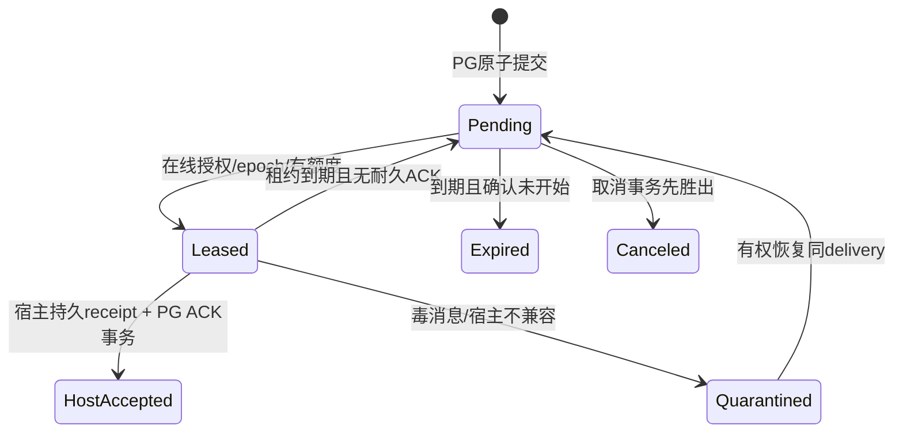

# 网络协议、授权与宿主恢复

状态：待评审协议提案。不是现有契约。本篇与 [总览](README.zh.md)、[验收](failure-validation.zh.md) 配套；后续必须先生成正式 schema/protobuf 和一致性测试，禁止各端私加同名字段。

## 1. 稳定身份与临时标识

| 标识 | 分配者、范围与含义 |
|---|---|
| tenant_id / account_id | IAM/org 权威决定；模型和报文声明不能决定租户。 |
| node_id | 平台注册 DSH 逻辑实例的稳定 ID；初期映射 endpoint。用户有多个 node，同 node 的多会话共享凭据但不共享全部授权。 |
| node_incarnation | 平台批准的实例注册世代；重新安装/恢复克隆不能自行复用旧世代执行。 |
| connection_epoch | PG 在接管连接时原子递增的 uint64；对应 ingress_id + lane，另校 dispatcher owner generation。拒绝旧世代写入，不用客户端时间排序。 |
| binding_id / host_session_id | 平台把真实宿主不透明 session ID 绑定到 node；绑定持久、只属于一个 tenant/node。 |
| grant_id / policy_revision | 单独授权记录及版本；绑定、血缘、thread 成员资格都不能替代它。 |
| channel_id | 应用内逻辑通道引用，关联稳定binding/subscription；不是NATS socket/consumer，不必每channel一个Broker subject。 |
| thread_id / thread_sequence | 业务沟通线程及其提交顺序；同线程事务加锁分配。跨线程无总顺序。 |
| message_id | 平台分配的不可变消息身份；请求/回复/结果等共用信封。 |
| delivery_id | 某 message 到某逻辑收件参与者的稳定投递身份；所有重试都不变；宿主 requestId 使用规范化 delivery_id。 |
| delivery_token | 单次领取租约的随机证明，绑定 tenant/node/binding/epoch/delivery 与 deadline；过期重领更换。它不是宿主 requestId。 |
| request_id | 一次协议请求和其响应的关联 ID；只用来关联，不能单独提供业务幂等。 |
| producer_epoch + idempotency_key | 源操作幂等作用域 `(tenant,node,binding,operation,producer_epoch,key)`；同键同体返回原结果，异体拒绝。 |
| node_mail_sequence / resume_cursor | node 收件日志位置与可恢复游标；不是 thread_sequence，不是已执行进度。 |

所有 uint64 在 JSON 中用十进制字符串，禁止 JS number 精度截断。UUID 用契约规范格式；host_session_id 不强制 UUID。`correlation_id` 指向原 request message，`causation_id` 指向触发消息；trace ID 只用于观测。session tree 的 root/parent 身份来自宿主核验和平台授权记录，不由模型复制字符串建立。

## 2. 原生 NATS 接入，不另造传输协议

一 DSH 默认一条官方 nats.js `wsconnect` 连接，Broker 使用 nats-server 原生 WSS。`@nats-io/nats-core` 的 WebSocket transport 与 `transport-node` 的原生 TCP connect 不能混用；须按真实宿主 Node 版本验证。NATS CONNECT/INFO/PING/PONG/PUB/SUB/UNSUB、WebSocket 二进制分帧、服务器发现与慢消费检测全部复用官方实现，不另定义 HELLO/REAUTH/CREDIT/GOAWAY 来替换它们。官方来源：[nats.js core](https://github.com/nats-io/nats.js/tree/main/core)、[WSS](https://docs.nats.io/learn/websocket/)。

R2运行时证据：正确CA根签发leaf，官方SDK3.4.0在DSH Electron44.7.0/Node24.21.0的原生W3C WebSocket路径（wsFactory仅返回new WebSocket，无TLS绕过）和显式ws8.22.0指定CA且rejectUnauthorized=true路径，均完成一连接两订阅。独立运行时兼容已通过。旧首失fixture错误把无IsCA/CertSign的leaf当CA，不能归因为SDK缺陷；完整Auriga插件/真实会话、安全权限、硬buffer与HA仍未测，首选的其余门禁不变。

### 2.1 三层准入与连接生命周期

1. **HTTPS 连接准备**：Node 用当前真实设备/实例凭据调用私有准备接口，IAM/org核有效身份、node归属和接收权限，生成短期一次性网络连接票据（提案：30秒可用、持久存摘要）。返回随机 `ingress_id`、精确上下行subject、允许协议版本。票据仅是现有登录的内部派生，不增加用户可见第二登录，不包含主密钥。
2. **Broker CONNECT auth callout**：Node将该票据作为NATS CONNECT认证数据经WSS提交。可信callout在线核原凭据/组织状态，并原子兑换票据；返回签名User JWT，绑定服务器提出的user_nkey与server audience，指定客户端account、精确pub/sub权限、max payload/订阅数与不晚于原访问凭据到期的exp。官方v2.12.6源码已核这些能力，但本项目映射仍须安全spike。失败/超时拒绝，不降级静态allow-all。
3. **Auriga 应用 READY**：Node先SUB本次唯一down subject，再发送READY（应用版本、adapter能力、原node cursor）。adapter从已授权up subject查询可信ingress记录，不信payload的node/tenant；核身份和能力后事务接管node epoch、记录route、返回READY_RESULT。只有此时才允许领取/发送该node的新正文。旧ingress标fenced，任何后续业务写与ACK拒绝，新正文从此只发新down subject。

票据兑换后而READY前断线：未形成可执行连接，按新票重试；旧票不可重放。SUB与READY可能乱序时，由NATS同连接顺序及READY结果确认订阅已建立，仍以PG恢复兜底。READY响应丢失：以同ingress查询当前epoch/重试READY；不要无条件增加世代。重复重连冲突在短时阈值后暂停，不让两个克隆无限互踢。

callout只负责CONNECT身份及subject边界；**每条应用操作**依然由adapter→collab核当前credential、binding/grant、tenant、参与者与epoch，禁止把ACL当每操作IAM。网络ticket/subject不能让模型指定session，`exec.agent.session.id`等仍来自可信宿主；外部通过网络收到的他人消息也不获得本地工具能力。

### 2.2 精确subject隔离

示意命名 `auriga.net.up.<shard>.<ingress>` 与 `auriga.net.down.<ingress>`，其中ingress为服务端随机不透明值。Node只可PUB自己up、SUB自己down；不允许DSH直发其他DSH。尽量只两条Broker订阅/方向约定，不按逻辑会话造Broker consumer。逻辑binding/thread身份在应用信封中，并经collab复核。

不授予客户端 `$JS.API.>`、`$SYS.>`、内部`auriga.evt.>`/服务subject、任意reply subject、全局`_INBOX.>`或通配订阅；应用关联响应统一经精确down返回，禁用默认request()自动创建全局inbox的用法，或专项证明其唯一私有前缀。服务端必须以收到的up subject提取ingress，忽略/拒绝payload中冒名tenant/node；客户端NATS header也不能伪造可信身份。

客户端account与内部service/system account独立。共享broker的account隔离只隔离权限，不提供CPU/磁盘故障域隔离；达到容量/威胁边界时部署独立接入broker，通过精确subject导入导出接内部adapter，不开放双向全通配。敏感auth callout请求使用其XKey加密能力、内部TLS与独立服务身份；不记录CONNECT凭据。

### 2.3 刷新、吊销、接管

NATS当前核验只支持连接时鉴权；**不用自定义REAUTH延长Broker权限**。access token到期前Node single-flight刷新，再获新票并有界重连。SDK负责协议连接，插件监督器负责异步获票与重新创建连接；不能假设SDK同步auth callback可await HTTP，也不能让自动重连反复重放已兑换票据。短暂迁移最多2条socket，只有新epoch能接收新派发，正常稳态1条。按5分钟凭据、提前60秒刷新估算每DSH约每4分钟一次认证重连，这是逻辑网络持续在线的有限续期成本，不是每会话短poll。若要更长物理连接寿命，须新增正式网络凭据生命周期/撤销机制并单独审查，不能擅自延长IAM token。

吊销以“权威准入拒绝+停止旧subject发布”为安全主路径，快速关闭连接事件只是缩短空闲socket存续时间。事务将route/grant标revoked，后续claim/ACK/执行准入被拒；所有adapter必须在派发前复核当前epoch与权限。已完成准入、在途中或Broker缓冲中的旧正文存在有界窗口，不能物理收回。Broker连接最终由User JWT到期关闭；具体即时kick机制尚未核，不以其存在作正确性前提。若产品要求从IAM撤销提交瞬间无任何在途正文，需额外定义跨服务线性化/加密密钥交接，当前方案不作此保证。

权威认证依赖故障时停止新ticket、READY、业务send/claim/ACK和执行准入；PG已有消息保留。退出清本机远程执行许可并断连，但不自动停止DSH或撤回已发生的副作用。重新登录、重连不能复活已撤销子grant；缺可信接管依据的丢失设备/克隆实例应重新注册node。

### 2.4 TLS、Origin与身份边界

拟由edge精确路径 `/ai/network/v1` 反代Broker WSS listener；不是标准MCP端点。TLS终止后跨机链路继续TLS，不能信外部身份头。Node专属edge入口拒绝任何Origin（含null）、Cookie和浏览器凭据混用；Broker同时配置Origin边界，但Origin不是认证，非浏览器可省略它。浏览器UI继续沿ADR0017/0020和DSH本机requestRejection，不能访问网络凭据。

WSS CONNECT内的凭据不是HTTP Authorization头；HTTP MCP仍使用原Bearer流程。外部首发WSS+短期凭据，内部mTLS。后续机器密钥/mTLS可降低票据盗用，但不能替代会话授权。托管INSTANCE及总部SYSTEM必须正式签发，`ait_`活动令牌、portal/admin cookie、模型key不可用于网络登录。HTTP-only弱安全安装保留显式受信回环/隔离链路选择，不自动从WSS降级，不宣称符合公网机密性目标。

时间由DB判租约/expiry，客户端monotonic计时；明显时钟偏差告警并刷新，不能放宽JWT exp。证书/签名钥采用有限重叠和失效拒绝；有界重连处理TLS轮换，不禁用校验。NATS服务发现不能泄露内部管理地址给外部客户端，公布的服务器地址须通过允许的外部入口访问。

## 3. Auriga应用信封：只补Broker不了解的业务语义

NATS payload首发UTF-8 JSON，最大64KiB（含应用头），正文继续现有16KiB上限；WS上是NATS原生二进制wire，不是“一条WS text frame一个Auriga JSON”。配置Broker max_payload、pending bytes、连接/订阅限额与SDK缓冲，应用在反序列化前再次限长。大文件经resource对象上传，只发授权引用/摘要/大小。应用不做fragment；NATS/WS分帧由官方实现。关闭压缩，具体代理/SDK读写超时通过接入spike定值。

**SDK缓冲硬门禁**：主控另核官方`@nats-io/nats-core@3.4.0`源码：`ReconnectToServerHandler`同步且不可throw；`protocol.js`的`pendingLimit`是触发flush的阈值，不是硬上限；`ws_transport.js`直接socket.send不自动实施字节硬cap。因此上文“配置SDK缓冲”是待实现约束，不能声称已有一个参数就保证有界。接入spike必须验证应用有限队列、断线暂停publish而不进入SDK重连积压、`wsFactory`/socket缓冲守卫或等价官方可用机制，以及上限触发后明确失败并安全关闭。无法证明最坏缓冲上限则N1不放行；不私改SDK内部字段或假设Go客户端行为等于JS。

JSON便于沿现有Go/Java/Node契约生成，不能声称性能更高。只有实测解析/带宽成瓶颈才协商Protobuf payload；NATS协议保持不变。`app_version`在READY协商，major不兼容拒绝，minor只接受定义好的可选字段；必要安全能力不降级。N/N-1滚更用相同应用schema互通测试。

示意（占位符，生产ID由平台分配）：

```json
{
  "app_version": "1.0",
  "type": "delivery",
  "epoch": "42",
  "delivery_id": "server-delivery-id",
  "delivery_token": "lease-proof-placeholder",
  "mail_sequence": "1205",
  "message": {
    "message_id": "server-message-id",
    "thread_id": "server-thread-id",
    "thread_sequence": "17",
    "target_binding_id": "authorized-binding-id",
    "kind": "message",
    "body": { "text": "示例正文" }
  }
}
```

最小应用消息集合为READY/READY_RESULT、DELIVERY、HOST_RECEIPT/RECEIPT_COMMITTED、RESUME_PAGE、RECEIVE_WINDOW、STATUS/ERROR。binding授权、线程操作仍用远程MCP/Node私有API；不再造通用OPEN/CLOSE/SEND传输体系。READY只作应用能力与PG世代对账，不代替NATS CONNECT；RESUME_PAGE只恢复PG业务，不重复实现Broker订阅；RECEIVE_WINDOW报告宿主剩余执行/磁盘容量，不替代NATS自身TCP/客户端pending流控。初始batch128、最多4页在途，窗口revision+epoch防重复扩额。

message kind可含普通消息、请求/响应、执行控制、进度/状态、唤醒、artifact_ref；附 `correlation_id/causation_id` 与 `durability`。最终结果/决定必durable，progress可合并丢弃并带revision。控制消息也需专门grant；模型不能因为type叫control就获取高优先级或绕过授权。

ACK_RECEIVED若需要只作为可选应用诊断，不清PG状态；NATS `flush()`/PONG、Core publish成功、JS PubAck、JS consumer ACK均不能映射为host_accepted。Host receipt逐项包含delivery/token/host_request_id/digest；只有collab事务结果能形成RECEIPT_COMMITTED。

错误族建议`network.unauthorized|revoked|stale_epoch|conflict|quota_exceeded|overloaded|expired|resume_unavailable|host_incompatible|outcome_unknown|protocol_error`，待契约统一。返回scope、关联request、retryable/retry_after，不泄漏堆栈/凭据。发送超时为outcome_unknown，查同幂等键；限流/认证错误不转换成功。传输重连期间禁止SDK盲目缓存并重发任意业务写；持久发送必须依赖应用幂等键和权威结果。
## 4. 两个状态机，不混淆投递和执行



上述 `HostAccepted` 结束传输交接，不结束执行生命周期。另记录 `not_started → admitted → running → completed|failed|canceled|outcome_unknown`，每次变化都是有版本的事件/结果，不修改原 message 内容。`admitted/running` 需关联同 delivery 和原生 turn/request 身份，不能由 LLM 文本“收到/完成”触发。

平台 ACK 四级：

1. `platform_stored`：PG 提交。数据库 durability 档和失效假设必须随部署披露。
2. `transport_received`：对端已读帧，不耐久。
3. `host_accepted`：宿主持久接收可恢复；需准确绑定 request/session，平台 ACK 事务已提交才能展示此状态。
4. `execution_completed`：宿主可信完成事件和结果记录，且语义满足本请求的完成契约。turn/end 可能代表失败/取消，不能无条件视为成功。

至少一次只保证有效期、保留期和故障模型内的已接受消息可恢复投递。网络不保证模型一定会响应，不保证工具副作用天然幂等。执行第三方写入应使用其业务幂等键或事务收件表；外部动作成功而结果落盘前崩溃时，无法查询结果则标 outcome_unknown，禁止自动重复不可幂等操作。连接 epoch 只能 fence 后续网络准入，不能杀死已开始的外部 HTTP 请求。

## 5. PostgreSQL 权威状态与事务

沿现有 collab 表加迁移，不改已合 migration；所有表 tenant_id、RLS、包含 tenant 的 FK。建议增补：

- connection_route：node世代、ingress及精确down subject；Broker负责物理路由，route更新、claim、ACK比较epoch。
- binding_grant/session_lineage：可信会话树与裁剪授权。根/祖先聚合计数单独表，祖先数量有上限。
- node_mailbox/dispatch_ready：按 node 的单调 mail sequence、dirty_version、next_due、parked、shard 与 owner generation。
- delivery 新列 target_participant/binding、mail_sequence、lease_epoch、expires_at、attempt、last_error；索引针对 pending/到期领取，不扫描全文。
- host_receipt：稳定 receipt、host request ID、session binding、digest、接受版本；同 ID 异体拒绝，receipt 可合并更新状态，不能覆盖消息身份。
- execution_status / operation_dedup：持久执行/控制结果引用与生产者世代的幂等 tombstone。并非业务 Task 调度表。

claim 事务：核权威身份和接收权限，按统一顺序锁 node、必要 binding/grant、thread/delivery；复核 epoch/lease 与期限，原子扣 tenant/node/root quota、领取每线程最早可交付项。不要持 DB 行锁等待宿主、网络或模型。在线权限请求与跨服务撤销无法形成一个全局 DB 事务，安全语义以准入校验点为界；需要更强原子撤销时另设计同域授权版本提交检查，不能宣称目前已具备。

同线程按提交 sequence 入宿主；不同线程并发。同一宿主 session 的 prompt 准入由插件串行，即使消息来自多个 thread，也不能并发穿过 hasPromptRequest 检查。顺序只保证入队，不保证多个 agent 的执行完成顺序。阻塞只限对应有序 thread/逻辑 recipient，不能锁住整个 DSH；毒消息先隔离，只有授权 skip 记录才能越过它。

线程内取消请求不被前一条执行消息的队头阻塞：取消进入独立受控控制队列，并以目标 operation_id 与状态版本 CAS。若取消先于 execution admission，结果 canceled，不再执行；若执行已开始，返回 cancel_requested/already_started，待宿主确认。连接断开、工具 timeout 和 channel close 都不隐式取消业务。过期也不撤销已经发生的副作用；已接受但 ACK 迟到的 receipt 进入 reconciliation，不以新请求身份重做。

## 6. 宿主持久 inbox 与崩溃窗口

插件维护专用持久 inbox/receipt ledger，至少存 `(tenant,node_incarnation,delivery_id,message_digest,binding_id,host_session_id,host_request_id,state)`；单写者锁、原子事务、真实 fsync/可恢复日志、容量和回收策略必须验证。可以选择兼容当前 Node 平台的嵌入式事务存储，不能仅以普通配置 JSON 的“已保存”作为断电耐久证明。不要把网络凭据与消息正文混写到公开日志。

顺序为：

1. 验证 target、epoch、grant 与幂等体；持久记录 RECEIVED，尚不能报 host_accepted。
2. 有既存 binding 时用原 native session 身份恢复，不重复 create 来“接收”；未绑定首次会话先持久预留 ID/明确 cwd/preset，再 native create、落盘、平台 bind。create/bind 响应丢失时查询同身份，不另建随机会话。
3. 在同 session 准入锁内，检查 durable ledger 和宿主历史/inbox 是否已有 requestId=delivery_id；普通会话调用 queue，子agent 走专用 adapter。prompt 前保持当前授权，禁止断线后盲目继续启动新远程任务。
4. prompt accepted 后核对正确 session 及持久 provider，执行 awaited flush；成功后写 ledger HOST_ACCEPTED 并 fsync，随后发 ACK_HOST。缺 provider、flush=false、异常、磁盘满均不发成功 ACK。
5. 平台核 token/epoch/绑定后提交 host_receipt/delivery 状态，回 ACK_COMMITTED。插件只在此后把平台游标推进至无空洞前缀；结果事件走同样可重放 outbox。

| 崩溃点 | 恢复动作 |
|---|---|
| ledger RECEIVED 前 | 平台重投，原 requestId 不变。 |
| RECEIVED 后、prompt 前 | 重新核权，恢复原 binding 并准入一次。 |
| prompt 已入内存、宿主 flush 前 | 宿主可能已开始执行；恢复核宿主日志/外部幂等结果。不能用“没 ACK”推断未执行；无法判定则 outcome_unknown。 |
| 宿主 flush 后、ledger HOST_ACCEPTED 前 | 从同 session inbox/历史核同 requestId；重建 receipt，不重新生成 requestId。历史不足时进入人工/受控 reconciliation。 |
| ledger HOST_ACCEPTED 后、平台 ACK 前 | 重新领取新 token 后提交同 receipt；不得再次 prompt。 |
| 平台 ACK 成功、响应丢失 | 查询/重送同 receipt，返回现有结果；游标不足只会重复恢复，不丢消息。 |
| 执行完成、结果事件丢失 | 宿主 durable outbox 按同结果 ID 重放；若结果未落盘且副作用不可查询，标 outcome_unknown。 |

**执行前耐久屏障的限制**：目前普通 prompt 会让宿主调度执行，随后 flush 不是“执行前必然持久”的证明。对于需要强恢复保证的执行控制，N1/N2 必须有真实宿主 checkpoint/准入适配证明，或保持为可恢复消息入箱并等待受控执行；不能以插件先写一条 RECEIVED 就宣称任意执行不会重复。系统禁止自动重放结果不明的非幂等动作；这会牺牲该项自动完成，换来不重复危险副作用的准确边界。

## 7. 当前安装 DSH 主源核查

只读安装包 `resources/app.asar`，未启动/修改用户 profile。package.json 显示 **0.2.1-rc.3**，build **be72761ee1a6736ebcdf4f3739363b083ae53c98**，dirty=false。这与 ADR 0016 的旧 rc.2 核验是不同证据。以下路径相对 ASAR 中 `dsh/node_modules/@deepseek-ai/`，行号为其发行 JS 文件。

| API/接缝 | 当前实际行为与设计要求 |
|---|---|
| `dsh-api-session-controller/lib/index.js:755` create | cwd=workspace.path 或 request.cwd 或 defaultCwd；已有不同 cwd 的 explicit session ID 会抛 session/conflict。首次创建需明确位置；已有绑定不得无条件再次 create。 |
| 同文件 `:210,370,392,1068` resolveAgent | 普通 cold session 可从 sessionQuery 观察后 agents.resume；prompt 内部调用此路径，不需以 create 冒恢复。 |
| 同文件 `:925,949,1128,3218` prompt | queue→followup，steer→steer；requestId 写 source.rpcId；去重检查 live inbox 与 user/message 历史。并发文本 admission 不自动等同平台的事务幂等，插件须按 session 串行。 |
| 同文件 `:128,140,394,1693` 子agent | origin=subagent 或受父拥有的会话拒普通 API 恢复/准入，要求 subagent delivery 与 durable parent address。网络必须保留 parent address、验证实际子agent归属；不得绕过拒绝使用普通 prompt。 |
| 同文件 `:849` fork | 默认最近完整 turn 前缀，或显式 atSeq，生成新 session、记录 parentSession/seed；不等于继承网络授权。 |
| `dsh-session/lib/index.js:1951` flush | 等所有 listener 完成，有参与者才返回 true；false 或异常都不能 ACK。返回 true 本身不证明参与者就是正确耐久 provider。 |
| `dsh-session-persistence-jsonl/lib/index.js:426,3194,3299` | flush listener drainLive/flush；JSONL 初建与 append 有 sync；Windows namespace 使用 write-through，POSIX 有目录 sync。源码提供耐久路径依据，不能替代目标文件系统断电试验。 |

发行文件 SHA-256：session-controller `a9801acb577b03053c5d5a3191ff555c5f1d791d0acddec113bea4511e33b386`；session-persistence-jsonl `973dd78679b2661d6f492343bc22b124ae958aa597d3b36c698a2c650f909984`。保留摘要便于未来版本比对，不把本机安装路径或用户数据写进公开文档。

适配分期：普通现存/冷会话是 N1 必测；首次建会话的 cwd/preset/bind 是 N1 必测；recursive subagent delivery 的确切方法、参数、父存活约束、冷子agent恢复与取消是 N2 必核，目前只核到普通入口拒绝，**尚未证明专用子agent API 全链路可用**。授权历史、等待/订阅、中断恢复、fork、产物引用分别跟随宿主真实 API 编写 adapter 测试，不从 mock 或同名方法推断。支持矩阵要写宿主 build/hash；升级后必须重跑，不笼统声称“API 不稳定”。

## 8. 游标、恢复与清理

node_mail_sequence 在同 node 的持久事务序列内分配；cursor 只表示此前 delivery 全部具有已提交的 host receipt 或显式终态 tombstone。过滤订阅产生的未授权项、不同 thread 的间隙不能通过取“已见最大 sequence”跳过。分配 aborted sequence 如产生空洞，服务端持久记录为非消息 gap，客户端不能自行补洞。

客户端 cursor 只是提示，平台从 PG 比较已确认前缀、在途 lease 和 receipt；客户端声称更大 cursor 不得清除未 ACK 数据。RESUME 页先重查权限，列出可恢复 binding、未确认 receipt 及 pending，返回显式 continuation。cursor 超出保留窗口返回 resume_unavailable/gap 范围，重新对账 durable receipt/历史；不假装全部送达。撤销会话不返回其正文，终态仅按当前有权范围查询。

连接迁移后旧租约 token 不能 ACK。插件把已落盘 receipt 摘要带入恢复，平台在新 epoch 为同 delivery 签新领取/reconcile token，核 identity/digest 后接受同 receipt；不能靠旧 cursor 或旧 socket 原样写。服务端已 host_accepted 的 delivery 可幂等返回状态而不重复下发正文。

幂等与保留需要闭合：producer_epoch 有服务器截止，建议最长 7 天；过期世代只可查询旧结果，不能产生新写。去重/终态 metadata 至少保留 30 天且覆盖最大离线/重试窗口；清理后仍拒绝旧 producer_epoch，防止旧键重新执行。续期发行新世代不能改变未决操作的原身份。自动 purge 不得先删 dedup 再让旧消息重试成功；本地 receipt 只在平台已确认且窗口结束后回收，磁盘满时明确拒收而非删掉未 ACK 数据。

## 9. 背压、公平性与资源隔离

初始可调默认值，均是提案：每连接未确认投递最多256条/1MiB，每logical channel最多16条/64KiB，adapter发队列硬上限2MiB；应用receipt/恢复状态保留64KiB队列与100条/秒预算。NATS原生协议控制由Broker处理。单DSH最多1,000活跃logical channels、5,000应用subscriptions、host admission并发4但同session为1；Broker侧仅少量固定subject订阅。超限在分配前拒绝，不把历史会话全装内存。

应用RECEIVE_WINDOW用单调revision的绝对可用窗口，结合server已在途数量核算，不因重复receipt重复加额度；epoch变化重置本连接计数并重新对账PG。持久inbox仍受磁盘/未处理条数限制，不能因为已写磁盘无限开窗。NATS/TCP级流控、adapter未确认窗口、执行预算同时满足才派发。慢客户端可能被NATS断开或丢Core消息，依赖PG重领修复，不能把SDK缓存当持久队列。

调度顺序是 tenant → node → root subtree → channel，采用带权 deficit round robin，按编码字节计费，小消息不被大消息永远挡住。系统 ACK/reauth/cancel 保留份额但同样限速；业务发件人不能自提优先级。大 fanout 按收件人数收费和限额；默认原子接受 fanout≤32，超过需先显式创建分批操作并逐目标返回结果，不能半数已提交却回一个全体失败。后续组播只有显式授权成员快照、每接收者 delivery/ACK、接收时再次核权，不能全网广播唤醒。

根子树预算在授权时做 reservation、消费时统一计量，父/子额度相加不得超过 root，再受 node/tenant 上限。初始最大深度 8、每 root 活跃 descendant 256；多开子会话不能绕过并发、token、消息或订阅配额。跨 DSH 委派同时计源授权树与目标执行预算，避免递归转发放大。

慢消费者在有限窗口内暂停其channel/node，其他节点继续；目标写超时10秒，由Broker配置/SDK适配实现并实测断连，pending留PG，不假定adapter有直接socket.close权。每线程重试指数退避，毒消息最多自动尝试5次后quarantine，显示原因/修复入口；不能无限重试拖住其他线程。实例忙、模型不可用属于执行状态，不应让adapter无限持有payload。临时progress可只保最新revision，durable message不可静默丢弃。

磁盘到 70% 告警，80% 限制新 fanout/大正文，90% 拒绝新 durable write，并预留 ACK/终态/回收空间；阈值须按实际磁盘和 WAL 余量设定，不能等 ENOSPC 才处理。过期数据写可查询终态后按策略清理；保留审计摘要与去重 tombstone，异常进入受限隔离区。存储发生实际错误时不再承诺成功 ACK。
