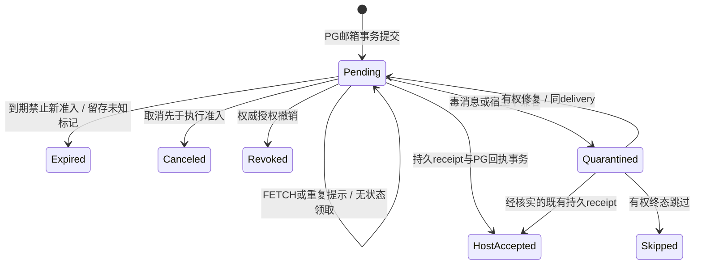

# 网络协议、授权与宿主恢复

状态：待评审协议提案。不是现有契约。本篇与 [总览](README.zh.md)、[验收](failure-validation.zh.md) 配套；后续必须先生成正式 schema/protobuf 和一致性测试，禁止各端私加同名字段。

## 1. 稳定身份与临时标识

| 标识 | 分配者、范围与含义 |
|---|---|
| tenant_id / account_id | IAM/org 权威决定；模型和报文声明不能决定租户。 |
| node_id | 平台注册 DSH 逻辑实例的稳定 ID；初期映射 endpoint。用户有多个 node，同 node 的多会话共享凭据但不共享全部授权。 |
| node_incarnation | 平台批准的实例注册世代；重新安装/恢复克隆不能自行复用旧世代执行。 |
| connection_epoch（连接世代） | PG 在接管连接时原子递增的 uint64；对应 ingress_id。拒绝旧世代的新业务操作；已持久回执仅按 §5 受限对账，不用客户端时间排序。 |
| binding_id / host_session_id | 平台把真实宿主不透明 session ID 绑定到 node；绑定持久、只属于一个 tenant/node。 |
| grant_id / policy_revision | 单独授权记录及版本；绑定、血缘、thread 成员资格都不能替代它。 |
| channel_id | 应用内逻辑通道引用，关联稳定binding/subscription；不是NATS socket/consumer，不必每channel一个Broker subject。 |
| thread_id / thread_sequence | 业务沟通线程及其提交顺序；同线程事务加锁分配。跨线程无总顺序。 |
| message_id | 平台分配的不可变消息身份；请求/回复/结果等共用信封。 |
| delivery_id | 某 message 到某逻辑收件参与者的稳定投递身份；所有重试都不变；宿主 requestId 使用规范化 delivery_id。 |
| request_id | 一次协议请求和其响应的关联 ID；只用来关联，不能单独提供业务幂等。 |
| producer_epoch + idempotency_key | 源操作幂等作用域 `(tenant,node,binding,operation,producer_epoch,key)`；同键同体返回原结果，异体拒绝。 |
| mail_seq / resume_cursor（确认游标） | node 邮箱序号与连续确认游标；不是 thread_sequence，不是执行进度。另有 scan_after，仅作分页位置。 |

所有 uint64 在 JSON 中用十进制字符串，禁止 JS number 精度截断。UUID 用契约规范格式；host_session_id 不强制 UUID。`correlation_id` 指向原 request message，`causation_id` 指向触发消息；trace ID 只用于观测。session tree 的 root/parent 身份来自宿主核验和平台授权记录，不由模型复制字符串建立。

## 2. 原生 NATS 接入，不另造传输协议

一 DSH 默认一条官方 nats.js `wsconnect` 连接，Broker 使用 nats-server 原生 WSS。`@nats-io/nats-core` 的 WebSocket transport 与 `transport-node` 的原生 TCP connect 不能混用；须按真实宿主 Node 版本验证。NATS CONNECT/INFO/PING/PONG/PUB/SUB/UNSUB、WebSocket 二进制分帧、服务器发现与慢消费检测全部复用官方实现，不另定义 HELLO/REAUTH/CREDIT/GOAWAY 来替换它们。官方来源：[nats.js core](https://github.com/nats-io/nats.js/tree/main/core)、[WSS](https://docs.nats.io/learn/websocket/)。

官方 SDK 在目标运行时的隔离连接证据及其限制见[验收 §1](failure-validation.zh.md#1-已有证据与明确未验证项)，不等于完整插件验收。

### 2.1 三层准入与连接生命周期

1. **HTTPS 连接准备**：Node 用当前真实设备/实例凭据调用私有准备接口，IAM/org核有效身份、node归属和接收权限，生成短期一次性网络连接票据（提案：30秒可用、持久存摘要）。返回随机 `ingress_id`、精确上下行 subject（路由主题）、允许协议版本。票据仅是现有登录的内部派生，不增加用户可见第二登录，不包含主密钥。
2. **Broker CONNECT auth callout（外部鉴权回调）**：Node将该票据作为NATS CONNECT认证数据经WSS提交。可信callout在线核原凭据/组织状态，并原子兑换票据；返回签名User JWT，绑定服务器提出的user_nkey与server audience，指定客户端 account、精确 pub/sub 权限、max payload/订阅数，以及不超过 IAM 会话/设备网络授权截止的 exp（默认上限一小时，见 §2.3）。官方v2.12.6源码已核这些能力，但本项目映射仍须安全spike。失败/超时拒绝，不降级静态allow-all。
3. **Auriga 应用 READY**：Node先SUB本次唯一down subject，再发送READY（应用版本、adapter能力、原node cursor）。adapter从已授权up subject查询可信ingress记录，不信payload的node/tenant；核身份和能力后事务接管node epoch、记录route、返回READY_RESULT。只有此时才允许 FETCH/发送该 node 的新正文。旧 ingress 标 fenced，新业务拒绝，迟到持久回执仅按 §5 对账；新正文只发新 down subject。READY_RESULT 带 head_seq、平台确认前缀与可恢复窗口。

票据兑换后而READY前断线：未形成可执行连接，按新票重试；旧票不可重放。SUB与READY可能乱序时，由NATS同连接顺序及READY结果确认订阅已建立，仍以PG恢复兜底。READY响应丢失：以同ingress查询当前epoch/重试READY；不要无条件增加世代。重复重连冲突在短时阈值后暂停，不让两个克隆无限互踢。

callout只负责CONNECT身份及subject边界；**每条应用操作**依然由adapter→collab核网络授权所关联的当前 IAM 会话/设备状态、binding/grant、tenant、参与者与 epoch，禁止把ACL当每操作IAM。网络ticket/subject不能让模型指定session，`exec.agent.session.id`等仍来自可信宿主；外部通过网络收到的他人消息也不获得本地工具能力。

### 2.2 精确subject隔离

示意命名 `auriga.net.up.<ingress>` 与 `auriga.net.down.<ingress>`，其中ingress为服务端随机不透明值。默认 Node 只可 PUB 自己 up、SUB 自己 down；经下述验证后才允许私有 reply 前缀订阅，不允许 DSH 直发其他 DSH。Broker 只有固定少量订阅/方向约定，不按逻辑会话造Broker consumer。逻辑binding/thread身份在应用信封中，并经collab复核。

不授予客户端 `$JS.API.>`、`$SYS.>`、内部服务 subject、全局 `_INBOX.>` 或跨 ingress 通配订阅。默认应用响应经精确 down subject 以 request_id 关联。官方 nats.js v3.4.0 的 [ConnectionOptions.inboxPrefix](https://github.com/nats-io/nats.js/blob/v3.4.0/core/src/core.ts) 支持私有响应前缀，因此 request() 不是一律禁用；可配置服务端分配的 `auriga.net.reply.<ingress>`，仅授权该前缀下 SDK 所需的窄订阅。

N0 须验证实际生成的 mux 订阅、noMux 分支、连接迁移清理与超时取消，以及 adapter 只向当前 ingress 私有前缀内合法 reply 发响应。拒绝任意 reply subject，不使用宽泛动态响应权限绕过 ACL。验证前保持固定 down 关联方式，两种方式共享 FETCH/RECEIPT 语义。服务端始终以收到的 up subject 提取 ingress，不相信 payload/header 自报的 tenant/node。

客户端account与内部service/system account独立。共享broker的account隔离只隔离权限，不提供CPU/磁盘故障域隔离；达到容量/威胁边界时部署独立接入broker，通过精确subject导入导出接内部adapter，不开放双向全通配。敏感auth callout请求使用其XKey加密能力、内部TLS与独立服务身份；不记录CONNECT凭据。

### 2.3 刷新、吊销、接管

NATS 在 CONNECT 时鉴权；不用自定义 REAUTH 延长 Broker 权限。区分三种期限：HTTPS 访问 token 按 IAM 原规则刷新；一次性连接票据只负责短时兑换；Broker User JWT 来自独立的网络连接授权，建议最长一小时且不超过 IAM 会话、设备授权或实例授权剩余期限。它不自动延长原 IAM 凭据，也不准用一个过期访问 token 继续调用业务 API。每次应用操作以 ingress 绑定的权威授权记录核当前身份，访问 token 的轮换不要求健康 WSS 跟着断开。

Node 在网络 JWT 真正到期前的随机安全窗口内获取新票并重建连接；每次意外断线也重新兑换，不能自动复用旧票。SDK 同步认证/重连 callback 不执行异步 HTTP、不 throw；插件监督器完成刷新及重建。稳态一条连接，迁移短暂最多两条，只有当前 epoch 可发新操作。以一小时有效期、平均提前 90 秒计算，大档 5,000 DSH 约 5,000/3,510=1.42 次握手/秒；若 IAM 授权剩余期更短，按实际周期重算。

吊销主路径是权威记录撤销后拒绝新操作和新 FETCH，并停止向旧 ingress 发正文；随后由隔离的系统运维身份按 server_id/CID 关闭连接。锁定 v2.12.6 的 [events.go:62–63](https://github.com/nats-io/nats-server/blob/v2.12.6/server/events.go#L62) 定义 KICK/LDM subject；[kickClient:3203](https://github.com/nats-io/nats-server/blob/v2.12.6/server/events.go#L3203) 解析 CID 并调用 DisconnectClientByID，[ldmClient:3221](https://github.com/nats-io/nats-server/blob/v2.12.6/server/events.go#L3221) 调用 LDMClientByID。KICK 用于撤销关闭；LDM 是迁移提示机制，不能代替撤销。

只读源码证明接口存在，不证明 Auriga 接线通过。N0 必核 auth callout 请求的 client_info 到 CID 的提取（[auth_callout.go:376/456](https://github.com/nats-io/nats-server/blob/v2.12.6/server/auth_callout.go#L456) 填入 c.cid），及受信 server_id、account、user_nkey 与 ingress 的原子关联。CID 是服务器本地标识，须带服务器运行世代防重启后复用误踢；用连接事件或受权查询核当前归属，不能只信客户端上报。验证多 Broker、重启、快速重连、旧 KICK 延迟和系统账号最小权限。外部 DSH 永不获 `$SYS` 权限。

KICK 失败不恢复授权；有界重试并告警，JWT 到期是最终连接关闭兜底。运维控制面可用时撤销到断连目标 ≤5 秒，跨服务在途正文和已开始副作用仍不可收回，不承诺从 IAM 提交瞬间全网线性撤销。原生 expiry 由 [setExpiration](https://github.com/nats-io/nats-server/blob/v2.12.6/server/auth_callout.go#L322) 设置。若正式网络授权与在线逐次校验未实现，不可直接把旧短 token 的 exp 拉长。

IAM/org 故障时拒绝新票、READY、发件、FETCH、回执状态写入和执行准入；已落盘 receipt 暂存待权威恢复后对账。退出清本机执行许可并断连，不复活被撤销子 grant，不撤回已发生副作用。缺可信接管依据的丢失设备/克隆实例重新注册 node。

### 2.4 TLS、Origin与身份边界

拟由edge精确路径 `/ai/network/v1` 反代Broker WSS listener；不是标准MCP端点。TLS终止后跨机链路继续TLS，不能信外部身份头。Node专属edge入口拒绝任何Origin（含null）、Cookie和浏览器凭据混用；Broker同时配置Origin边界，但Origin不是认证，非浏览器可省略它。浏览器UI继续沿ADR0017/0020和DSH本机requestRejection，不能访问网络凭据。

WSS CONNECT内的凭据不是HTTP Authorization头；HTTP MCP仍使用原Bearer流程。外部首发WSS+短期凭据，内部mTLS。后续机器密钥/mTLS可降低票据盗用，但不能替代会话授权。托管INSTANCE及总部SYSTEM必须正式签发，`ait_`活动令牌、portal/admin cookie、模型key不可用于网络登录。HTTP-only弱安全安装保留显式受信回环/隔离链路选择，不自动从WSS降级，不宣称符合公网机密性目标。

时间由 DB 判 route 有效期/expiry，客户端monotonic计时；明显时钟偏差告警并刷新，不能放宽JWT exp。证书/签名钥采用有限重叠和失效拒绝；有界重连处理TLS轮换，不禁用校验。NATS服务发现不能泄露内部管理地址给外部客户端，公布的服务器地址须通过允许的外部入口访问。

## 3. Auriga应用信封：只补Broker不了解的业务语义

NATS payload首发UTF-8 JSON，最大64KiB（含应用头），正文继续现有16KiB上限；WS上是NATS原生二进制wire，不是“一条WS text frame一个Auriga JSON”。配置Broker max_payload、pending bytes、连接/订阅限额与SDK缓冲，应用在反序列化前再次限长。大文件经resource对象上传，只发授权引用/摘要/大小。应用不做fragment；NATS/WS分帧由官方实现。关闭压缩，具体代理/SDK读写超时通过接入spike定值。

**SDK 缓冲硬门禁**：pendingLimit 是 flush 阈值，不是硬上限；WebSocket send 也不自动提供字节硬 cap，源码证据见验收 §1。N0/N1 必须证明应用队列、SDK 与 socket 缓冲的总上界。断线即停止向 SDK publish；超限明确失败并关闭连接。不能私改 SDK 内部字段或用 Go 客户端行为推断 JS。

JSON便于沿现有Go/Java/Node契约生成，不能声称性能更高。只有实测解析/带宽成瓶颈才协商Protobuf payload；NATS协议保持不变。`app_version`在READY协商，major不兼容拒绝，minor只接受定义好的可选字段；必要安全能力不降级。N/N-1滚更用相同应用schema互通测试。

示意（占位符，生产ID由平台分配）：

```json
{
  "app_version": "1.0",
  "type": "delivery",
  "epoch": "42",
  "delivery_id": "server-delivery-id",
  "mail_seq": "1205",
  "message": {
    "message_id": "server-message-id",
    "thread_id": "server-thread-id",
    "thread_sequence": "17",
    "target_binding_id": "authorized-binding-id",
    "kind": "message",
    "body": { "text": "示例正文" }
  }
}
```

最小应用消息为 READY/READY_RESULT、HEAD、FETCH/FETCH_RESULT、RECEIPT/RECEIPT_COMMITTED、STATUS/ERROR。DELIVERY 只是 FETCH_RESULT 中的条目，不是另一套重传帧。binding 元数据恢复单独分页；NATS 订阅与心跳仍交官方实现。

FETCH 携带 request_id、resume_cursor、受保护的 continuation（含 scan_after/snapshot_head）及本次 max_items/max_bytes。返回条目、受权终态或不暴露正文的空洞说明、当前 head、平台确认前缀和下一页位置。整页含编码头不超过 64KiB，最多 128 项只是数量上限；剩余窗口不足则缩页。Node 默认 single-flight，重复请求/响应不改变额度。FETCH 不锁定 delivery、不修改其状态、不建立租约；Core 请求超时可同位置重试。额度耗尽暂停，收到回执确认/本地空间释放才继续。无待取页时不按秒发空 FETCH。

message kind可含普通消息、请求/响应、执行控制、进度/状态、唤醒、artifact_ref；附 `correlation_id/causation_id` 与 `durability`。最终结果/决定必durable，progress可合并丢弃并带revision。控制消息也需专门grant；模型不能因为type叫control就获取高优先级或绕过授权。

ACK_RECEIVED若需要只作为可选应用诊断，不清PG状态；NATS `flush()`/PONG、Core publish成功、JS PubAck、JS consumer ACK均不能映射为host_accepted。Host receipt 逐项包含 delivery_id/binding_id/host_request_id/digest 与持久接受证据；只有collab事务结果能形成RECEIPT_COMMITTED。

错误族建议`network.unauthorized|revoked|stale_epoch|conflict|quota_exceeded|overloaded|expired|resume_unavailable|host_incompatible|outcome_unknown|protocol_error`，待契约统一。返回scope、关联request、retryable/retry_after，不泄漏堆栈/凭据。发送超时为outcome_unknown，查同幂等键；限流/认证错误不转换成功。传输重连期间禁止SDK盲目缓存并重发任意业务写；持久发送必须依赖应用幂等键和权威结果。
## 4. 两个状态机，不混淆投递和执行



Expired/Canceled/Revoked/Skipped 记录停止新准入的决定，不能凭没有回执推断宿主从未执行；迟到接受证据须独立对账，必要时执行结果为 outcome_unknown。Quarantined 不是成功，也不自动让确认前缀越过空洞。

上述 `HostAccepted` 结束传输交接，不结束执行生命周期。另记录 `not_started → admitted → running → completed|failed|canceled|outcome_unknown`，每次变化都是有版本的事件/结果，不修改原 message 内容。`admitted/running` 需关联同 delivery 和原生 turn/request 身份，不能由 LLM 文本“收到/完成”触发。

平台 ACK 四级：

1. `platform_stored`：PG 提交。数据库 durability 档和失效假设必须随部署披露。
2. `transport_received`：对端已读帧，不耐久。
3. `host_accepted`：宿主持久接收可恢复；需准确绑定 request/session，平台 ACK 事务已提交才能展示此状态。
4. `execution_completed`：宿主可信完成事件和结果记录，且语义满足本请求的完成契约。turn/end 可能代表失败/取消，不能无条件视为成功。

至少一次只保证有效期、保留期和故障模型内的已接受消息可恢复投递。网络不保证模型一定会响应，不保证工具副作用天然幂等。执行第三方写入应使用其业务幂等键或事务收件表；外部动作成功而结果落盘前崩溃时，无法查询结果则标 outcome_unknown，禁止自动重复不可幂等操作。连接 epoch 只能 fence 后续网络准入，不能杀死已开始的外部 HTTP 请求。

## 5. PostgreSQL 权威状态与事务

沿现有 collab 表新增迁移，不修改已合 migration；tenant_id、RLS、含 tenant 的 FK 保留。拟增加：

- connection_route：当前 epoch/ingress、网络授权引用、server_id/CID/服务器运行世代与有效期。新 FETCH/写操作核当前路由。
- binding_grant/session_lineage：独立会话授权与可信血缘，root/祖先聚合预算。
- node_mailbox：head_seq、committed_cursor、保留窗口下界；以邮箱行锁分配序号，事务回滚同时回退。未确认数/字节与 delivery 在同事务更新，用索引找在线积压，不引入 dirty_version、dispatch_ready 或 owner generation。
- delivery：target_participant/binding、mail_seq、expires_at、隔离原因；每 node 序号唯一。保留 pending/终态索引及每逻辑收件人的唯一约束，不增加 lease_epoch/delivery_token。
- host_receipt：稳定 delivery、digest、宿主 request/session、持久证据及接受状态；同 ID 异体拒绝，稀疏回执与连续前缀同事务推进。
- execution_status / operation_dedup：执行准入、结果和源操作幂等 tombstone，不是业务任务调度表。

send 事务按稳定次序锁目标邮箱、thread 和配额；fanout 在原子上限内全成或全退。FETCH 逐项核权、只读有界页面，不持 DB 锁等宿主/网络。RECEIPT 事务核身份、绑定、digest 与原 request，写幂等回执、更新稀疏已确认集合并推进无空洞前缀。已 host_accepted 的同 receipt 返回原结果，不再次扣/释放配额。PG 错误不返回成功。

允许旧连接迟到 RECEIPT 的范围很窄：连接所属网络授权仍有效、同 tenant/node/incarnation 与原 binding、digest/request 身份一致，且只能补录接受事实或返回已有结果。它不能改路由、准入执行、取消或重映射会话。因吊销而失权的旧连接拒绝；新有效连接或授权对账流程可提交本地持久证据。若过期/取消先发生，记录 receipt 事实与冲突结果，不覆盖已存在的准入终态，不自动重新 prompt。旧 epoch FETCH 和迟到页面仍拒绝。

每次执行准入也核当前权限与执行状态，准入与取消的版本 CAS 决定谁先发生。在线 IAM 与 collab 不是一个跨服务原子事务；这里保证准入校验点后的既定边界，不声称零窗口全局撤销。

同线程按提交 sequence 入宿主；不同线程并发。同一宿主 session 的 prompt 准入由插件串行，即使消息来自多个 thread，也不能并发穿过 hasPromptRequest 检查。顺序只保证入队，不保证多个 agent 的执行完成顺序。阻塞只限对应有序 thread/逻辑 recipient，不能锁住整个 DSH；毒消息先隔离，只有已提交接受或有权的 skip/过期/撤销终态才能越过对应空洞。

线程内取消请求不被前一条执行消息的队头阻塞：取消进入独立受控控制队列，并以目标 operation_id 与状态版本 CAS。若取消先于 execution admission，结果 canceled，不再执行；若执行已开始，返回 cancel_requested/already_started，待宿主确认。连接断开、工具 timeout 和 channel close 都不隐式取消业务。过期也不撤销已经发生的副作用；已接受但 ACK 迟到的 receipt 进入 reconciliation，不以新请求身份重做。

## 6. 宿主持久 inbox 与崩溃窗口

宿主 adapter 通过 `deliver(page) → receipts` 与网络层解耦；fixture 传输可独立调用。输入含已核验的 node/binding/epoch/准入上下文，输出逐项接受证据或 retry/quarantined/outcome_unknown；Host 仍须在真正执行前重查当前准入，不能信任过期页面。插件维护专用持久 inbox/receipt ledger（收件与回执账本），至少存 `(tenant,node_incarnation,delivery_id,message_digest,binding_id,host_session_id,host_request_id,state)`；单写者锁、原子事务、真实 fsync/可恢复日志、容量和回收策略必须验证。可以选择兼容当前 Node 平台的嵌入式事务存储，不能仅以普通配置 JSON 的“已保存”作为断电耐久证明。不要把网络凭据与消息正文混写到公开日志。

顺序为：

1. 验证 target、epoch、grant 与幂等体；持久记录 RECEIVED，尚不能报 host_accepted。
2. 有既存 binding 时用原 native session 身份恢复，不重复 create 来“接收”；未绑定首次会话先持久预留 ID/明确 cwd/preset，再 native create、落盘、平台 bind。create/bind 响应丢失时查询同身份，不另建随机会话。
3. 在同 session 准入锁内，检查 durable ledger 和宿主历史/inbox 是否已有 requestId=delivery_id；普通会话调用 queue，子agent 走专用 adapter。prompt 前保持当前授权，禁止断线后盲目继续启动新远程任务。
4. prompt accepted 后核对正确 session 及持久 provider，执行 awaited flush；成功后写 ledger HOST_ACCEPTED 并 fsync，随后发 RECEIPT。缺 provider、flush=false、异常、磁盘满均不发成功 ACK。
5. 平台按 §5 核身份/绑定/digest 后提交 host_receipt/delivery 状态，回 RECEIPT_COMMITTED。插件只在此后把平台游标推进至无空洞前缀；结果事件走同样可重放 outbox。

| 崩溃点 | 恢复动作 |
|---|---|
| ledger RECEIVED 前 | 平台重投，原 requestId 不变。 |
| RECEIVED 后、prompt 前 | 重新核权，恢复原 binding 并准入一次。 |
| prompt 已入内存、宿主 flush 前 | 宿主可能已开始执行；恢复核宿主日志/外部幂等结果。不能用“没 ACK”推断未执行；无法判定则 outcome_unknown。 |
| 宿主 flush 后、ledger HOST_ACCEPTED 前 | 从同 session inbox/历史核同 requestId；重建 receipt，不重新生成 requestId。历史不足时进入人工/受控 reconciliation。 |
| ledger HOST_ACCEPTED 后、平台 ACK 前 | 在有效连接上提交同 receipt，无需领取 token；不得再次 prompt。 |
| 平台 ACK 成功、响应丢失 | 查询/重送同 receipt，返回现有结果；游标不足只会重复恢复，不丢消息。 |
| 执行完成、结果事件丢失 | 宿主 durable outbox 按同结果 ID 重放；若结果未落盘且副作用不可查询，标 outcome_unknown。 |

**执行前耐久屏障的限制**：目前普通 prompt 会让宿主调度执行，随后 flush 不是“执行前必然持久”的证明。对于需要强恢复保证的执行控制，N1/N2 必须有真实宿主 checkpoint/准入适配证明，或保持为可恢复消息入箱并等待受控执行；不能以插件先写一条 RECEIVED 就宣称任意执行不会重复。系统禁止自动重放结果不明的非幂等动作；这会牺牲该项自动完成，换来不重复危险副作用的准确边界。

## 7. 宿主适配边界

当前锁定宿主的 API、build/hash 与发行源码位置集中见[验收证据 §1.2](failure-validation.zh.md#12-宿主发行源码与接缝证据)。N1 独立验证普通既有/冷会话、首次明确 cwd/preset 的创建，以及 open-thread 返回前已到达消息的映射竞争。先持久预留请求与会话映射，回包和接收路径在同一绑定锁下合并；不能靠重新 create 随机会话消除冲突。

N2 再核专用子 agent delivery、parent address、父不在线和归档。普通入口拒绝子 agent 时返回 host_incompatible，不绕过、不默认继承父能力。fork、历史、等待、中断和产物按宿主原生能力分别验收，保留 Codex 原生协作目标。宿主 adapter 的 fixture 测试可先进行，只有真实宿主证据才能确认兼容；本轮均不执行。

## 8. 游标、恢复与清理

`mail_seq` 在目标 node 邮箱行锁内递增，提交顺序与可见 head 一致。`resume_cursor` 仅表示此前每项已有平台提交的 host receipt 或显式终态 tombstone；不是已见最大值。暂时无权或未知项不能伪造为成功；明确撤销可生成不含正文的 revoked 终态，授权依赖故障则失败关闭。

分页位置 `scan_after` 与确认前缀不同：FETCH 从平台前缀之后扫描，以快照 head 和有界 continuation 继续。continuation 由服务端签名或等价防篡改，绑定 node/incarnation、扫描位置、快照边界与期限；它只允许读取，不授予新权限，每页重查授权。一次扫到 head 后，后续 HEAD、READY 或已知空洞的退避重试开始新一轮，从平台前缀重新查未确认索引。无未决项时不启动轮询。

例：101 是 thread A 毒消息，102 是 thread B 正常消息。页内 101 留隔离记录，scan_after 可推进到 102；102 的 receipt 单独提交而 committed_cursor 仍停 100。恢复时服务端排除已接受 102，101 不反复占整页；已隔离项只回小状态，同 thread 后续项暂停，其他 thread 仍取页。quarantine 不是终态，只有修复接受或有权 skip/过期终态才跨过 101。未决空洞与后续稀疏回执保存在 PG，不无限堆客户端内存；存储配额耗尽可暂停整个 node，不能许诺一个永不处理的空洞下无限接收。

客户端游标回退时返回平台确认前缀并对账本地 ledger，不重新执行已接受项；客户端超前时纠正到 PG 前缀并保留全部未确认项。不能因客户端上报更大游标而删除数据。越出保留窗口返回 resume_unavailable 与可见 gap 范围，重新核对持久证据，绝不当作全收。分页重叠、响应丢失与乱序只产生重复页面；delivery_id/digest 去重且不按响应到达顺序推进确认。旧 epoch 页丢弃，其持久 receipt 可由新连接幂等补交。

node 邮箱顺序只用于同步，业务入队顺序按 thread/逻辑收件人检查。取消走单独受限控制类别，可按 FETCH 的受权类别优先取，不受正文 thread 队头阻塞；它仍占 node 总预算，控制类别的分页位置也不能推进全局确认前缀。单 session 的 prompt 准入继续串行。

幂等与保留需要闭合：producer_epoch 有服务器截止，建议最长 7 天；过期世代只可查询旧结果，不能产生新写。去重/终态 metadata 至少保留 30 天且覆盖最大离线/重试窗口；清理后仍拒绝旧 producer_epoch，防止旧键重新执行。续期发行新世代不能改变未决操作的原身份。自动 purge 不得先删 dedup 再让旧消息重试成功；有空洞时，其后已确认的稀疏回执/终态元数据不得先于前缀合并删除；配额不足时拒绝新增而非丢证据。本地 receipt 只在平台已确认且窗口结束后回收，磁盘满时明确拒收而非删掉未 ACK 数据。

## 9. 背压、公平性与资源隔离

所有默认数值以[总览 §10](README.zh.md#10-可调默认值设计提案未批准或压测)为集中入口，以下解释实施约束。

初始可调默认值，均是提案：每连接未确认投递最多256条/1MiB，每logical channel最多16条/64KiB，adapter发队列硬上限2MiB；应用receipt/恢复状态保留64KiB队列与100条/秒预算。NATS原生协议控制由Broker处理。单DSH最多1,000活跃logical channels、5,000应用subscriptions、host admission并发4但同session为1；Broker侧仅少量固定subject订阅。超限在分配前拒绝，不把历史会话全装内存。

窗口由客户端按已取页未回执、本地持久未处理项与执行预算计算；每次 FETCH 给绝对条数/字节上限，并受服务端 node/tenant 限流约束。重复页不重复占用逻辑容量，迟到回执不重复释放预算；换 epoch 先对账 ledger 再继续。没有服务端逐消息在途 lease，也不新增 RECEIVE_WINDOW 协议状态。慢消费或丢 Core 响应按同位置重新 FETCH，不把 SDK 缓存当持久队列。

服务端首发按 tenant/node 请求限流与有界并发处理 FETCH，插件按 root/channel 轮转并保留控制预算；不引入有 owner 的 DRR dispatcher。连续热点、超大批次与控制类别同样受限，防一个 node 耗尽请求池。只有 N3 压测证明需要才增加按字节的公平请求调度。fanout 默认原子上限 32，超限显式分批且逐目标返回结果；未来组播仍逐接收者核权、记 delivery/receipt，不全网广播。

根子树预算在授权时做 reservation、消费时统一计量，父/子额度相加不得超过 root，再受 node/tenant 上限。初始最大深度 8、每 root 活跃 descendant 256；多开子会话不能绕过并发、token、消息或订阅配额。跨 DSH 委派同时计源授权树与目标执行预算，避免递归转发放大。

慢消费者在有限窗口内暂停其channel/node，其他节点继续；目标写超时10秒，由Broker配置/SDK适配实现并实测断连，pending 留 PG，不假定adapter有直接socket.close权。每线程重试指数退避，毒消息最多自动尝试5次后quarantine，显示原因/修复入口；不能无限重试拖住其他线程。实例忙、模型不可用属于执行状态，不应让adapter无限持有payload。临时progress可只保最新revision，durable message不可静默丢弃。

磁盘到 70% 告警，80% 限制新 fanout/大正文，90% 拒绝新 durable write，并预留 ACK/终态/回收空间；阈值须按实际磁盘和 WAL 余量设定，不能等 ENOSPC 才处理。过期数据写可查询终态后按策略清理；保留审计摘要与去重 tombstone，异常进入受限隔离区。存储发生实际错误时不再承诺成功 ACK。
